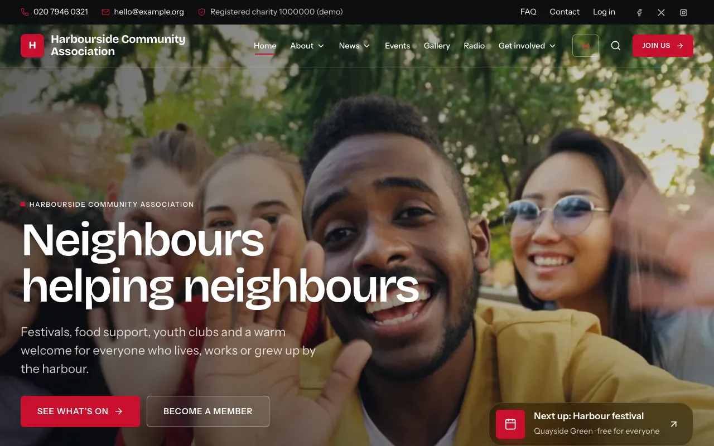

# Gather

A self-hosted community website builder and CMS in plain PHP 8.2+ (no
framework, no Composer at runtime) for charities, diaspora unions, clubs and
alumni bodies: a page builder with 29 section types, news and events with
registration, galleries, membership with digital ID cards, newsletters with
bounce handling, a job board and an online radio station. Admins work in a
grouped, collapsible sidebar, can view the site as a member to help them
(time-limited and audited), and have the whole manual built in as a
searchable help centre. It runs on ordinary shared hosting (cPanel, Plesk),
a VPS or aaPanel.

**Documentation: [docs/](docs/README.md)**: installation guides for each kind
of hosting, a [website manager guide](docs/manager-guide/README.md) with a
[How do I…?](docs/manager-guide/how-do-i.md) index, a
[member guide](docs/member-guide.md) and
[email deliverability](docs/email-deliverability.md). The same guides are in
the admin area (**Help centre**, `/admin/help`, with search and a **Help**
button on each screen), the member guide is on the site at `/help`, and
`php bin/docs-html` builds them into a static website for GitHub Pages
([how](docs/docs-website.md)).

Built clean-room from a written specification (no code, text or assets from
other products). Developer notes: [BUILD-NOTES.md](BUILD-NOTES.md).



## Requirements

- PHP 8.2+ with `pdo_mysql`, `gd` (with WebP), `fileinfo`, `mbstring`, `sodium`, `openssl`, `zlib`; `intl` and `exif` recommended
- MySQL 8 or MariaDB 10.6+ (utf8mb4)
- Apache with `mod_rewrite`, LiteSpeed, or Nginx (see `nginx.conf.example`); document root = `public/`, or the root `.htaccess` fallback on Apache/LiteSpeed
- A cron job every minute, HTTPS

Details: [docs/requirements.md](docs/requirements.md).

## Run locally

```bash
# Option A: the web installer (needs a one-time install token you create first)
php -r 'echo bin2hex(random_bytes(16)), PHP_EOL;' > storage/install-token   # or set GATHER_INSTALL_TOKEN
php -S 127.0.0.1:8080 -t public public/index.php
# open http://127.0.0.1:8080/install  (token, site address, DB details -> admin -> theme -> demo content)

# Option B: by hand
cp config.example.php config.php          # fill in the DB section and an app_key of 32+ characters, set 'installed' => true
php -r 'echo bin2hex(random_bytes(32)), PHP_EOL;'   # a suitable app_key
php bin/migrate
GATHER_ADMIN_PASSWORD='choose-a-long-one' php bin/make-admin you@example.org --name="Your Name"
php bin/demo you@example.org              # optional demo content
php -S 127.0.0.1:8080 -t public public/index.php
```

Emails are written to `storage/mail/*.eml` (open them in any mail client) until
the super admin switches Email settings to SMTP (vendored PHPMailer). Campaigns,
notice copies and birthday emails are sent by cron, so run `php bin/cron`
every minute (or by hand while testing).

## Test

```bash
cp tests/config.test.example.php tests/config.test.php   # point at an EMPTY throwaway database
bin/check                     # lint + unit/DB tests + php -S smoke test
php tests/run.php [filter]    # unit and database tests only
php tests/smoke.php           # end-to-end: installs through /install, then exercises the site
```

The tests drop and recreate every table in the test database.

## Command line

| Command | Does |
|---|---|
| `php bin/migrate [--status]` | Apply pending SQL migrations in `migrations/` |
| `php bin/make-admin <email> [--role=super_admin\|admin] [--perm=content,events,...]` | Create or update an admin |
| `php bin/demo <admin-email>` | Load demo content into an empty site |
| `php bin/cron [--force\|--list]` | Run due scheduled jobs: publishing, cleanup, purge of unverified sign-ups (14 days), scheduled campaigns, the email queue (per-minute limit), birthdays (daily at the configured time), job expiry, bounce mailbox, daily backups. The exact crontab line for your server is shown on Admin → System health |
| `php bin/backup [--uploads]` | Write a database backup (and optionally an uploads zip) into `storage/backups` |
| `php bin/restore <file.sql.gz> [--yes]` | Replace every table with a Gather backup (asks for the database name) |
| `bin/check` | Lint, secrets check, tests and smoke test |
| `bin/package [--zip [--flat]] [ref]` | Build `dist/gather-<date>-<commit>.tar.gz` (and `.zip`, or a `-flat.zip` without the top folder) for upload: no config, storage, tests or dev tools (`docs/` is included for the help centre) |
| `php bin/docs-html [folder]` | Build the documentation website from `docs/` into `dist/docs-site/` (relative links, images, `.nojekyll`); see [docs/docs-website.md](docs/docs-website.md) |

## Layout

```
public/            web root: index.php (front controller), .htaccess, assets/, uploads/ (WebP variants only)
.htaccess          fallback when the document root is the project folder: routes everything into public/
nginx.conf.example Nginx server block
src/               bootstrap, lib/ (helpers), Core/ (router, sanitiser, mail), Sections/ (page-builder section types),
                   Site/, Account/, Admin/, Install/ handlers
templates/         layouts/, site/, account/, admin/, sections/, install/, email/, partials/  (print only)
themes/<name>/     civic, heritage, harvest, monochrome: theme.json (design defaults), tokens.css, overrides.css, preview.png
public/assets/     css/, js/ (ES modules), img/ (icon + section-thumbnail sprites), fonts/ (OFL, self-hosted), vendor/ (qrcode-generator, MIT)
vendor/phpmailer/  PHPMailer 6.9.3 (LGPL 2.1, unmodified src/ files + LICENSE), loaded by src/Core/Mail/SmtpMailer.php
demo-assets/       original demo radio media (synthesised music, speech, generated video) + the dev script that made them
migrations/        numbered SQL files
storage/           originals/, variants/ (private), mail/, logs/, cache/, backups/  (not web-reachable)
docs/              Markdown guides (shown in the admin help centre and at /help; never served directly), images/ screenshots
bin/               migrate, make-admin, demo, cron, backup, restore, check, package, docs-html
dev-tools/         dev only (never deployed): axe-core + Lighthouse (npm install here), audit.mjs, touch-reorder.mjs
tests/             run.php (runner), *_test.php, smoke.php
```

## Deploy

See [docs/](docs/README.md): [cPanel](docs/install-cpanel.md),
[VPS](docs/install-vps.md), [aaPanel](docs/install-aaPanel.md),
[Plesk](docs/install-plesk.md). In short: `bin/check`, commit,
`bin/package --zip`, upload, document root at `public/`, HTTPS, create the
install token, run `/install`, add the cron line from **Admin → System
health**, then fix anything that page marks as a problem. The site refuses to
run without an `app_key` of at least 32 characters. Behind a proxy/CDN, list
it in `trusted_proxies`.

`dev-tools/htaccess-check.sh` checks the Apache rules against a real Apache +
PHP-FPM (both document-root layouts); `dev-tools/doc-shots.mjs` regenerates
the screenshots in `docs/images/`.

## Accessibility audit (dev only)

```bash
cd dev-tools && npm install && cd ..        # axe-core and Lighthouse, local to this folder
php -S 127.0.0.1:8080 -t public public/index.php &
PUBLIC_PAGES="/,/join" node dev-tools/audit.mjs http://127.0.0.1:8080 admin@email adminpass member@email memberpass
```
