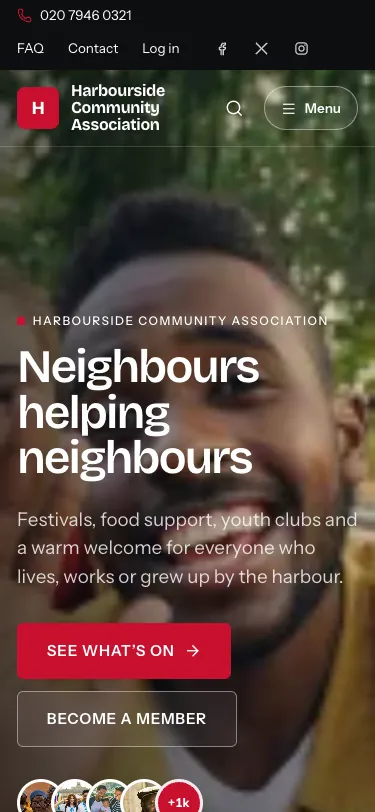

# Gather documentation

Gather is a self-hosted website and membership system for community
organisations: charities, diaspora unions, clubs and alumni associations. It
runs on ordinary PHP hosting. You do not need a special server or a monthly
platform fee.

These guides are written for three kinds of reader. Pick the part you need.

## For the person who installs the site

Start with the requirements, then follow the guide for your kind of hosting.

| Guide | What it covers |
|---|---|
| [Getting the code](getting-the-code.md) | Download from GitHub, a release package or `git clone`; updating later; what you must never overwrite |
| [Requirements](requirements.md) | PHP, database, web server, cron, HTTPS and upload limits |
| [Install on cPanel shared hosting](install-cpanel.md) | Step by step, including hosts where you cannot change the document root |
| [Install on a VPS (Ubuntu 24.04)](install-vps.md) | Apache or Nginx with PHP-FPM, MariaDB, Certbot, cron, firewall, backups |
| [Install on aaPanel](install-aaPanel.md) | The aaPanel control panel |
| [Install on Plesk](install-plesk.md) | Short notes for Plesk |
| [Local development](local-development.md) | Running Gather on your own computer with PHP's built-in server |
| [Email deliverability](email-deliverability.md) | SMTP, SPF/DKIM/DMARC, the bounce mailbox, provider webhooks, suppression list |

Files at the top of the code that also help: [`nginx.conf.example`](../nginx.conf.example)
(Nginx server block), `config.example.php` (settings file), and the root
`.htaccess` (lets Gather run when the document root cannot point at `public/`).

## For the website manager

The [Website manager guide](manager-guide/README.md) explains every screen
of the admin area in plain language. It starts with
[How do I…?](manager-guide/how-do-i.md), a list of everyday tasks with links
to the right page.

## For members

The [Member guide](member-guide.md) explains joining, verifying your email,
your dashboard, your member card, email preferences, the job board and
deleting your account. You can link to it from your own site.

## Screenshots

Screenshots are in [`images/`](images/). They come from the demo site that
ships with Gather (a fictional "Harbourside Community Association"), so your
site will look different once you add your own content and pick a theme.

