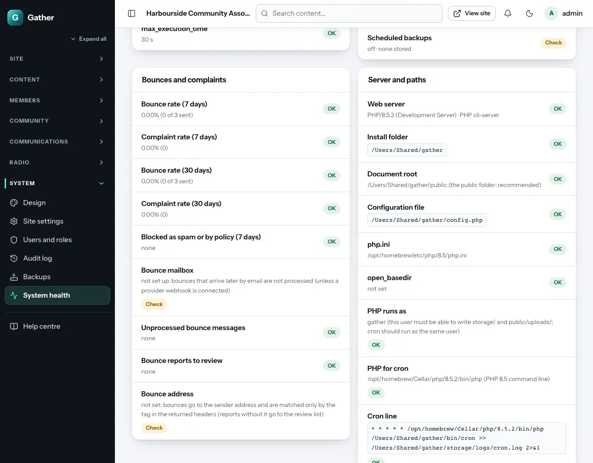

# Install on cPanel shared hosting

This guide installs Gather on a normal shared hosting account managed with
**cPanel**. You need only a web browser. If your host also offers
**Terminal** in cPanel (or SSH), a few steps get quicker, and this guide
shows both ways.

cPanel looks slightly different from host to host (themes, CloudLinux,
LiteSpeed). If a menu name here does not match exactly, use cPanel's search
box at the top of the home screen.

In the examples below, replace:

| Placeholder | Example |
|---|---|
| `example.org` | your domain |
| `community.example.org` | the address the Gather site will have |
| `cpuser` | your cPanel user name (shown in the right-hand sidebar of cPanel) |
| `/home/cpuser` | your home folder (shown as "Home Directory" in the sidebar) |

Before you start, check the [requirements](requirements.md). Most cPanel
hosts with PHP 8.2+ are fine.

## Which setup?

- **Recommended: a subdomain or an extra domain** (for example
  `community.example.org`) whose document root you point at Gather's
  `public/` folder. That is Option A below.
- **The main domain of the account** (`example.org` itself) usually has its
  document root fixed to `public_html`. Gather still works there: see the
  [fallback](#fallback-when-the-document-root-cannot-be-changed).

## Option A: upload with File Manager (recommended)

### 1. Get the package

Download the latest release `.zip` (the one **without** `-flat` in its name)
or GitHub's "Download ZIP". See [Getting the code](getting-the-code.md).

### 2. Upload and extract it in your home folder

1. cPanel → **Files → File Manager**. You start in your home folder
   (`/home/cpuser`). Stay there; do **not** open `public_html`.
2. Click **Settings** (top right), tick **Show Hidden Files (dotfiles)**, and
   save. Gather relies on `.htaccess` files, and this makes them visible.
3. Click **Upload**, choose the ZIP file, and wait for the progress bar to
   reach 100 %. Then go back to File Manager.
4. Right-click the ZIP → **Extract** → extract to `/home/cpuser`. You now have
   a folder `gather` (or `gather-main` if you used GitHub's ZIP; rename it to
   `gather` with right-click → **Rename**).
5. Delete the ZIP file.

Keeping Gather outside `public_html` means none of its private files are
inside a web folder at all.

### 3. Create the (sub)domain and point it at `gather/public`

Newer cPanel: **Domains → Domains → Create A New Domain**.

- **Domain**: `community.example.org` (or another domain you own).
- Untick **Share document root (/home/cpuser/public_html) with "example.org"**.
- **Document Root**: `gather/public`.
- **Submit**.

Older cPanel: **Domains → Subdomains** (or **Addon Domains**), with the same
domain and **Document Root** `gather/public`.

If the domain already exists with a different document root, open
**Domains → Domains**, click **Manage** next to it, and change the document
root to `gather/public`. (Not every host allows this. If yours does not, use
the fallback below.)

For a brand-new subdomain, the DNS record is usually created automatically.
For a separate domain, its DNS must point at this hosting account.

### 4. Choose the PHP version

cPanel → **Software → MultiPHP Manager**:

1. Tick the box next to your Gather domain.
2. In **PHP Version**, choose **PHP 8.3** (or 8.2 or newer) and click
   **Apply**.

**Extensions**: most hosts already include everything Gather needs. If your
cPanel has **Select PHP Version** (CloudLinux), open it, choose the same
version, and make sure `gd`, `intl`, `exif`, `fileinfo`, `mbstring`, `pdo_mysql`
(also shown as `nd_pdo_mysql`) and `sodium` are ticked. Otherwise, check
after installing: **System health** lists anything missing, and your host can
enable it.

### 5. Raise the upload limits (for the radio)

cPanel → **Software → MultiPHP INI Editor** → **Basic Mode** → choose your
Gather domain, then set:

| Setting | Value |
|---|---|
| `upload_max_filesize` | `320M` |
| `post_max_size` | `330M` |
| `memory_limit` | `256M` |
| `max_execution_time` | `300` |
| `max_input_time` | `300` |
| `display_errors` | Disabled |

Click **Apply**.

Many shared hosts cap these values (often at 128M or 256M). If yours does,
take the highest it allows. Radio audio up to that size still works; for
long videos, compress them or ask the host to raise the cap. Without the
radio, `32M` is plenty.

The editor saves these settings in a `.user.ini` (or `php.ini`) file in the
document root, `gather/public/`. Leave that file in place when you update.

### 6. Create the database

cPanel → **Databases → Manage My Databases** (or the **Database Wizard**):

1. **Create New Database**: type `gather`. cPanel adds your user name in front:
   the real name is `cpuser_gather`. Write it down.
2. **Add New User**: user name `gather` (becomes `cpuser_gather`), and a strong
   password from **Password Generator**. Keep the password somewhere safe.
   You will paste it into the installer in a moment.
3. **Add User To Database**: choose the user and the database, click **Add**,
   tick **ALL PRIVILEGES**, and click **Make Changes**.

New cPanel databases use `utf8mb4` already. Gather's tables set it themselves
anyway.

### 7. Switch on HTTPS before installing

cPanel → **Security → SSL/TLS Status**: tick your Gather domain (and its
`www.` version if it has one) and click **Run AutoSSL**. It can take a few
minutes. Wait until the domain shows a valid certificate.

Then cPanel → **Domains → Domains** and switch **Force HTTPS Redirect** on for
the domain.

Do this before the installer runs, because the installer records the site
address (`https://…`) and uses it in every email link.

AutoSSL checks your domain by placing a small file in
`.well-known/` inside the document root. Gather lets those files through,
in the fallback setup too.

### 8. Create the install token

The installer only runs for someone who knows a one-time **install token**,
so a stranger cannot take over your new site before you do.

**With File Manager**:

1. Open `/home/cpuser/gather/storage`.
2. Click **+ File**, name it `install-token`, and click **Create New File**.
3. Right-click `install-token` → **Edit**. Type or paste a random string of
   **at least 16 letters and digits** (a password generator is ideal). Save.
4. Keep the string for the next step.

**With Terminal** (cPanel → **Advanced → Terminal**):

```bash
cd ~/gather
php -r 'echo bin2hex(random_bytes(16)), PHP_EOL;' > storage/install-token
cat storage/install-token
```

The file is deleted automatically when the installation finishes.

### 9. Run the installer

Open `https://community.example.org/install` in your browser.

1. **Database**
   - **Install token**: the string from step 8.
   - **Site address**: `https://community.example.org` (pre-filled; check that
     it starts with `https://`).
   - **Host** `localhost`, **Port** `3306`.
   - **Database name** `cpuser_gather`, **User** `cpuser_gather`, and the
     **Password** from step 6.
   - **Connect and create tables**. The installer writes `config.php` (with a
     new random secret key) and creates the tables.
2. **Admin**: your organisation's name and the first **super admin** (your
   name, email and a password of at least 10 characters).
3. **Theme**: pick one (you can change it any time under Design).
4. **Content**: load the demo content to explore every feature, or start
   with an empty site. Click **Finish installation**.

The installer then locks itself: `/install` returns "not found" from now on.

If the database step says it cannot connect, check the prefixed names
(`cpuser_…`) and that the user was added to the database with all
privileges.

### 10. Add the cron job

Gather needs one job that runs every minute. It sends emails, publishes
scheduled posts and events, makes the daily backup and checks the bounce
mailbox.

1. Log in to your new site and open **Admin → System health**. In the group
   **Server and paths**, copy the **Cron line**. It looks like this:

   ```
   * * * * * /opt/cpanel/ea-php83/root/usr/bin/php /home/cpuser/gather/bin/cron >> /home/cpuser/gather/storage/logs/cron.log 2>&1
   ```

   The path to PHP is detected for your PHP version. If "PHP for cron" says it
   could not be confirmed, use `/usr/local/bin/php`, or ask your host for the
   PHP 8.x command-line path.
2. cPanel → **Advanced → Cron Jobs** → **Add New Cron Job**:
   - **Common Settings**: **Once Per Minute (\* \* \* \* \*)**.
   - **Command**: everything *after* the five stars, for example
     `/opt/cpanel/ea-php83/root/usr/bin/php /home/cpuser/gather/bin/cron >> /home/cpuser/gather/storage/logs/cron.log 2>&1`
   - **Add New Cron Job**.
3. After two minutes, reload **System health**: **Cron** should show a recent
   "last run".

Some hosts allow cron only every 5 or 15 minutes. Gather still works:
emails then leave in batches at that pace, and scheduled posts are also
published when someone visits the site.



### 11. Set up email

Until you do this, Gather only saves emails as files in `storage/mail/` and
nothing is delivered.

1. cPanel → **Email → Email Accounts → Create**:
   - `no-reply@example.org` (or `hello@`), the address emails come from.
   - `bounces@example.org`, a mailbox only Gather reads (optional but
     recommended; see [Email deliverability](email-deliverability.md)).
2. Next to the sending account, click **Connect Devices**. Under **Mail Client
   Manual Settings → Secure SSL/TLS Settings** you see the server name
   (usually `mail.example.org`) and the ports.
3. In Gather: **Admin → Email settings**:
   - **Sender name** and **Sender address** (`no-reply@example.org`).
   - **Send emails with**: **SMTP server**.
   - **SMTP server** `mail.example.org`, **Port** `465`, **Encryption**
     **SSL/TLS (port 465)** (or port `587` with **STARTTLS (port 587)**).
   - **User name**: the full address; **Password**: the mailbox password.
   - **Save email settings**, then **Send a test email**.
4. **Bounce mailbox** (same screen, further down): **Bounce address**
   `bounces@example.org`; **Read the bounce mailbox**: **IMAP**; **Mail
   server** `mail.example.org`, **Port** `993`, **Encryption** **SSL/TLS**,
   the full address and its password. **Save bounce settings**, then **Check
   the bounce mailbox now**.
5. cPanel → **Email → Email Deliverability**: if it shows problems for your
   domain's **DKIM** or **SPF**, click **Repair** (or **Manage** to see the
   records). Add a DMARC record too: see
   [Email deliverability](email-deliverability.md#3-dmarc-what-receivers-should-do-with-fakes).

### 12. Check everything

Open **Admin → System health**. Fix anything marked **Problem**; items marked
**Check** are advice. Typical items on shared hosting:

- **Largest upload** below the radio limit: step 5 (or accept the host's cap).
- **Mail transport: file**: step 11.
- **Scheduled backups: off**: switch them on under **Backups** (see
  [Backups and restore](manager-guide/backups.md)).

Then follow the [website manager guide](manager-guide/README.md), starting
with [First login and the dashboard](manager-guide/first-login.md).

## Option B: Git Version Control

If your host offers **Git Version Control** in cPanel, you can install and
update straight from GitHub. You need no ZIP files.

1. cPanel → **Files → Git Version Control → Create**.
2. Switch **Clone a Repository** on.
   - **Clone URL**: `https://github.com/YOUR-ACCOUNT/gather.git`
   - **Repository Path**: `gather` (becomes `/home/cpuser/gather`)
   - **Repository Name**: `Gather`
   - **Create**.
3. Continue with step 3 of Option A (point the domain at `gather/public`) and
   follow the rest of the steps.

The repository also contains `docs/`, `tests/` and `dev-tools/`. Visitors
cannot reach them. To update later: **Git Version Control → Manage →
Pull or Deploy → Update from Remote**, then
[run the database update](#running-a-command-without-a-terminal).

## Fallback: when the document root cannot be changed

Use this for the main domain of the account (`example.org`, whose document
root is `public_html`) when your host will not change it.

1. Download the **flat** release ZIP (`gather-…-flat.zip`). It has no top
   folder.
2. File Manager → **Settings** → **Show Hidden Files**.
3. Open `public_html`. If it holds an old site, move that somewhere safe
   first; delete the host's placeholder `index.html` if there is one.
4. Upload the flat ZIP into `public_html` and **Extract** it there. You should
   now see `public_html/.htaccess`, `public_html/public/`, `public_html/src/`
   and so on.
5. Continue with step 4 of Option A. Use `public_html` instead of `gather`
   in the paths, so the install token goes in `public_html/storage/install-token`.

How it stays safe: the `.htaccess` file at the top sends every request into
`public/`, so `https://example.org/config.php` or `…/storage/…` shows "not
found". Each private folder has its own deny rule as well, and certificate
checks in `.well-known/` still work. **System health → Document root** will
say it is the install folder and that this works. If you can later move to a
subdomain with the document root set to `public/`, do. It is the stronger
setup.

If you only have GitHub's "Download ZIP", extract it anywhere, open the
`gather-main` folder, select everything inside (including the dotfiles), and
use **Move** to put it into `public_html`.

## Updating

Always make a backup first (**Admin → Backups → Back up to the server now**
with uploaded files, or cPanel → **Files → Backup**).

**Option A (package in `~/gather`)**: upload the new non-flat ZIP to your home
folder and **Extract** it there. Its `gather/` folder lands on top of the old
one and replaces the program files. Your `config.php`, `storage/` and
`public/uploads/` are not in the ZIP, so they stay as they are. If the release
came from GitHub's "Download ZIP" (folder `gather-main`), rename it to
`gather` first, or extract it elsewhere and move its contents over.

**Fallback (flat package in `public_html`)**: upload the new flat ZIP into
`public_html` and **Extract** it there, letting it overwrite.

With Terminal, either way is one command:

```bash
cd ~ && unzip -o gather-*.zip && rm gather-*.zip              # Option A: folder package in ~
cd ~/public_html && unzip -o ../gather-*-flat.zip            # Fallback: flat package uploaded to ~
```

**Option B (Git)**: **Git Version Control → Manage → Pull or Deploy → Update
from Remote**.

Then **update the database** (next section) and open **System health**:
"Migrations" must say *none pending*. Check the upload limits there too,
because some PHP setups keep them in `public/.htaccess`, which an update
replaces.

## Running a command without a terminal

A few jobs use Gather's command-line tools, above all `bin/migrate` after an
update. With **Terminal** in cPanel:

```bash
cd ~/gather && php bin/migrate
```

Without Terminal, use a temporary cron job:

1. **Cron Jobs → Add New Cron Job**, **Once Per Minute**, command (with your
   PHP path from System health):
   `/usr/local/bin/php /home/cpuser/gather/bin/migrate >> /home/cpuser/gather/storage/logs/migrate.log 2>&1`
2. Wait two minutes. **System health → Migrations** should say *none
   pending* (or open `storage/logs/migrate.log` in File Manager).
3. **Delete** that cron job again. Running `migrate` repeatedly is harmless,
   but there is no reason to keep it.

## Troubleshooting on cPanel

| Symptom | What to check |
|---|---|
| "403 Forbidden" or the host's default page | The domain's document root: it must be `gather/public` (Option A) or the folder holding Gather's `.htaccess` (fallback) |
| Every page except the home page is "not found" | `.htaccess` files missing (hidden files were not uploaded or moved), or the host disabled `.htaccess` overrides |
| "500 Internal Server Error" | cPanel → **Metrics → Errors** for the reason; then `gather/storage/logs/php-error.log` |
| Installer says the folder is not writable | The Gather folder must be writable by your account (permissions `755` for folders); your host may run PHP as a different user, so ask them |
| `/install` asks for a token although you made one | The file must be `storage/install-token` (no extension) with at least 16 characters |
| Emails do not arrive | **Email settings → Send a test email**; **Delivery log**; cPanel → **Email Deliverability**; your host may block outgoing SMTP to outside providers |
| Cron never runs | **Cron Jobs**: the command must start with a PHP path, and your host's cron email (top of the Cron Jobs page) may show the error |
| Uploads fail | **System health → Uploads**; step 5 |

More: [Troubleshooting](manager-guide/troubleshooting.md).
