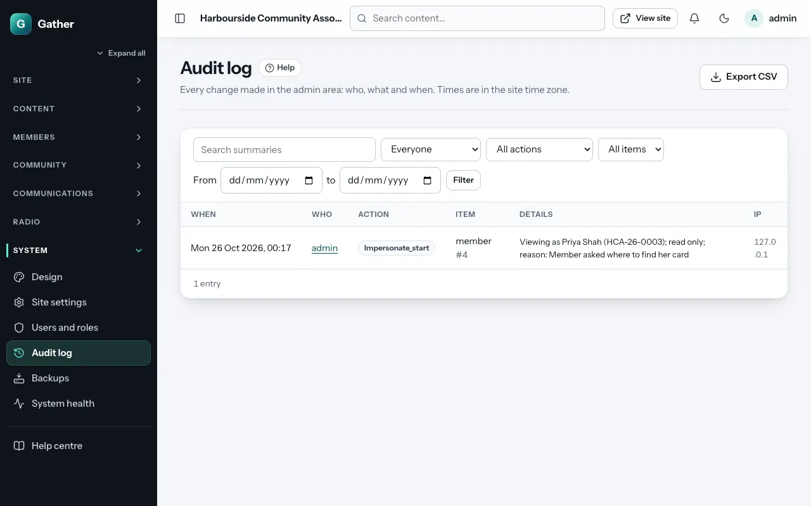

# Audit log *(super admin)*

**Admin → Audit log** records every change made in the admin area: who did
what, to which item, and when (in the site's time zone). It also records
important member actions, such as email changes, data exports and deletion
requests, and system jobs.

## Finding something

Filters across the top:

- **Search the summaries**: free text, for example a member's name or a page
  title.
- **Who**: one admin, **Everyone**, or **System / visitors** (automatic jobs
  and public actions).
- **Action**: for example create, update, delete, publish, send, export.
- **Item type**: page, post, member, campaign, design, settings…
- **From … to**: a date range.

Click **Filter** (or **Clear** to start again). Each row shows when, who,
the action, the item, details, and the network (IP) address.

**Export CSV** downloads the filtered list as a spreadsheet.

## What it is for

- Finding out who changed a page, or when a member was removed.
- Showing your committee or a regulator how personal data is handled (for
  example, who exported the member list and when).
- Spotting mistakes or misuse early.

The log cannot be edited or deleted from the admin area.
