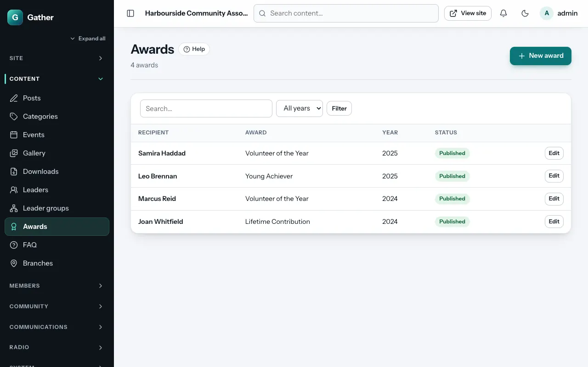

# Awards

Permission: **content**.

Use awards to celebrate people: volunteer of the year, lifetime service,
scholarship winners. Visitors see them at `/awards`, grouped by year.

## Adding an award

**Admin → Awards → New award**:

- **Recipient name**.
- **Award**: the title, for example "Volunteer of the Year".
- **Year**.
- **Citation**: why they received it.
- **Photo** (optional).
- **Status** (**Published** or **Draft**) and **Order** within the year
  (lower first).

The list can be filtered by year.

## On the site

`/awards` lists winners by year, newest first. The **Awards** page section
shows the latest year, all years or one chosen year on any page (see
[Page builder](page-builder.md#community)).
