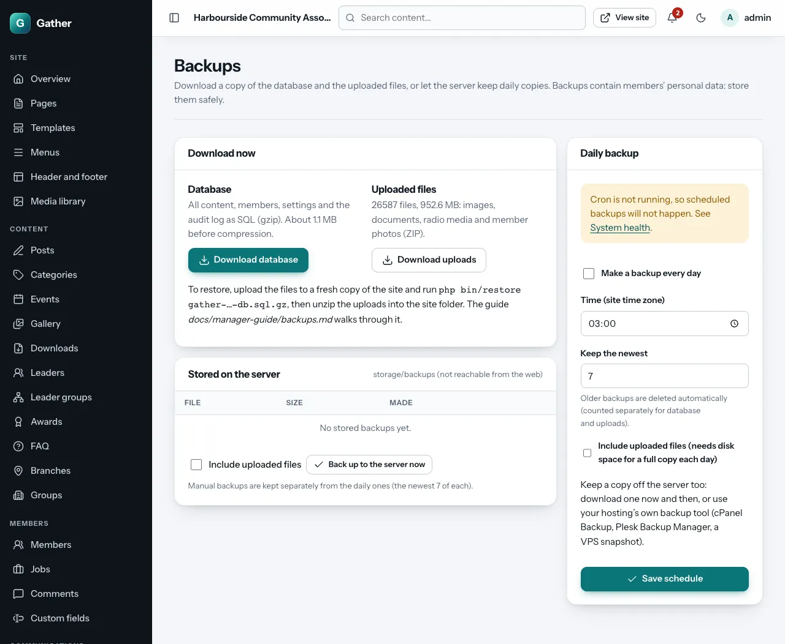

# Backups and restore *(super admin)*

A backup is a copy of your site's data that you can go back to if something
goes wrong: a mistake, a broken update, a hacked or lost server.

Gather backs up two things:

| Part | Holds | File |
|---|---|---|
| **Database** | All content, members, settings, the audit log | `gather-YYYYmmdd-HHMMSS-db.sql.gz` |
| **Uploaded files** | Images, documents, radio media and member photos | `gather-YYYYmmdd-HHMMSS-uploads.zip` |

The program itself is not in the backup. You can always download it again
(see [Getting the code](../getting-the-code.md)). Keep a copy of
`config.php` somewhere safe as well: it holds the secret key that stored
passwords depend on.

**Backups contain members' personal data.** Store them as carefully as the
site itself: encrypted, and only where trusted people can reach them.

## The Backups screen

**Admin → Backups**.



### Download now

- **Download database**: saves the database to your computer straight away.
- **Download uploads**: a ZIP of all uploaded files (this can be large).

### Stored on the server

**Back up to the server now** (tick **Include uploaded files** if wanted)
makes a backup in the site's private `storage/backups` folder, which cannot be
reached from the web. The table lists stored backups with **Download** and
**Delete**. Manual backups are kept separately from the daily ones.

### Daily backup

- **Make a backup every day**: on.
- **Time (site time zone)**: a quiet time, for example 03:00.
- **Keep the newest**: how many to keep (1–60; for example 14). Older ones are
  deleted automatically, counted separately for database and uploads.
- **Include uploaded files**: needs disk space for a full copy every day.
  On small hosting plans, back up the database daily and download the
  uploads now and then.
- **Save schedule**.

Daily backups need the cron job. If cron is not running, the screen warns
you.

## Keep a copy away from the server

Backups on the server do not help if the server itself is lost. At least
once a month (weekly is better), **download** the latest backup and keep it
somewhere else, such as an encrypted drive or your organisation's cloud
storage. Also use your hosting's own backups if it has them (cPanel
**Backup**, Plesk **Backup Manager**, VPS snapshots). On a VPS, the
[VPS guide](../install-vps.md#14-backups-off-the-server) shows how to copy
backups off the server automatically.

## Restoring

Restoring **replaces everything** in the database with the backup. Anything
changed since the backup is lost. Take a fresh backup first, just in case.

Restoring needs your technical person or hosting access. It is done on the
server, not from the admin area.

### With a terminal (SSH, cPanel Terminal)

From the Gather folder (on a VPS, as the web server user, for example
`sudo -u www-data php …`):

```bash
php bin/restore storage/backups/gather-20261025-030000-db.sql.gz   # asks you to type the database name to confirm
php bin/migrate                                                     # brings an older backup up to date
```

Then the uploaded files, if needed: unzip the uploads ZIP into the Gather
folder (it recreates `public/uploads/`, `storage/originals/` and
`storage/variants/`):

```bash
unzip -o gather-20261025-030000-uploads.zip -d /path/to/gather
```

On a VPS, give the files back to the web server user afterwards:
`sudo chown -R www-data:www-data storage public/uploads`.

### Without a terminal (shared hosting)

- **Database**: open **phpMyAdmin** from your hosting panel, select the
  Gather database, choose **Import**, and upload the `.sql.gz` file. The
  backup contains plain SQL that removes and recreates every table. Your
  hosting's upload limit applies; for a large database, ask your host or use
  the terminal method. Afterwards
  [run the database update](../install-cpanel.md#running-a-command-without-a-terminal)
  in case the backup is older than the code.
- **Uploaded files**: upload the ZIP with the file manager into the Gather
  folder and **Extract** it there, letting it overwrite.

### Moving to a new server

The same steps work for moving: install Gather on the new server (with the
same `app_key` in `config.php` if you want stored email passwords to keep
working; otherwise re-enter them in Email settings), restore the database,
extract the uploads, run `php bin/migrate`, and check **System health**.

## Test your backups

A backup you have never restored is a hope, not a plan. Once, and after
big changes, restore a backup into a spare copy of the site (a test
subdomain with its own database) and check that it works.
