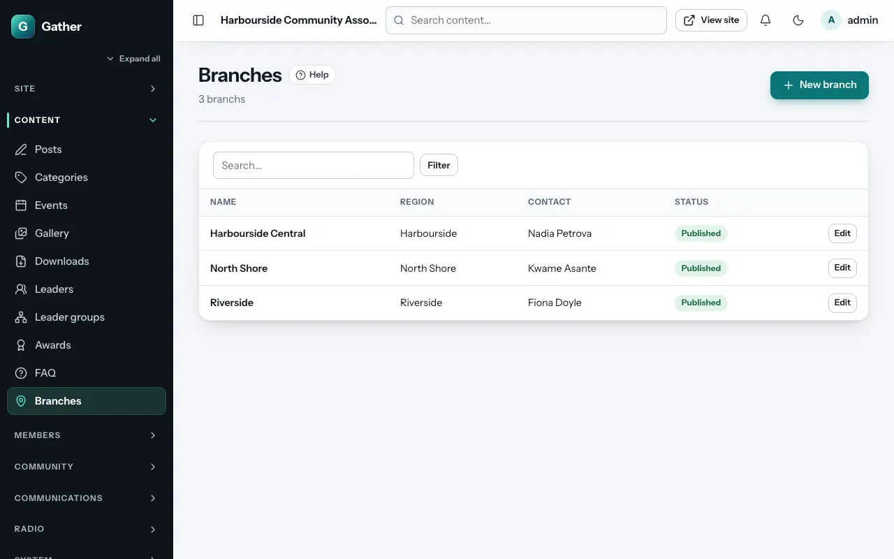
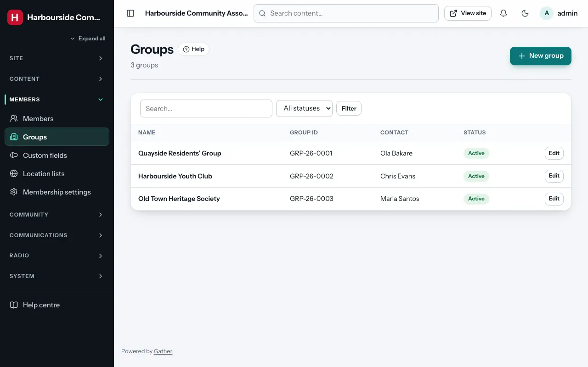

# Branches and groups

Two directories that look alike but are different things:

| | Branches | Groups |
|---|---|---|
| What | Your own local chapters (for example the London branch) | Separate organisations affiliated with you (for example a youth association or a partner club) |
| Who adds them | Admins | The organisations sign up themselves; admins can add them too |
| Can log in | No | Yes, with a group account |
| Permission | **content** | **members and groups** |
| On the site | `/branches` | `/groups` |

## Branches

**Admin → Branches → New branch**:

- **Name** and **URL slug**.
- **City / region**.
- **Contact person**, **Email**, **Phone**.
- **Meeting venue**.
- **Description**.
- **Status** (**Published** or **Draft**) and **Order** (lower first).

## Groups

An organisation registers itself with **Register a group** under the
joining form (`/join/group`): organisation name, contact person, phone,
address, country, email, password and an optional logo. After it confirms
its email address it gets a **group ID** (with your group prefix; see
[Membership settings](members.md#membership-settings)) and a group account
where it can edit its profile.

**Admin → Groups** lists them:

- **Name**, **URL slug**, **Group ID** (assigned automatically; can be set
  by hand), **Contact person**, **Email**, **Phone**, **Address**,
  **Country**, **Website**, **Description**, **Logo**.
- **Status**:
  - **Active (listed)**: shown in the public directory; the group can log in.
  - **Hidden**: not listed, but can still log in.
  - **Suspended**: not listed, and the group's login is blocked.
- **Order** (lower first).

You can email all group accounts with a [campaign](campaigns.md) (audience
**Group accounts**). Custom fields can be asked of group accounts too (see
[Custom fields](members.md#custom-fields)).

## On the site

`/branches` and `/groups` list them as cards with their details. The
**Branches or groups** page section shows either directory on any page (see
[Page builder](page-builder.md#community)).
