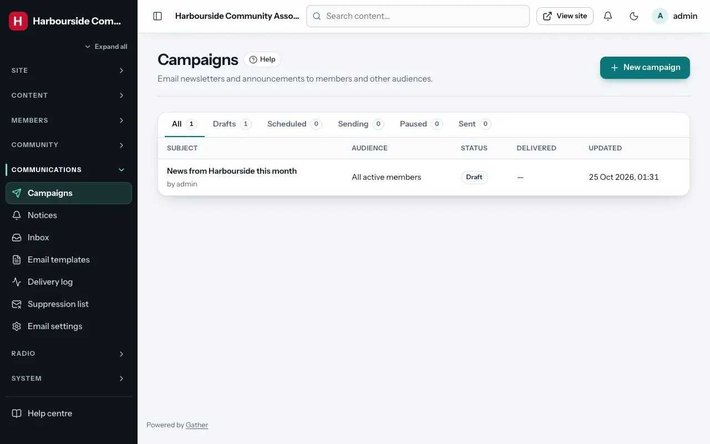
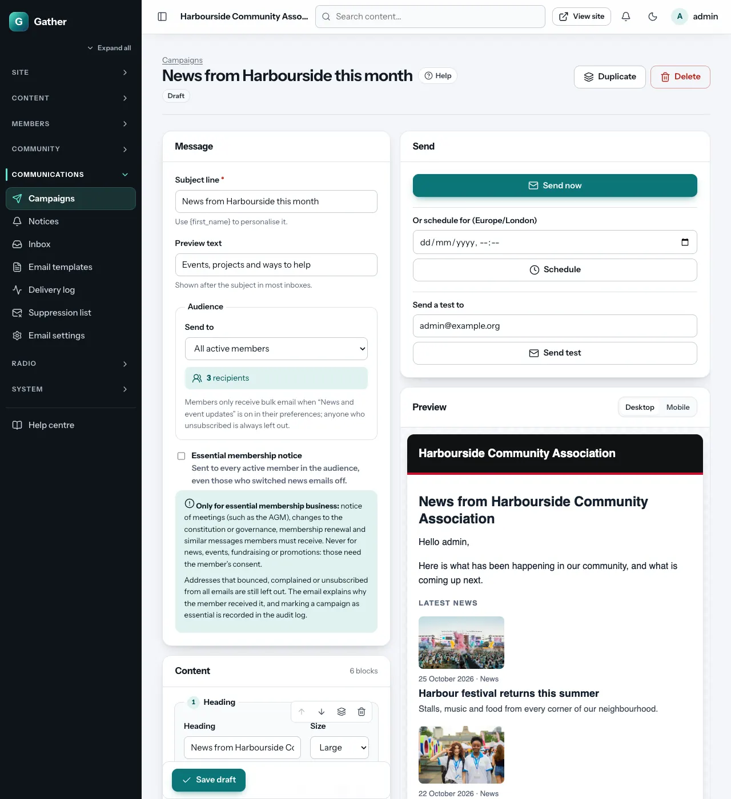

# Campaigns (newsletters) and essential notices

Permission: **communications**.

A campaign is an email sent to many people at once: a monthly newsletter,
an event invitation, an appeal. You build it from blocks, preview it, send
yourself a test, then send it now or schedule it.

Before your first campaign, check that email is set up (**System health →
Mail transport** should say SMTP; see [Email settings](email-settings.md)).

## The campaigns list

**Admin → Campaigns** shows each campaign's subject, audience, status
(**Draft**, **Scheduled**, **Sending**, **Sent**, **Cancelled**, or
**Paused**), how many were delivered, and when it was last changed. Click
**New campaign** to start.

## Building a campaign

### Message

- **Subject line**. `{first_name}` is replaced with each person's first name
  ("{first_name}, see what's on this month").
- **Preview text**: the line most inboxes show after the subject.
- **Audience → Send to**:

  | Audience | Who |
  |---|---|
  | **All active members** | Every verified, active member |
  | **Members of one membership type** | Choose the type |
  | **Members by location** | Choose which location (country of residence, origin, nationality or a Location custom field), then a country and optionally a state/region and local area, for example *Origin → Nigeria → Ekiti* |
  | **Members with a custom field value** | Choose the field and the value it must equal |
  | **Members with a birthday this month** | |
  | **People registered for an event** | Including guests who registered |
  | **Group accounts** | Affiliated organisations |
  | **Admins** | Your admin team (handy for internal updates) |

  The box shows the number of recipients and how many are left out.
  Members only receive bulk email when **News and event updates** is on in
  their preferences; anyone who unsubscribed, bounced or complained is
  always left out.

### Content blocks

Click **Add a block** and choose one:

| Block | What it is |
|---|---|
| **Heading** | A title (large or smaller) |
| **Text** | Formatted text; `{first_name}` works here too |
| **Image** | A public image from the media library, with alt text and an optional link |
| **Button** | A button with text and a link (`https://…` or a page like `/events`) |
| **Divider** | A thin line between parts |
| **Latest posts** | The newest public posts *at the moment the campaign is sent* |
| **Upcoming events** | The next public events *at the moment the campaign is sent* |

Each block has **Move block up / down**, **Duplicate block** and **Remove
block** buttons. Changes are saved automatically (and with **Save draft**).

### Preview

The **Preview** on the right shows the saved email as a member would see it,
personalised for you, with **Desktop** and **Mobile** widths. Emails use your
theme's colours and work in all common email programs.

Every campaign automatically gets an **unsubscribe** link and a **Manage
email preferences** link at the bottom, plus the headers Gmail and Yahoo
need for one-click unsubscribe.

## Testing and sending

In the **Send** box:

1. **Send a test to**: your address (or a colleague's), then **Send test**.
   Check it on your phone too.
2. Then either:
   - **Send now**, or
   - **Or schedule for**: pick a date and time, then **Schedule**.
     **Cancel schedule** stops it. Changes you save before the time are
     included.

Sending happens in the background (the cron job sends batches every minute,
at the pace set in Email settings), so a large list takes a while. You can
close the page. Nobody receives a campaign twice.

**Sent campaigns cannot be edited.** Use **Duplicate** to make a copy for a
new version or next month's newsletter. **Delete** removes a campaign you no
longer need.

## The delivery log

Each campaign has a **Delivery log** (button at the top): recipients,
**Delivered**, **Waiting**, **Soft bounces**, **Hard bounces**,
**Complaints**, **Suppressed** and **Failed**, and a row per recipient with the
outcome, attempts and any error.

- **Retry failed**: tries again for recipients the mail server never
  accepted. (Emails interrupted by a server crash are not retried, so nobody
  gets them twice.)
- **Paused campaigns**: if receiving servers start refusing your emails as
  spam ("blocked"), Gather **pauses** the campaign and shows a banner. This
  protects your reputation. Fix the cause (see
  [Email deliverability](../email-deliverability.md)), then click **Resume
  sending**. Sending also pauses by itself while your mail server is
  unreachable, and resumes automatically.

## Essential membership notices

Normally, campaigns only go to members who opted in to **News and event
updates**. Some messages must reach every member, though: the notice of the
annual general meeting, a change to the constitution, membership renewal.

Tick **Essential membership notice** in the campaign. Only super admins, and
admins who also have the **Essential membership notices** permission (see
[Users and roles](users-roles.md)), can tick or untick it and send or
schedule an essential notice; for other admins the box is greyed out. Then:

- it goes to **every active member in the audience**, even those who switched
  news emails off;
- it still **never** goes to addresses that bounced, complained, or
  unsubscribed from all emails;
- the email explains why the member received it;
- marking (and unmarking) a campaign as essential is recorded in the
  [audit log](audit-log.md).

**Use it only for essential membership business**: notices of meetings,
constitutional or governance changes, renewals and similar messages members
must receive. **Never** for news, events, fundraising or promotions; those
need the member's consent. Misusing it breaks data protection law (UK GDPR
and PECR) and annoys members into reporting you as spam.

## Good practice

- Send regularly but not too often (monthly is typical).
- Keep the subject short and specific.
- Always send a test first.
- Watch the bounce and complaint rates on **System health**. They should
  stay below 2 % and 0.1 %.
