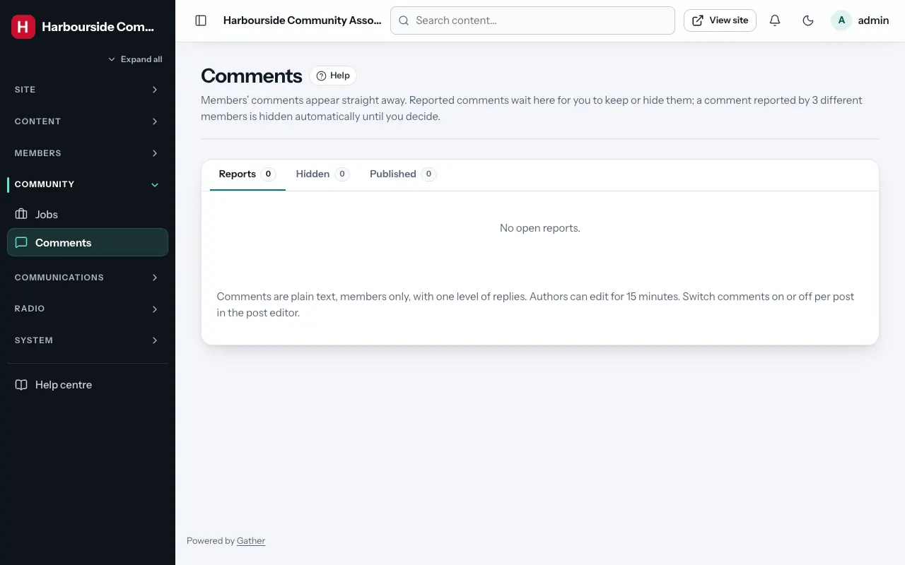

# Comments and reports

Permission: **content**.

Members can comment on posts that allow it (tick **Allow comments** on the
post; see [Posts](posts.md)). Comments:

- are for **logged-in, verified members only**;
- are **published straight away**, with no approval needed;
- are plain text (no links or formatting), with one level of replies;
- can be edited by their author for **15 minutes** and deleted at any time;
- can be **reported** by other members (once each, with a reason).

Likes work the same way: members only, instant. Turn them off per post with
**Allow likes**.

## The comments screen

**Admin → Comments** has three tabs:

| Tab | Shows |
|---|---|
| **Reports** | Comments members have reported, waiting for you |
| **Hidden** | Comments that are hidden from the site |
| **Published** | All visible comments |

For each comment you see the post it is on, the author, when it was posted,
what it replies to, and the reports with their reasons. Actions:

- **Keep**: the comment is fine; the reports are closed. (If it had been hidden
  automatically, it becomes visible again.)
- **Hide**: removes it from the site but keeps it here. The author still sees
  it, marked as hidden.
- **Show again**: undoes a hide.
- **Delete**: removes it for good. If other members replied to it, it shows
  as "[deleted]" so their replies still make sense.

**Automatic hiding**: a comment reported by **three different members** is
hidden at once, until you look at it. Keep it to show it again.

Reported comments are counted on the dashboard's **Needs attention** and in
the bell at the top.

## Tips

- Agree a simple comment policy with your committee (for example: be kind,
  no adverts, no personal details) and put it on a page.
- Hide first, delete later. Hiding is reversible.
- Members who comment are told by email when someone replies to them.
