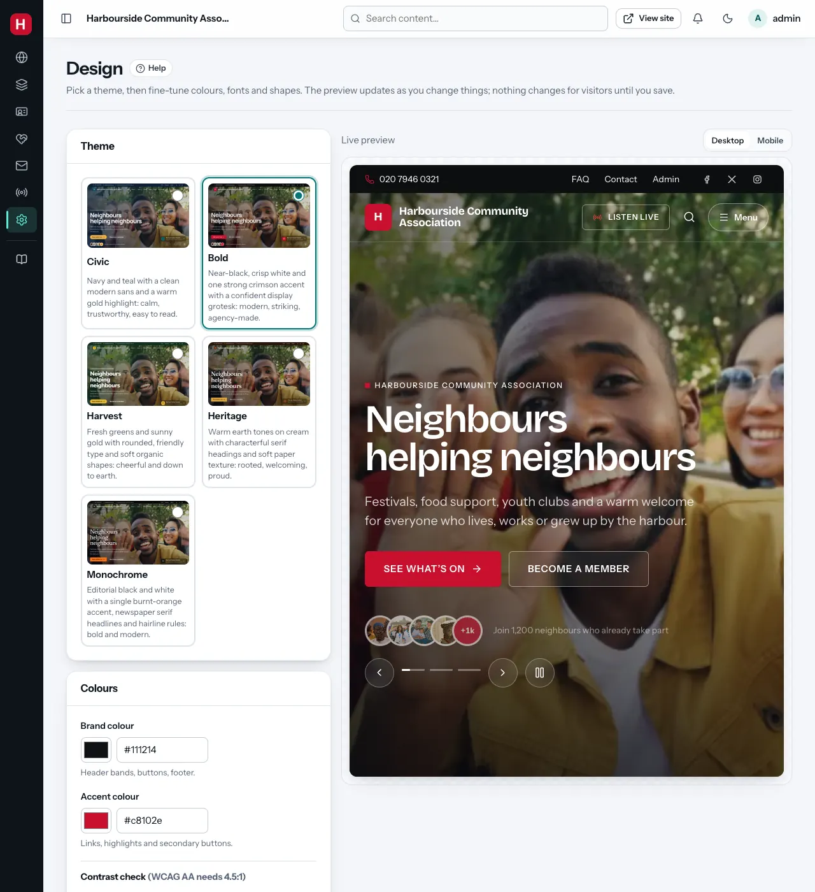

# Design and themes *(super admin)*

**Admin → Design** controls how the whole public site looks. On the right is
a **live preview** of your home page. It changes as you click, but visitors
see nothing new until you click **Save design**.

## 1. Theme

A theme is a complete look: colours, fonts, corner shapes and the rhythm of
the sections. Pick one by clicking its card.

| Theme | Character |
|---|---|
| **Bold** | Near-black, crisp white and one strong crimson accent with a confident display font: modern and striking |
| **Civic** | Navy and teal with a clean modern font and a warm gold highlight: calm and trustworthy |
| **Harvest** | Fresh greens and sunny gold with rounded, friendly type: cheerful and down to earth |
| **Heritage** | Warm earth tones on cream with characterful serif headings: rooted and welcoming |
| **Monochrome** | Editorial black and white with one burnt-orange accent and newspaper-style headings |

Changing the theme keeps all your content. Only the look changes.

## 2. Colours

- **Brand colour**: header bands, buttons and the footer.
- **Accent colour**: links, highlights and secondary buttons.

Type a colour code (like `#1f6f8b`) or click the swatch to pick one.

**Contrast check**: underneath, Gather tests whether text stays readable on
your colours. Each line shows a ratio and **Pass** or **Too low**. The
accessibility standard (WCAG AA) needs at least 4.5 : 1. You can still save
colours that fail, but you get a warning: some visitors, especially those
with poor eyesight, will struggle to read the text. Try a darker brand colour
or a different accent.

## 3. Type and shape

- **Heading font** and **Body font**: chosen from a curated list. All fonts
  are stored on your own site, so no visitor data goes to font services. The
  "No download" options use fonts already on visitors' devices (fastest).
- **Corner radius**: **Sharp**, **Soft**, **Rounded** or **Extra round**
  corners on cards, images and buttons.
- **Button style**: **Pill**, **Rounded corners** or **Square** buttons.

## Saving and undoing

- **Save design**: makes the changes live.
- **Reset to theme defaults**: removes your colour, font and shape changes
  and goes back to the theme's own settings.
- **Desktop / Mobile** above the preview: check both before saving.

Clicking a different theme resets the colour, font and shape controls to
that theme's own settings. So pick the theme first, then adjust. Gather
stores only what differs from the theme.

## What else changes the look

- The logo and organisation name: [Site settings](settings.md).
- The header and footer: [Header, footer and menus](header-footer-menus.md).
- Each page's sections and their backgrounds:
  [Pages and the page builder](page-builder.md).
- Which part of a photo stays visible when it is cropped:
  [focal points](media-library.md#focal-points).
