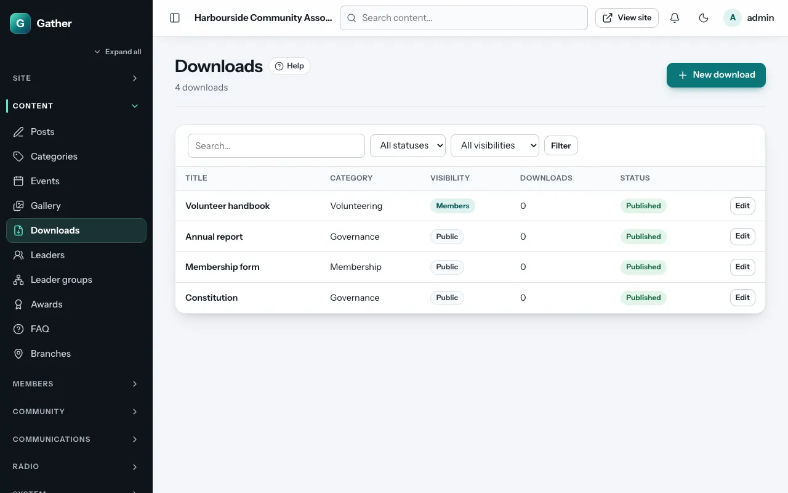

# Downloads

Permission: **content**.

Downloads are documents people can save: the constitution, meeting minutes,
forms, annual reports, a programme leaflet. Visitors find them at
`/downloads`. Members find members-only files in their account too.

## Adding a download

**Admin → Downloads → New download**:

- **Title**, **URL slug**, **Summary** and **Description**.
- **File** (required): a document, audio, video or image file (documents up
  to 20 MB; see [Media library](media-library.md) for all limits).
- **Category**: type one (for example "Minutes") or pick one you used
  before. Downloads are grouped by category.
- **Cover image** (optional).
- **Status**, **Publish date**.
- **Visibility**: **Everyone**, or **Members only**: then only logged-in
  members can open the file, even if someone shares the link.
- **Create download**.

The list shows how many times each file was downloaded.

## Updating a document

To publish a new version under the same link (for example corrected
minutes), open the file in the **Media library** and use **Replace file**.
To keep the old version available as well, add a new download instead.

## On the site

`/downloads` lists files by category with their type, size and download
count. Members-only files show a lock for visitors who are not logged in.
The **Downloads list** page section shows them on any page (see
[Page builder](page-builder.md#content)), and members see their files under
**My account → Downloads**.

Members can also **like** downloads.
