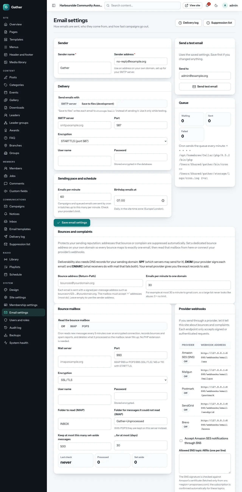
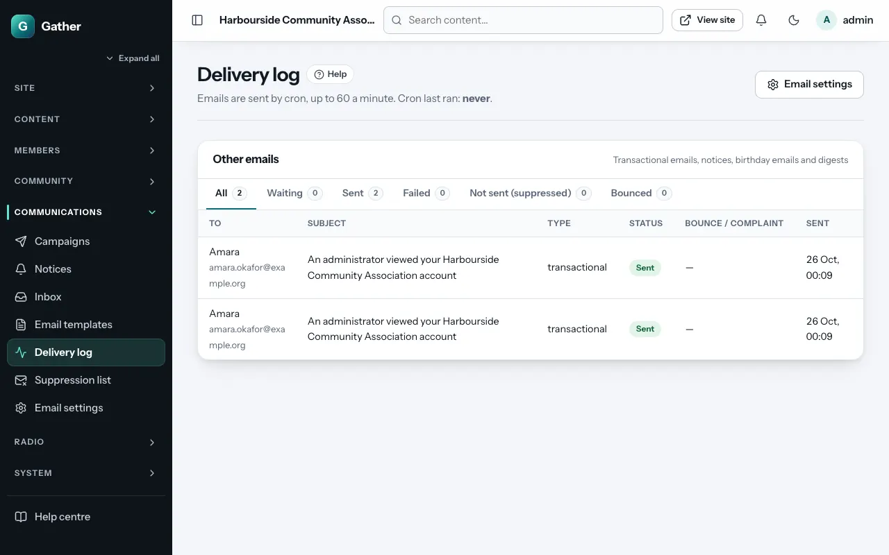
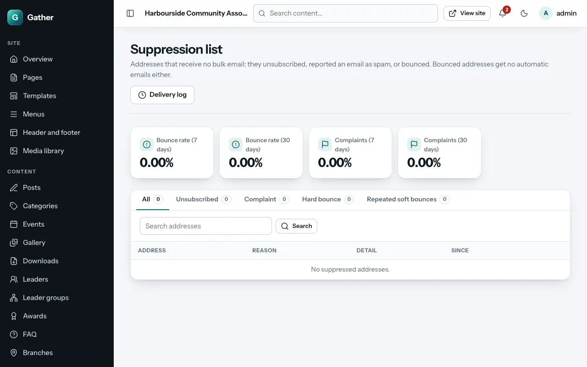

# Email settings, delivery log and suppression list

## Email settings *(super admin)*

**Admin → Email settings** decides how the site sends email. Set it up once,
ideally together with whoever manages your domain and hosting. The full
technical guide, including SPF, DKIM and DMARC and the bounce mailbox, is
[Email deliverability](../email-deliverability.md). This page summarises
the screen.

**Sender**: **Sender name** (usually your organisation) and **Sender
address** (an address on your own domain, such as `news@example.org`).

**Delivery**: **Send emails with**:

- **SMTP server**: real sending. Fill in **SMTP server**, **Port**,
  **Encryption** (**STARTTLS (port 587)** or **SSL/TLS (port 465)**),
  **User name** and **Password** from your email provider. The password is
  stored encrypted.
- **Save to files (development)**: nothing is sent; emails are saved on the
  server. Only for testing.

**Sending pace and schedule**:

- **Emails per minute**: how fast campaigns and queued emails go out. Use
  your provider's limit.
- **Birthday emails at**: the time birthday greetings and the admins'
  birthday digest are sent each day.

Click **Save email settings**, then **Send a test email** (right-hand box)
to check that it works.

**Queue**: how many emails are waiting, sent and failed.

**Bounces and complaints**: the bounce address, the pace per receiving
domain, the bounce mailbox and provider webhooks. Explained step by step in
[Email deliverability](../email-deliverability.md#3-bounces-the-bounce-address-and-mailbox).

## Delivery log

Permission: **communications**.

**Admin → Delivery log** shows what was sent:

- **Recent campaigns**, each with delivered, soft and hard bounces,
  complaints, suppressed and status.
- **Other emails**: account emails, notice copies, birthday emails and
  digests, with recipient, subject, type, status, any bounce or complaint,
  and when it was sent.

If the mail server could not be reached, a banner says sending is paused
until a certain time. Nothing is lost: waiting emails go out when it answers
again.

## Suppression list

Permission: **communications**.

**Admin → Suppression list** shows the addresses that get no bulk email, and
why:

| Reason | Meaning |
|---|---|
| **Unsubscribed** | The person clicked unsubscribe |
| **Complaint** | They marked one of your emails as spam |
| **Hard bounce** | The address does not exist |
| **Repeated soft bounces** | Three temporary failures (such as a full mailbox) within 30 days |

Bounced addresses get no automatic emails either, except ones the person
asks for themselves (such as a password reset).

At the top you see the bounce and complaint rates for the last 7 and 30 days.
At the bottom, the **latest bounces and complaints** as they came in.

**Clear** (bounces only): when a member has fixed their address or their
mailbox works again, clear the suppression so they receive email again.
Unsubscribes and complaints show **Person's choice**: only the member can
undo them, by switching news emails back on in their preferences.

Members whose address bounced see a banner in their account asking them to
update it.

## When someone says "I don't get your emails"

1. Search for their address in the **Suppression list**. If they bounced and
   the address is now fine, **Clear** it.
2. Check the **Delivery log** for their address: was it delivered?
3. Ask them to look in their spam folder and to add your sender address to
   their contacts.
4. For newsletters: ask them to check that **News and event updates** is on
   under My account → Email preferences.
5. Still stuck? See [Email deliverability](../email-deliverability.md).
