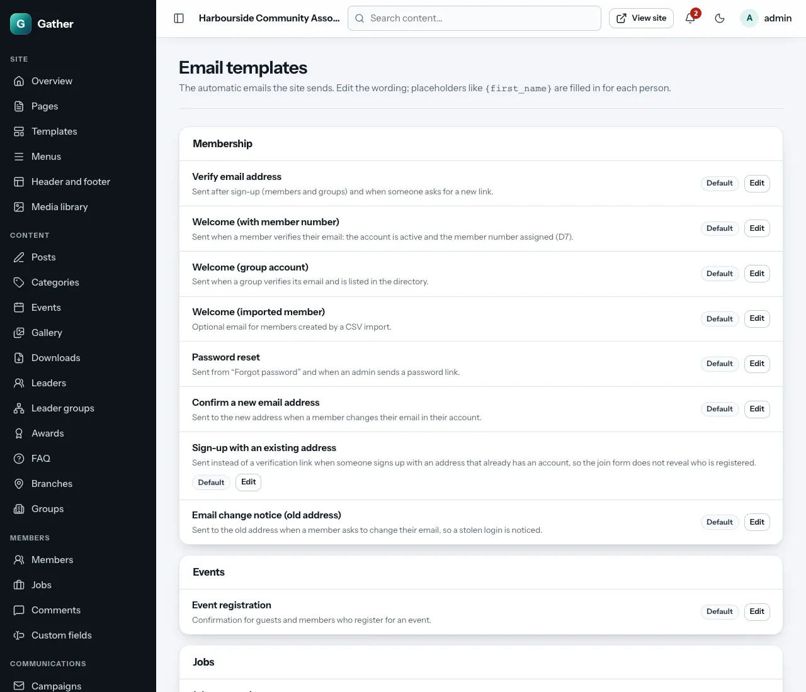
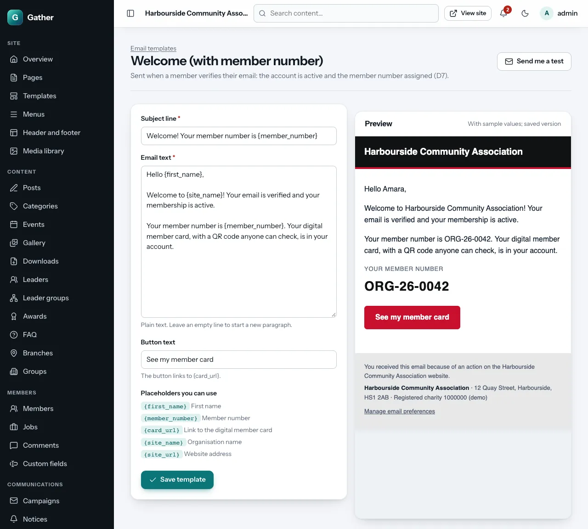

# Email templates

Permission: **communications**.

Gather sends automatic emails: when someone joins, resets a password,
registers for an event, and so on. **Admin → Email templates** lets you
change their wording so they sound like your organisation. Each one is
marked **Default** or **Edited**.

## The automatic emails

| Template | Sent when |
|---|---|
| Verify email address | Someone joins (the link to confirm their email) |
| Welcome (with member number) | A member confirms their email |
| Welcome (group account) | A group confirms its email |
| Welcome (imported member) | You import members and tick "email new members" |
| Sign-up with an existing address | Someone tries to join with an email that already has an account |
| Password reset | Someone uses "Forgotten your password?" |
| Confirm a new email address | A member changes their email |
| Email change notice (old address) | …and their old address is told |
| Event registration | Someone registers for an event |
| Job approved / Job not approved | You approve or reject a job post |
| Job awaiting approval (to admins) | A member posts a job that needs approval |
| Reply to a comment | Someone replies to a member's comment |
| Birthday greeting | On a member's birthday (if they opted in) |
| Birthday digest (to admins) | Each morning: today's and the coming week's birthdays |
| Contact form copy | The sender asked for a copy of their contact message |
| Contact form message (to the organisation) | Someone uses the contact form |
| Reply from the inbox | You reply to a message in the [Inbox](inbox.md) |
| Admin invitation | A super admin invites a new admin |
| Deletion request (to super admins) | A member asks for their account to be deleted |
| An administrator viewed your account | An admin used [Log in as this member](members.md#log-in-as-a-member) (only while **Site settings → Help and member support** has the notice switched on) |

## Editing a template

Click **Edit** next to a template:

- **Subject line**.
- **Email text**: plain text. Leave an empty line to start a new paragraph.
- **Button text**: the label of the button (where the email has one; the
  button's link is fixed, for example the verification link).
- **Placeholders you can use**: words in curly brackets that are filled in
  for each person, such as `{first_name}`, `{site_name}` or
  `{member_number}`. Each template lists the ones it supports. Gather refuses
  to save unknown placeholders, so a typo cannot reach members.
- **Preview**: the email with sample values (the saved version).
- **Save template**, then **Send me a test** to see it in your own inbox.
- **Reset to default** puts back Gather's original wording.

Every email automatically gets your logo and colours, and a **Manage email
preferences** link at the bottom.

Campaigns and notices are written in their own screens, not here.
