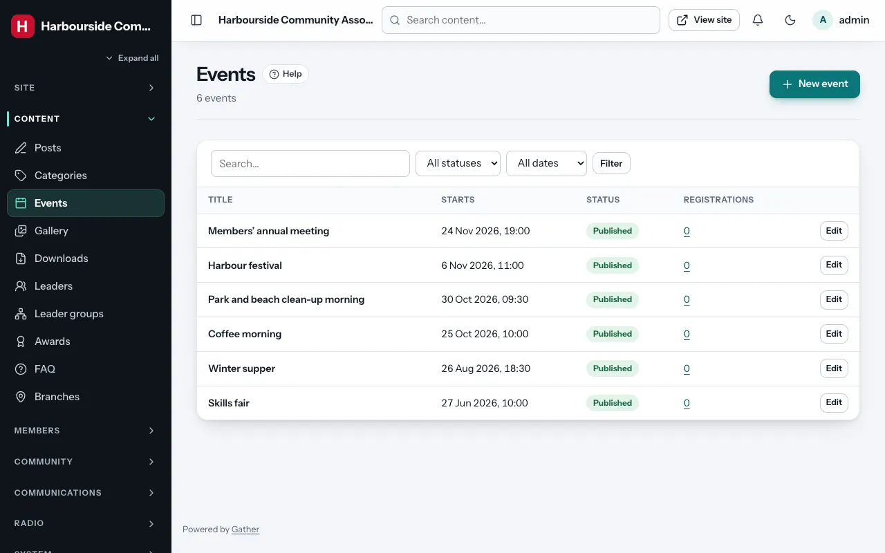
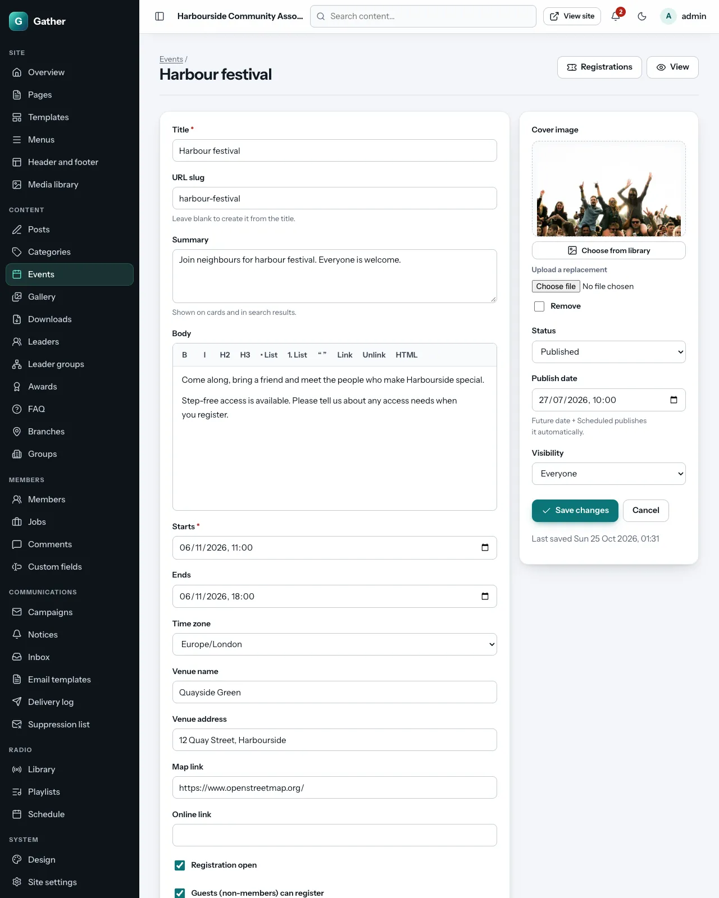
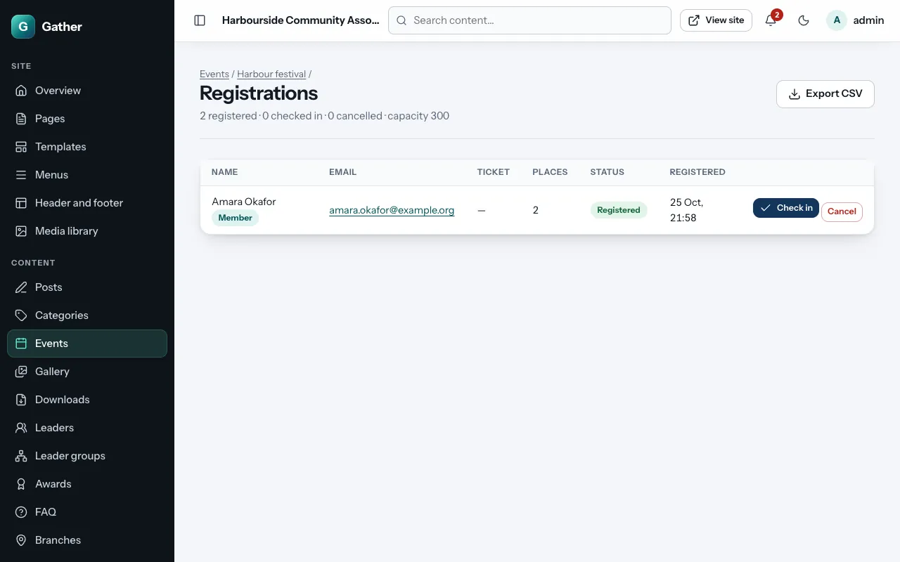
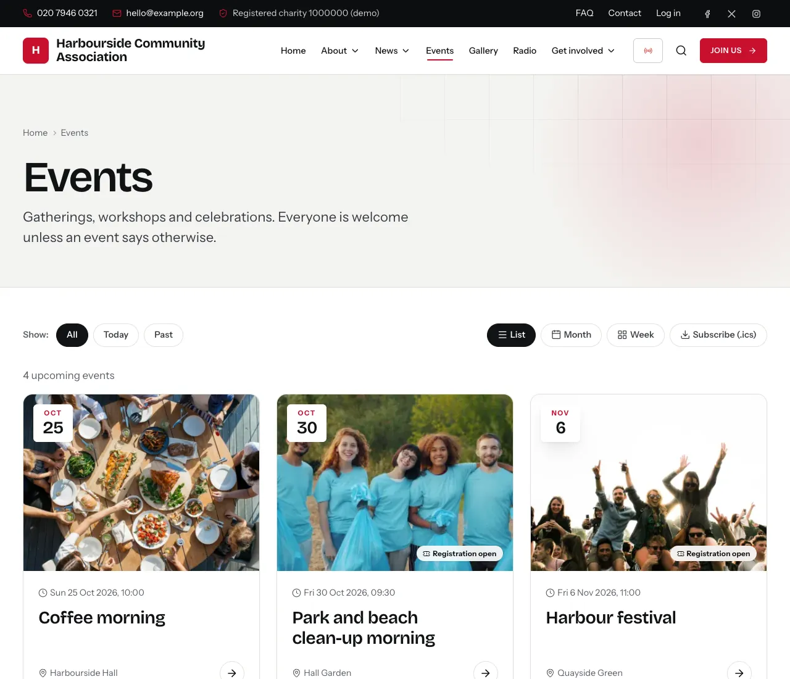
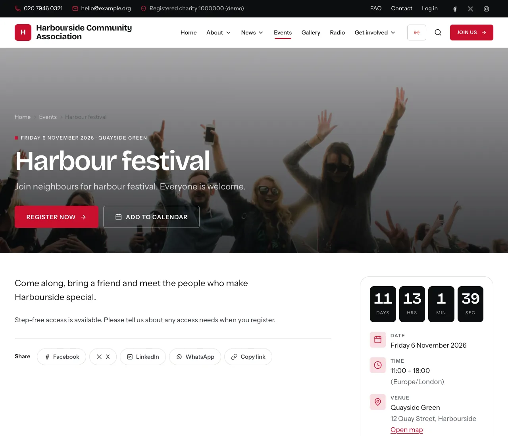
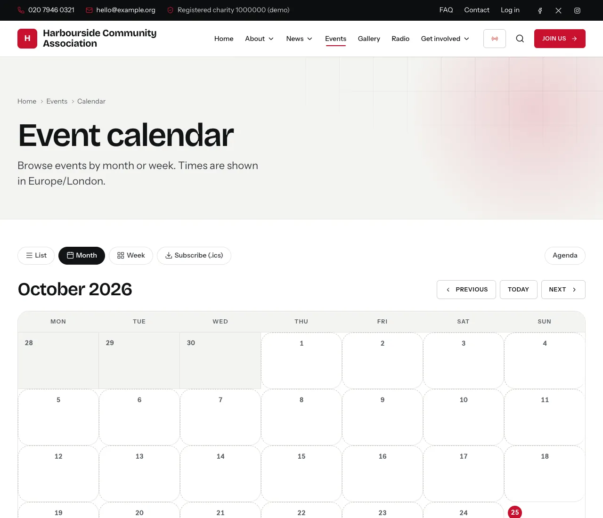

# Events, registrations and the calendar

Permission: **events**.

## Adding an event

**Admin → Events** lists all events (filter by status, or by upcoming and
past) with their start time and number of registrations.

Click **New event**.

**What and when**

- **Title**, **URL slug**, **Summary** (for cards) and **Body** (the full
  description), as for [posts](posts.md).
- **Starts** (required) and **Ends**.
- **Time zone**: normally your site's time zone. Change it for an event held
  elsewhere: times are shown correctly to everyone.

**Where**

- **Venue name** and **Venue address**.
- **Map link**: a link to the place on a map (OpenStreetMap, Google Maps…).
- **Online link**: for online or hybrid events (Zoom, Teams, a livestream).

**Registration**

- **Registration open**: shows a registration form on the event page.
- **Guests (non-members) can register**: untick to allow members only.
- **Capacity**: the number of places (empty = unlimited). The page shows how
  many are left, and registration closes when it is full.
- **Registration deadline**: registration closes at this time.
- **Ticket options**: a name and a price label for each kind of ticket, for
  example "Adult · £5" and "Child · free". These are labels only: **no
  payment is taken online**. Two empty rows are always offered for new
  options.

**Right-hand column**: **Cover image**, **Status** (draft, published,
scheduled), **Publish date** and **Visibility** (everyone or members only),
as for posts.

## Registrations

Open an event and click **Registrations** (top right):

- The top line counts places **registered**, **checked in** and
  **cancelled**.
- Each row shows the name, email, ticket, number of places, status and when
  they registered.
- **Check in**: on the day, mark people as they arrive (**Undo check-in** if
  you clicked the wrong one).
- **Cancel** / **Restore**: cancel a registration (the place becomes free
  again) or bring it back.
- **Export CSV**: the list as a spreadsheet, for name badges or a printed
  door list.

People who register get a confirmation email (wording under
[Email templates](email-templates.md) → *Event registration*). Members see
their registrations under **My events** and can cancel there themselves.

To email everyone registered for an event, make a [campaign](campaigns.md)
with the audience **People registered for an event**.

## On the site

- **Events** (`/events`): **Upcoming**, **Today** and **Past** events as cards
  with date badges.
- **The event page**: date, time, venue with map, online link, a countdown,
  the registration form, and **Add to calendar** (downloads an `.ics` file
  for Outlook, Apple or Google Calendar).
- **The calendar** (`/events/calendar`): **Month**, **Week** and **Agenda**
  views. **Subscribe (.ics)** gives a calendar feed (`/events.ics`) that
  people can add to their calendar app, so new events appear there by
  themselves.
- The **Upcoming events** and **Event calendar** page sections (see
  [Page builder](page-builder.md#content)).

## Tips

- Add a cover photo: events with pictures get far more attention.
- After an event, keep it published: it moves to **Past** automatically and
  shows "This event has finished".
- For members-only events, set **Visibility: Members only** *and* untick
  **Guests (non-members) can register**.
