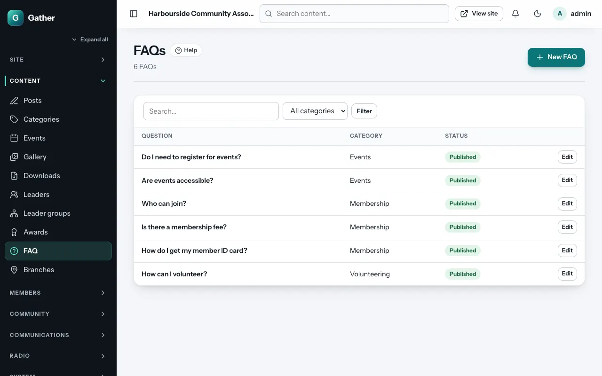

# FAQs

Permission: **content**.

Frequently asked questions save you answering the same emails again and
again. Visitors see them at `/faq` as an accordion: click a question to open
its answer.

## Adding a question

**Admin → FAQ → New FAQ**:

- **Question**.
- **Answer**: formatted text with links.
- **Category**: for example "Membership", "Events" or "Donations". Questions
  are grouped by category, and page sections can show one category.
- **Visibility**: **Everyone** or **Members only**.
- **Status** (**Published** or **Draft**) and **Order** (lower first).

The list can be filtered by category.

## On the site

`/faq` shows all questions by category. The **FAQ accordion** page section
shows one category (or all) on any page. The Contact and Membership starter
pages use it (see [Page builder](page-builder.md#content)).

Good questions to start with: How do I join? How much does membership
cost? How do I update my details? Can I bring guests to events? How do I
make a donation? Who do I contact about…?
