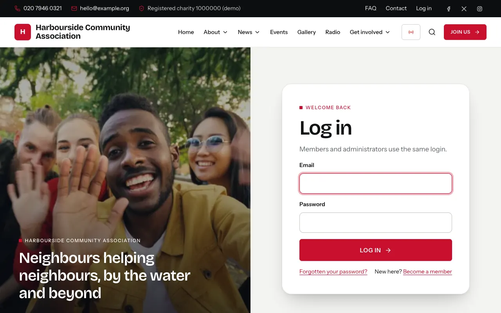
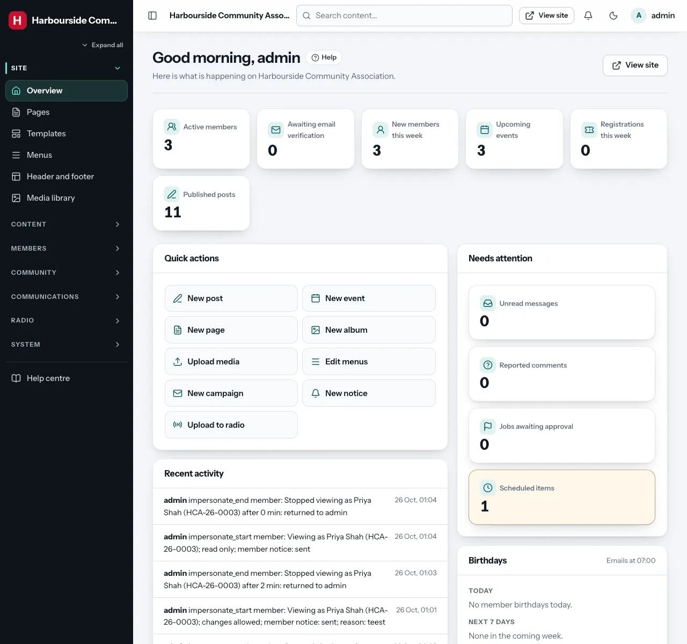
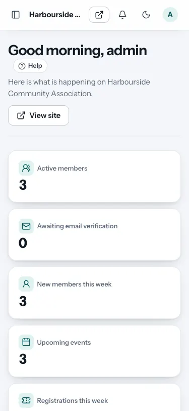

# First login and the dashboard

## Logging in

Go to your site and click **Log in** at the top (or add `/login` to the
address, for example `https://community.example.org/login`). Admins and
members use the same login page. After logging in, admins arrive at the
admin area (`/admin`) and members at **My account**.

The first super admin was created during installation. Other admins get an
email invitation from a super admin (see [Users and roles](users-roles.md)),
with a link to choose their password. The link works for 72 hours.

**Forgotten your password?** Use the link on the login page. You get an
email with a link that works for one hour. After 10 wrong passwords in a
row, the login is locked for 15 minutes.

**Changing your own password**: the admin area has no profile page for
this. Log out and use **Forgotten your password?** on the login page, or ask
a super admin to send you a password link (**Users and roles** → your name →
**Send password link**).

## Finding your way around

**The menu on the left** lists every area you may manage, grouped as
*Site*, *Content*, *Members*, *Communications*, *Radio* and *System*. The
icon at the top left (next to the site name) folds the menu into a narrow
strip of icons, and your browser remembers your choice.

**The top bar** has:

- **Search content**: finds posts, pages, events and more by title.
- **View site**: opens the public website in a new tab.
- **The bell**: the number of things waiting for you (unread contact
  messages, reported comments, jobs awaiting approval).
- **The moon/sun**: switches the admin area between light and dark.
- **Your name**: shows your email and role, and the **Log out** button.

On a phone, the menu opens from the button at the top left.

## The dashboard (Overview)

| Part | What it shows |
|---|---|
| **Numbers at the top** | Active members, members waiting to verify their email, new members this week, upcoming events, registrations this week, published posts |
| **Quick actions** | Shortcuts: new post, event, page, album, upload media, edit menus, new campaign, new notice, upload to radio (only those you have permission for) |
| **Needs attention** | Unread messages, reported comments, jobs awaiting approval and scheduled items. Highlighted cards need you; click one to go there |
| **Recent activity** | The latest changes made in the admin area (from the [audit log](audit-log.md)) |
| **Birthdays** | Members with a birthday today and in the next 7 days, and whether their greeting email is on |
| **System** | When the scheduled jobs (cron) last ran. A warning appears if they have stopped |

## Your first hour: a checklist for a new site

If you have just installed Gather, these steps give it your organisation's
identity. Each links to the full explanation.

1. **Site settings**: the organisation's name, contact details, logo and social
   links. See [Site settings](settings.md).
2. **Design**: pick a theme and set your brand colour. See
   [Design and themes](design.md).
3. **Membership settings**: member number format, how long membership lasts,
   regions and membership types. See [Members](members.md#membership-settings).
4. **Email settings** (with whoever set up the hosting): see
   [Email settings](email-settings.md).
5. **Pages**: edit the home page and the About page; delete demo pages you do
   not need. See [Pages and the page builder](page-builder.md).
6. **Menus**: make the main menu match your pages. See
   [Header, footer and menus](header-footer-menus.md).
7. **Users and roles**: invite the other people who will help, and give each
   only the areas they need. Keep at least two super admins. See
   [Users and roles](users-roles.md).
8. **Backups**: switch on the daily backup. See [Backups](backups.md).
9. **System health**: check there is nothing marked "Problem". See
   [System health](system-health.md).

### If you started with the demo content

The demo is a fictional "Harbourside Community Association" with news,
events, albums, leaders, radio programmes, a notice, a draft campaign, two
jobs and three demo members. Replace or delete it bit by bit. Delete the
demo members under **Members** (open each one → **Remove member**), and the
radio programmes under **Radio → Library** (remove them from playlists and
the schedule first).

## Good habits

- **Log out** on shared computers (your name in the top bar → **Log out**).
- Use a **long, unique password** (at least 10 characters; a password
  manager helps).
- Only give people the permissions they need.
- Look at **Needs attention** and the **bell** once or twice a week.
