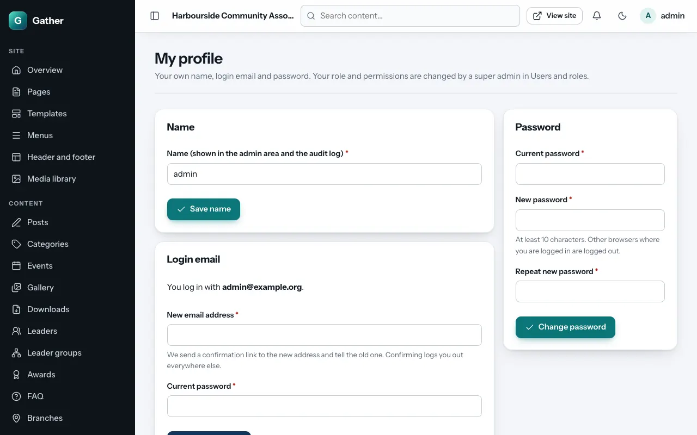
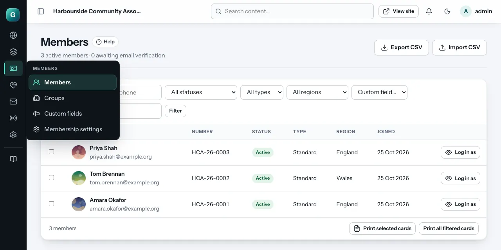

# First login and the dashboard

## Logging in

Go to your site and click **Log in** at the top (or add `/login` to the
address, for example `https://community.example.org/login`). Admins and
members use the same login page. After logging in, admins arrive at the
admin area (`/admin`) and members at **My account**.

The first super admin was created during installation. Other admins get an
email invitation from a super admin (see [Users and roles](users-roles.md)),
with a link to choose their password. The link works for 72 hours.

**Forgotten your password?** Use the link on the login page. You get an
email with a link that works for one hour. After 10 wrong passwords in a
row, the login is locked for 15 minutes.

## Your own profile

**Your own name, email and password**: click your name at the top right,
then **My profile** (`/admin/profile`). Every admin can use it, whatever
their permissions:

- **Name**: how you appear in the admin area and the audit log.
- **Login email**: type the new address and your current password. Gather
  emails a confirmation link to the new address (and tells the old one).
  Until you open the link you keep logging in with the old address; once
  confirmed, you are logged out everywhere else.
- **Password**: your current password, then the new one twice (at least 10
  characters). Any other browser or device where you were logged in is
  logged out. After 10 wrong current passwords in an hour, wait an hour.

All three changes are recorded in the [audit log](audit-log.md).

## Finding your way around

**The menu on the left** lists every area you may manage, in groups:
*Site*, *Content*, *Members*, *Community*, *Communications*, *Radio* and
*System*. You only see the groups and screens you have permission for.

- Click a group's name to open or close it. The arrow next to the name
  points down when the group is open.
- The group of the page you are on opens by itself and is highlighted (bold,
  with a coloured bar); the page itself is highlighted inside it.
- **Expand all** / **Collapse all** at the top opens or closes every group.
- Your browser remembers which groups you opened, so the menu looks the same
  next time. (It is remembered per browser: another computer starts with
  only the current group open.)
- **Help centre** at the bottom opens these guides inside the admin area
  (see [The help centre](help-centre.md)).

The top of the menu shows your organisation's name and site icon (long
names are shortened; point at the name to read it in full). "Gather", the
software's name, only appears in the small "Powered by Gather" line at the
bottom of each admin page.

The icon at the top left (next to the site name) folds the menu into a
narrow strip with one icon per group; the group you are in is highlighted.
Point at an icon (or move to it with the Tab key, or click it) to see that
group's screens in a small panel next to it; press Escape to close the
panel. Your browser remembers whether the menu is folded. The page builder
and the Design screen always use the narrow menu, to leave room for the
preview.

**The Help button** next to the title of most screens opens the guide page
for that screen.

**The top bar** has:

- **Search content**: finds posts, pages, events and more by title.
- **View site**: opens the public website in a new tab.
- **The bell**: the number of things waiting for you (unread contact
  messages, reported comments, jobs awaiting approval).
- **The moon/sun**: switches the admin area between light and dark.
- **Your name**: shows your email and role, **My profile** (change your
  name, email or password, see [Your own profile](#your-own-profile)) and
  the **Log out** button.

On a phone, the menu opens from the button at the top left, with the same
groups. Tap outside it or press Escape to close it.

## The dashboard (Overview)

| Part | What it shows |
|---|---|
| **Numbers at the top** | Active members, members waiting to verify their email, new members this week, upcoming events, registrations this week, published posts |
| **Quick actions** | Shortcuts: new post, event, page, album, upload media, edit menus, new campaign, new notice, upload to radio (only those you have permission for) |
| **Needs attention** | Unread messages, reported comments, jobs awaiting approval and scheduled items. Highlighted cards need you; click one to go there |
| **Recent activity** | The latest changes made in the admin area (from the [audit log](audit-log.md)) |
| **Birthdays** | Members with a birthday today and in the next 7 days, and whether their greeting email is on |
| **System** | When the scheduled jobs (cron) last ran. A warning appears if they have stopped |

## Your first hour: a checklist for a new site

If you have just installed Gather, these steps give it your organisation's
identity. Each links to the full explanation.

1. **Site settings**: the organisation's name, contact details, logo and social
   links. See [Site settings](settings.md).
2. **Design**: pick a theme and set your brand colour. See
   [Design and themes](design.md).
3. **Membership settings**: member number format, how long membership lasts,
   membership types, and whether to ask where members are from. See
   [Members](members.md#membership-settings).
4. **Email settings** (with whoever set up the hosting): see
   [Email settings](email-settings.md).
5. **Pages**: edit the home page and the About page; delete demo pages you do
   not need. See [Pages and the page builder](page-builder.md).
6. **Menus**: make the main menu match your pages. See
   [Header, footer and menus](header-footer-menus.md).
7. **Users and roles**: invite the other people who will help, and give each
   only the areas they need. Keep at least two super admins. See
   [Users and roles](users-roles.md).
8. **Backups**: switch on the daily backup. See [Backups](backups.md).
9. **System health**: check there is nothing marked "Problem". See
   [System health](system-health.md).

### If you started with the demo content

The demo is a fictional "Harbourside Community Association" with news,
events, albums, leaders, radio programmes, a notice, a draft campaign, two
jobs and three demo members. Replace or delete it bit by bit. Delete the
demo members under **Members** (open each one → **Remove member**), and the
radio programmes under **Radio → Library** (remove them from playlists and
the schedule first).

## Good habits

- **Log out** on shared computers (your name in the top bar → **Log out**).
- Use a **long, unique password** (at least 10 characters; a password
  manager helps).
- Only give people the permissions they need.
- Look at **Needs attention** and the **bell** once or twice a week.
