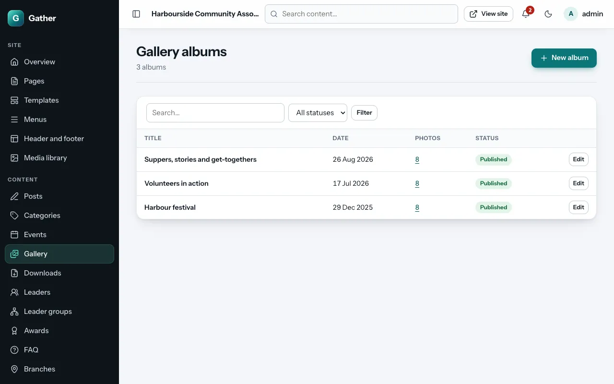
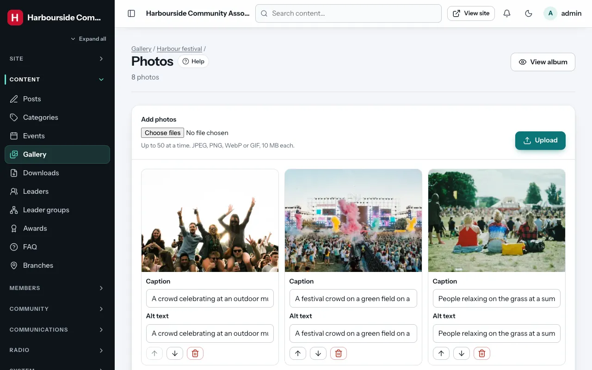
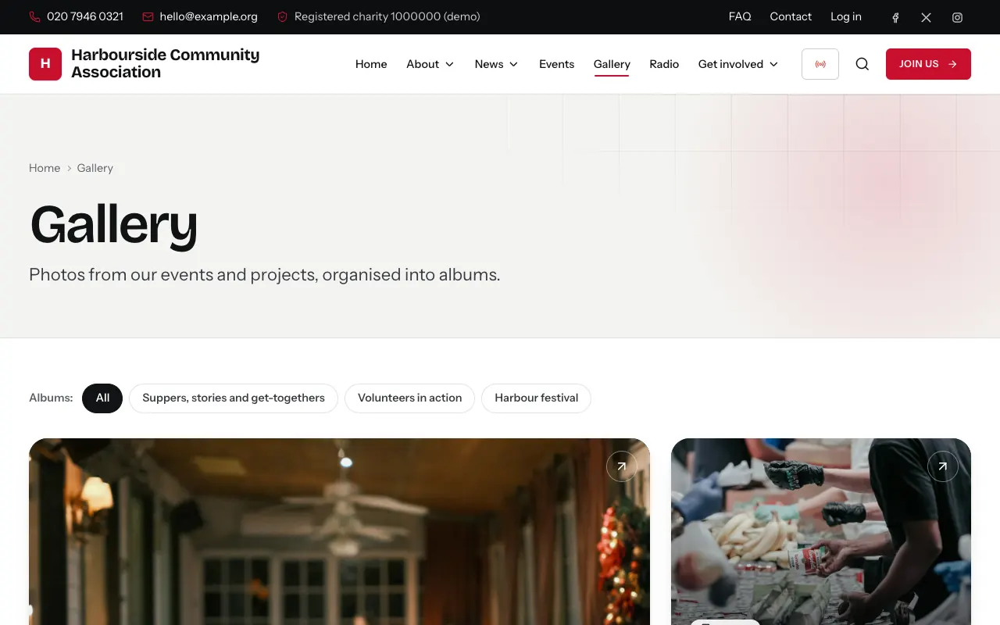

# Gallery

Permission: **gallery and media**.

The gallery is a set of photo **albums**, for example one per event.
Visitors see them at `/gallery`.

## Creating an album

**Admin → Gallery → New album**:

- **Title**, **URL slug**, **Summary** and **Description**.
- **Album date**: when the photos were taken.
- **Cover image**: the picture on the album's tile. Choose one, so the tile
  has a picture.
- **Status**, **Publish date** and **Visibility** (**Everyone** or
  **Members only**).
- **Create album**.

## Adding photos

Open the album and click **Manage photos** (or go to **Admin → Gallery**
and use the album's photos link):

1. **Add photos**: choose up to **50 photos at a time** (JPEG, PNG, WebP or
   GIF, up to 10 MB each) and click **Upload**.
2. For each photo, type a **Caption** (shown under the photo) and **Alt
   text** (a description for people who cannot see it). Then click **Save
   captions and alt text**.
3. **Move photo earlier** / **Move photo later** changes the order;
   **Remove photo** takes it out of the album.

**View album** opens it on the site.

## On the site

`/gallery` shows the albums as tiles (the newest large). An album page shows
its photos; clicking a photo opens it full screen (a "lightbox") with
previous/next buttons (the arrow keys work too).

The **Gallery** page section can show one album or the latest photos from
all albums anywhere on a page (see
[Page builder](page-builder.md#content)).

## Tips

- Ask people's permission before publishing photos in which they are clearly
  recognisable, especially children. Use **Members only** albums for private
  occasions.
- Set the **focal point** of cover photos (see
  [Media library](media-library.md#focal-points)) so faces are not cut off on
  the tiles.
