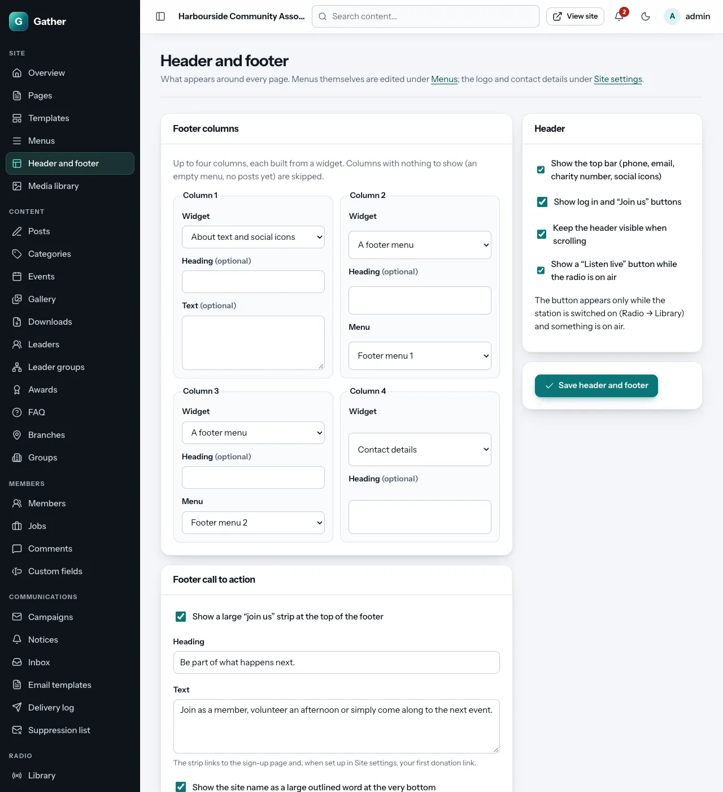
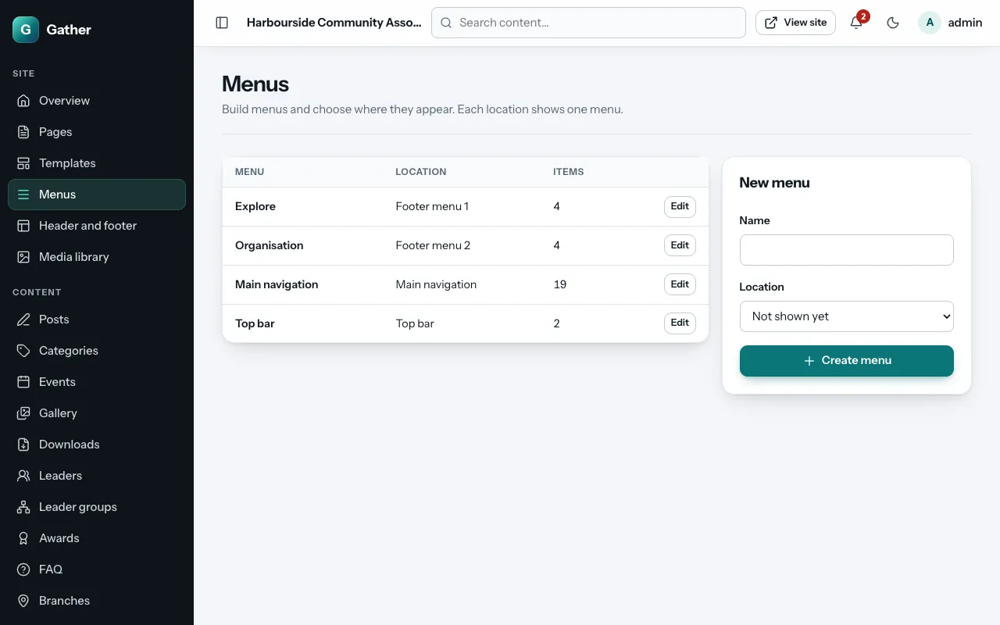
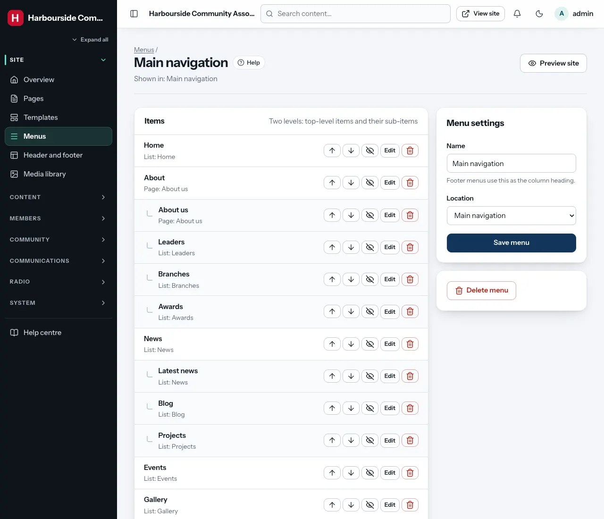

# Header, footer and menus

Permission: **pages and menus**.

The **header** is the bar at the top of every page (logo, menu, buttons). The
**footer** is the area at the bottom. **Menus** are the lists of links shown
in them.

## The header

**Admin → Header and footer**, box **Header**:

| Option | Effect |
|---|---|
| **Show the top bar** | The thin strip above the header with phone, email, charity number and social icons (from [Site settings](settings.md)) and the top-bar menu |
| **Show log in and "Join us" buttons** | The buttons at the top right |
| **Keep the header visible when scrolling** | The header sticks to the top of the screen. On pages that start with a full-screen photo it is see-through at first and turns into a solid (frosted) bar as you scroll |
| **Show a "Listen live" button while the radio is on air** | Appears only while the station is switched on and something is playing (see [Radio](radio.md)) |

Click **Save header and footer**.

On phones, the menu becomes a **Menu** button that opens a full-screen list.

## The footer

### Footer columns

Up to four columns. For each one, choose a **Widget**:

| Widget | Shows |
|---|---|
| **About text and social icons** | The footer "about" text from Site settings (or the **Text** you type here) and social icons |
| **A footer menu** | One of the four footer menus (choose which under **Menu**) |
| **Contact details** | Address, phone and email from Site settings |
| **Latest news** | The newest posts |
| **Social links** | Icons for your social pages |
| **Donate** | Your donation text and buttons from Site settings |
| **"Join us" button** | A short text and a button to the sign-up page |

**Heading** (optional) is the column title. Choose **Not used** to leave a
column out. Columns with nothing to show (an empty menu, no posts yet) are
skipped automatically.

### Footer call to action

- **Show a large "join us" strip at the top of the footer**: a big band with
  your **Heading** and **Text**. It links to the sign-up page and, when set,
  to your first donation link.
- **Show the site name as a large outlined word at the very bottom**: a
  decorative touch.

## Menus

**Admin → Menus** lists your menus and where each appears. A **location**
shows one menu:

| Location | Where |
|---|---|
| **Main navigation** | The header |
| **Top bar** | The thin strip above the header |
| **Footer menu 1–4** | Footer columns that use the "A footer menu" widget |

Until you assign a menu to **Main navigation**, the site shows a simple
default menu.

### Creating a menu

Under **New menu**, type a **Name** (for footer menus, the name is used as
the column heading), choose a **Location** (or **Not shown yet** to prepare it
first), and click **Create menu**.

### Adding items

Open the menu. Under **Add an item**:

- **Label**: the text people see. Leave it empty to use the page's title.
- **Links to**, one of:
  - **Page**: one of your pages.
  - **Content list**: a whole section of the site, such as *News*, *Events*, *Event calendar*, *Gallery*, *Downloads*, *Leaders*, *FAQ* or *Groups*.
  - **Content item**: one particular post, event, album…
  - **Web address**: any address, such as `https://…` or `/join`.
- **Parent**: **None (top level)**, or a top-level item to put this one
  under it, as a dropdown. Menus have two levels.
- **Open in a new tab**: for links to other websites.
- **Hidden (keep it, but do not show it)**: takes an item off the menu
  without deleting it.

Click **Add item**. Use **Move up** / **Move down** to reorder, **Edit** to
change an item, and **Delete** to remove it. A dropdown with more than five
items is shown as a wide two-column panel.

**Broken links**: if a page or item that a menu links to is deleted, the item
is marked **Target deleted: edit or remove**, and Menus shows a "broken"
count. Edit the item, choose a new target, and save.

**Menu settings** (on the same screen) lets you rename the menu, move it to
another location (or **Not shown**), and **Delete menu**. **Preview site**
opens the site so you can check the result.
