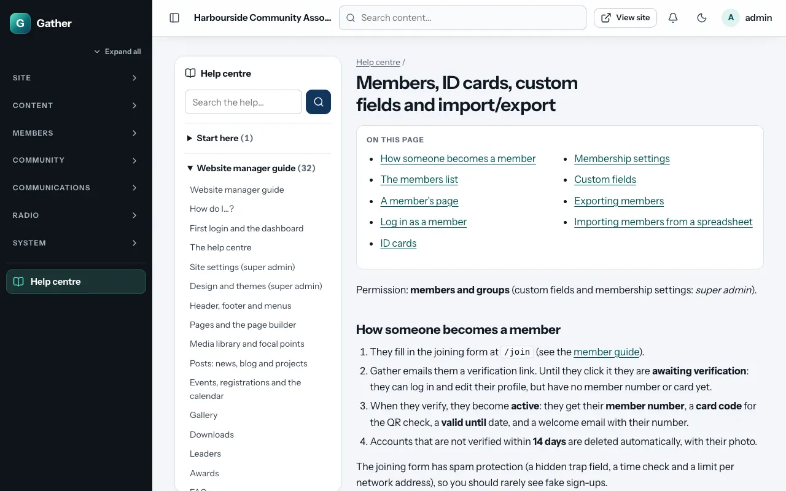

# The help centre

Every guide in this documentation is also built into the admin area, so you
can read it next to the screen you are working on. Nothing extra needs to be
installed: the guides ship with Gather.

## Opening the help

There are three ways in:

- **Help centre** at the bottom of the menu on the left (`/admin/help`).
- The **Help** button next to the title of most admin screens. It opens the
  guide page for that screen. On the Members list, for example, it opens
  [Members, ID cards, custom fields and import/export](members.md).
- [How do I…?](how-do-i.md), the everyday task list, is the second entry in
  the contents.

Every admin can open the help centre, whatever their permissions. The pages
describe the whole admin area, so some of them explain screens you may not
have in your menu.

## Finding your way in a guide

- **Contents** (left on a computer, at the top on a phone) lists every guide,
  grouped as *Start here*, *Website manager guide*, *Member guide*, *Email*
  and *Installing and hosting*. Click a group to open or close it.
- **On this page** lists the sections of a longer guide. Click one to jump to
  it.
- **Previous** and **Next** at the bottom take you through the guides in
  reading order.
- Screenshots come from the demo site, so your own site looks different once
  it has your content and theme.

## Searching

Type one or more words in **Search the help** and press Enter. Gather looks
through the text of every guide and lists the sections that contain all of
your words, with the words highlighted. Words in a section's heading count
more than words in its text. Click a result to open that section.

Tips:

- Use short, plain words: `card`, `bounce`, `backup`, `password`.
- Every word must appear, so remove words if you get no results.
- Search is not case sensitive.

## The member guide on your website

The [Member guide](../member-guide.md) is also shown on the public website at
`/help`, in your site's theme. A **Help** link appears in the footer and in
the menu of **My account**, so members can find answers about joining, their
card, email preferences and their account without asking you.

Under **Site settings → Help and member support**, a super admin chooses who
can open `/help`:

- **Everyone (public)**: the default. Anyone can read it, which also helps
  people who are thinking about joining.
- **Logged-in members only**: visitors are asked to log in first.

Only the member guide is shown on the public site. The website manager
guide, the installation guides and the deliverability guide are only in the
admin area (and on GitHub).

## A documentation website (optional)

The person who installs the site can also publish all the guides as a small
stand-alone website, for example on GitHub Pages, so that the installation
guides can be read before Gather is installed. See
[Publishing the documentation as a website](../docs-website.md).

## When the guides change

The help centre reads the guides from the `docs/` folder of your installation
each time a page is opened (and keeps a ready-made copy in `storage/cache/`
until the file changes). When you [update the site](updating.md), the help
centre updates with it.
