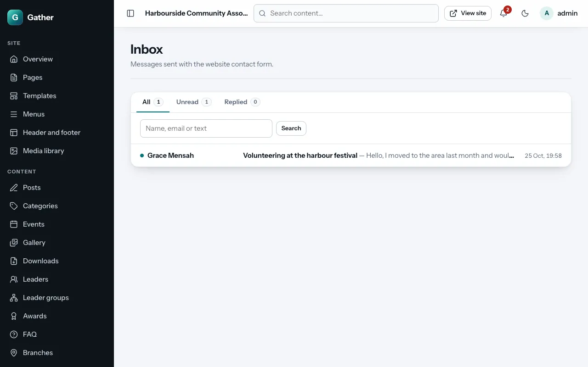
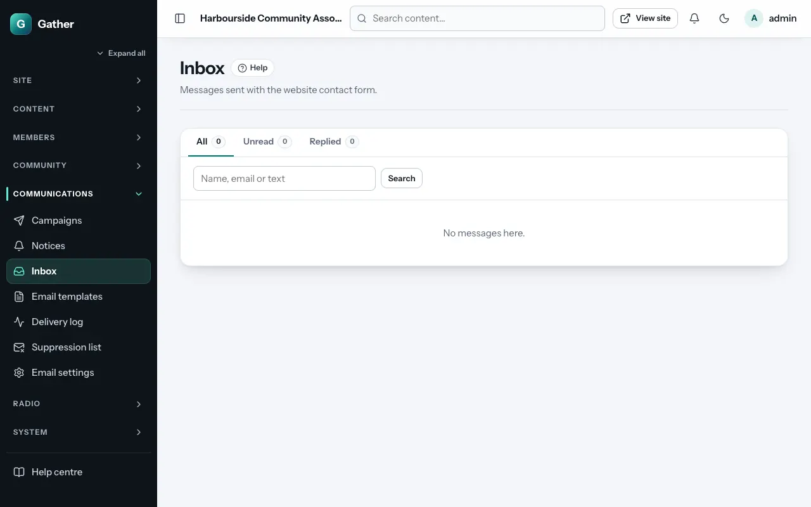

# Inbox

Permission: **communications**.

Messages sent with the website's contact form (the **Contact** page section)
arrive in **Admin → Inbox**. They are also emailed to the contact address
in [Site settings](settings.md), but the inbox keeps them all in one place
with your replies.

## Reading messages

The list can show **all**, **unread** or **replied** messages, and has a
search box. Unread messages are counted in the bell at the top and on the
dashboard.

Click a message to read it. It is marked as read (**Mark as unread** puts it
back). **Delete** removes it.

## Replying

On the message page, under **Reply by email**:

1. The **Subject** is filled in for you.
2. Type **Your reply**.
3. **Send reply**.

The reply is emailed to the sender from the site's sender address, with your
organisation's contact address as the reply-to, so their answer reaches you.
Replies are kept under the message (marked **replied**). The wording around
your reply comes from the **Reply from the inbox** [email
template](email-templates.md).

## Spam

The contact form has protection built in (a hidden trap field, a time check,
and at most five messages an hour from the same network address), so very
little spam gets through. If some does, just delete it.
