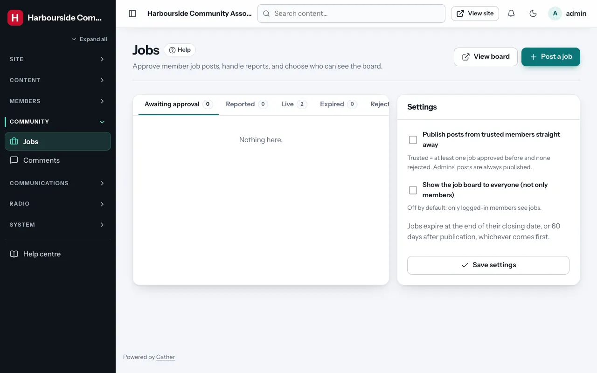
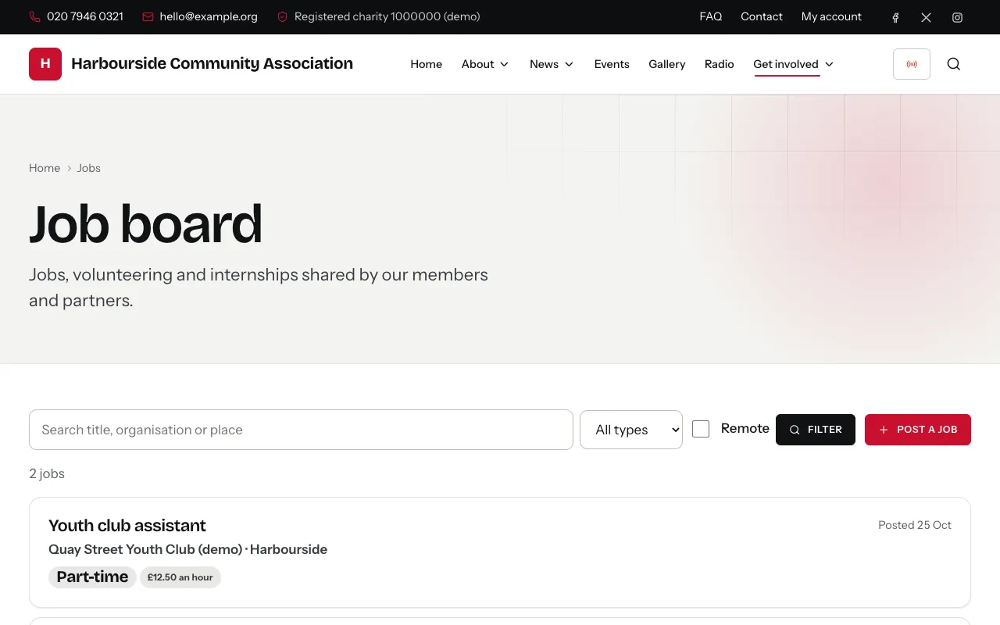

# Job board

Permission: **jobs**.

The job board (`/jobs`) lets members share jobs, volunteering roles and
internships with each other. Members post them from their account; admins
approve them here.

## The jobs screen

**Admin → Jobs** has tabs: **awaiting approval**, **reported**, **live**,
**expired** and **rejected**.

For a job awaiting approval you see who posted it, the description and how
to apply. Then:

- **Approve**: it goes on the board. The member gets an email.
- **Reject**: type a **Reason for rejecting** (it is emailed to the member)
  and click **Reject**.

For a **reported** job (members can report a job once each, with a reason):

- **Keep and close reports**: the job stays; the reports are closed.
- **Delete**: removes the job.

Admins with the jobs permission get an email when a job is waiting for
approval.

## Posting a job yourself

**Post a job** (top of the screen). Fill in the **Job title**,
**Organisation**, **Location**, **Type** (**Full-time**, **Part-time**,
**Contract**, **Volunteer** or **Internship**), **Salary or pay**, **Remote
working possible**, **Description**, **How to apply** (an **Application
link** or an email address) and the **Closing date**. Jobs posted by admins
go live straight away.

## Settings

At the bottom of the jobs screen:

- **Publish posts from trusted members straight away**: a *trusted* member
  has had at least one job approved before and none rejected. Their posts
  then skip the queue. (If they edit a live job, it goes back for approval
  unless they are trusted.)
- **Show the job board to everyone (not only members)**: off by default, so
  only logged-in members see jobs.

Click **Save settings**.

## Expiry

A job leaves the board at the end of its **closing date**, or **60 days**
after it was published, whichever comes first. Members can post up to five
jobs a day.

