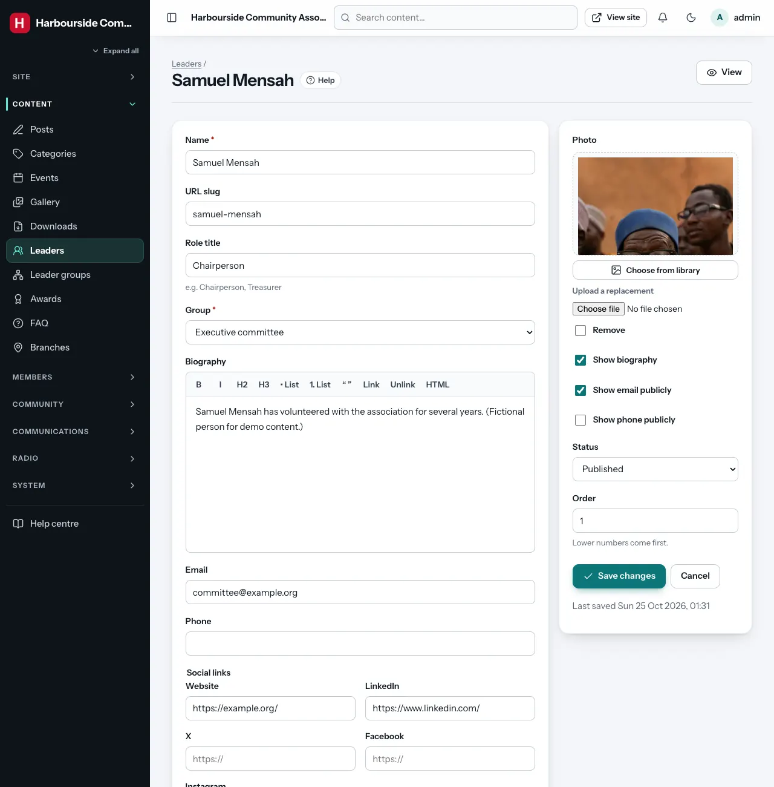
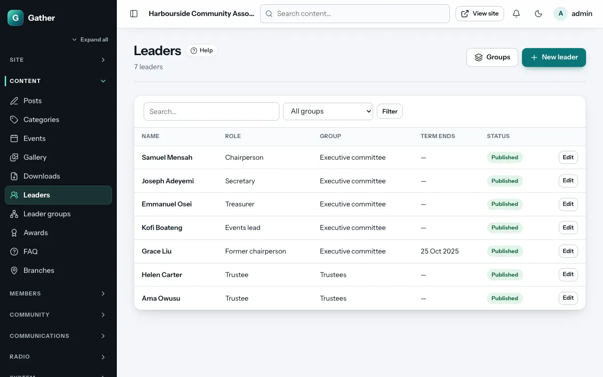

# Leaders

Permission: **content**.

Leaders are the people who run your organisation: the committee, trustees,
elders, coordinators. Each leader belongs to a **leader group**. Visitors see
them at `/leaders`.

## Leader groups

**Admin → Leader groups → New leader group**:

- **Name**, for example "Executive committee", "Trustees" or "Youth wing".
- **URL slug**: the group's page is `/leaders/<slug>`.
- **Description**: a short introduction shown above the group.
- **Order**: lower numbers come first.

A group that still has leaders in it cannot be deleted.

## Adding a leader

**Admin → Leaders → New leader**:

- **Name**, **URL slug**, **Role title** (for example "Chairperson",
  "Treasurer") and **Group**.
- **Biography**.
- **Email** and **Phone**, with **Show email publicly** and **Show phone
  publicly** (both off by default; only switch them on with the person's
  agreement).
- **Social links**: website, LinkedIn, X, Facebook, Instagram.
- **Term start** and **Term end**. When the term end has passed, the
  leader moves automatically to the **past leaders** archive. You do not
  need to delete former leaders.
- **Photo**: a portrait (set the focal point on the face).
- **Show biography**: untick to list only name, role and photo.
- **Status** (**Published** or **Draft**) and **Order** (lower first).

## On the site

`/leaders` shows each group with photo cards (name, role, and social links
on hover). Clicking a leader opens their profile. Past leaders have their own
archive. The **Leaders** page section shows one group on any page (see
[Page builder](page-builder.md#community)).
