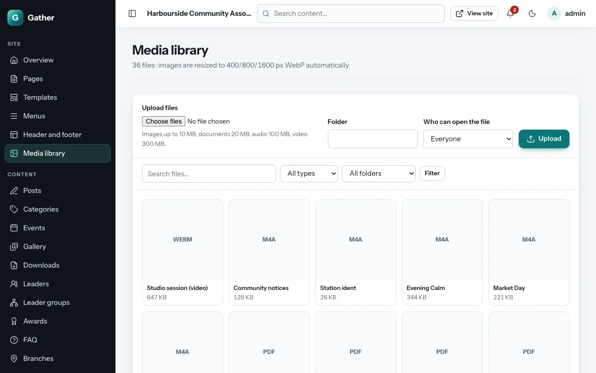
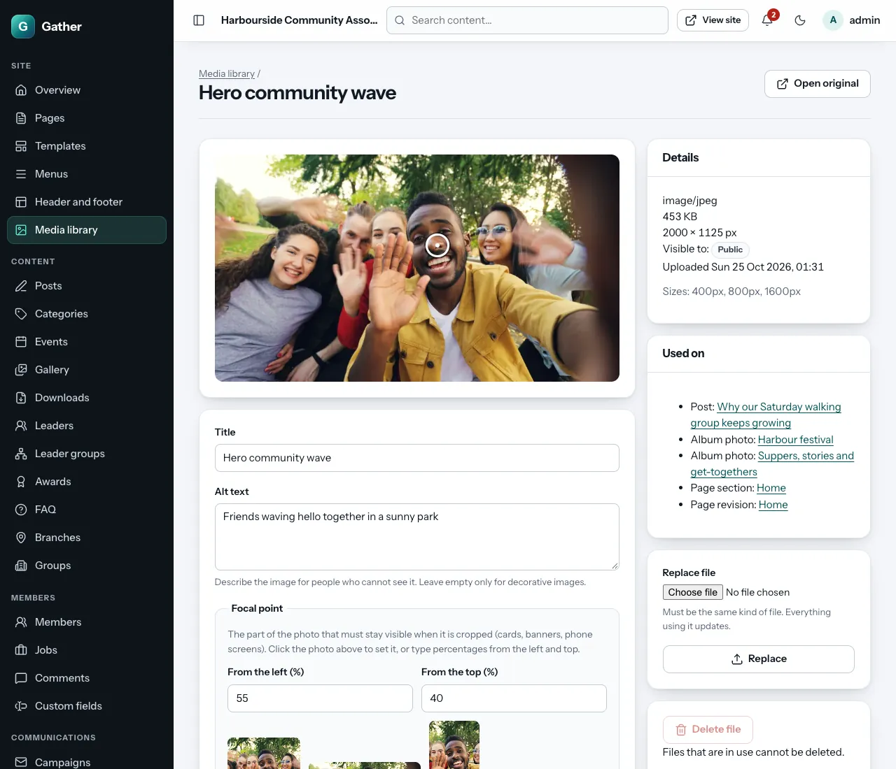

# Media library and focal points

Permission: **gallery and media**.

**Admin → Media library** holds the images and documents used across the
site: page sections, post covers, the logo, downloads. Gallery photos and
radio programmes are uploaded from their own screens but are stored here
too.

## Uploading

Under **Upload files**:

1. Choose one or more files.
2. **Folder** (optional): type a folder name (for example "Festival 2026") or
   pick an existing one. Folders only help you find things later.
3. **Who can open the file**: **Everyone**, or **Members only** (for example
   minutes or member documents; only logged-in members can open them).
4. **Upload**.

Accepted files and sizes:

| Kind | Files | Up to |
|---|---|---|
| Images | JPEG, PNG, WebP, GIF | 10 MB |
| Documents | PDF, Word, Excel, PowerPoint | 20 MB |
| Audio | MP3, M4A, OGG | 100 MB |
| Video | MP4, WebM | 300 MB |

Your hosting may set a lower limit (see **System health → Uploads**).

What happens to images: Gather removes hidden location data (GPS) from
photos, turns phone photos the right way up, and makes fast WebP copies at
400, 800 and 1600 pixels wide, so each visitor downloads only the size their
screen needs. You can upload photos straight from a camera or phone.

## Finding files

Search by name, filter by **Type** and **Folder**, then click a file to
open its details.

## A file's details

- **Title**: for your own use and the library list.
- **Alt text**: a short description of the image for people who cannot see
  it ("Volunteers handing out food parcels"). Screen readers read it aloud,
  and search engines use it. Leave it empty only for purely decorative
  images.
- **Focal point**: see below.
- **Folder**.
- **Save details**.

On the right:

- **Details**: file type, size, dimensions, who can see it, when it was
  uploaded, and the sizes made.
- **Used on**: every place that uses this file (posts, pages, albums…).
- **Replace file**: upload a new version (the same kind of file).
  Everything that uses it updates at once, which is handy for a new logo or
  an updated document.
- **Delete file**: only possible when the file is not used anywhere. Remove
  it from the pages first (**Used on** shows where).
- **Open original**: the file as uploaded.

## Focal points

The same photo is cropped differently in different places: square on a
card, a wide strip in a banner, tall on a phone. The **focal point** is the
spot that must always stay visible, usually a face.

1. Open the image in the media library.
2. **Click on the important spot** in the photo. A circle marks it. (Or type
   **From the left (%)** and **From the top (%)**: 50 / 50 is the centre.)
3. The **Square**, **Banner** and **Phone** previews show how the crops will
   look.
4. **Save details**.

Every crop on the site then keeps that point in view, on every screen size.
This works without JavaScript too: typing the numbers is enough.

## Good habits

- Fill in **alt text** when you upload. It is the most important
  accessibility step on most sites.
- Upload photos at a decent size (at least 1600 pixels wide for banners).
  Gather makes the small versions.
- Use **Members only** for anything private. Public files can be opened by
  anyone who has the link.
- Member photos (for ID cards) are not in the library. They are managed
  under [Members](members.md).
