# Members, ID cards, custom fields and import/export

Permission: **members and groups** (custom fields, location lists and
membership settings: *super admin*).

## How someone becomes a member

1. They fill in the joining form at `/join` (see the
   [member guide](../member-guide.md#joining)).
2. Gather emails them a verification link. Until they click it they are
   **awaiting verification**: they can log in and edit their profile, but
   have no member number or card yet.
3. When they verify, they become **active**: they get their **member
   number**, a **card code** for the QR check, a **valid until** date, and a
   welcome email with their number.
4. Accounts that are not verified within **14 days** are deleted
   automatically, with their photo.

The joining form has spam protection (a hidden trap field, a time check and
a limit per network address), so you should rarely see fake sign-ups.

## The members list

**Admin → Members**.

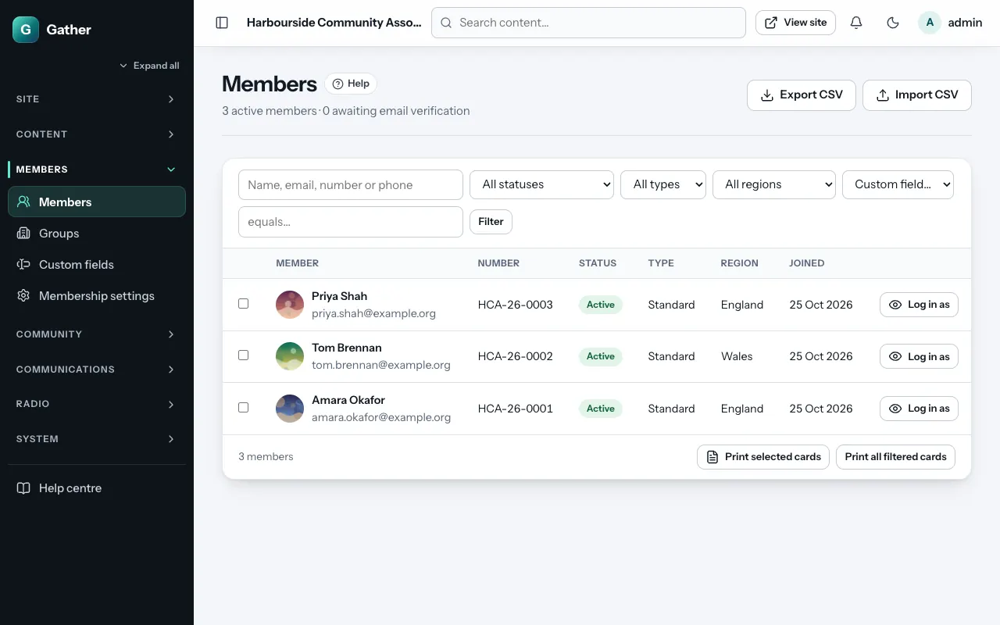

- **Search** by name, email, member number or phone.
- **Filters**: **Status** (**Active**, **Awaiting verification**,
  **Suspended**, **Card expired**, **Deletion requested**), **Membership
  type**, and any **Custom field** with a value.
- **Filter by location**: choose **which location** (country of residence,
  origin, nationality, or a Location custom field), then a **country** and,
  if you like, a **state/region** and a **local area**. For example *Origin →
  Nigeria → Ekiti* lists everyone whose state of origin is Ekiti. The
  export and the card print buttons follow this filter too.
- The **Lives in** column shows each member's region and country.
- The heading shows how many are active, awaiting verification, and (if any)
  have asked for deletion. Click that link to see them.
- **Export CSV** / **Import CSV**: see below.
- Tick members and click **Print selected cards**, or **Print all filtered
  cards**: see [Printing cards](#printing-cards).
- **Log in as** (at the end of a row, with the *Log in as a member*
  permission): see the site as that member. See
  [Log in as a member](#log-in-as-a-member).

## A member's page

Click a member.

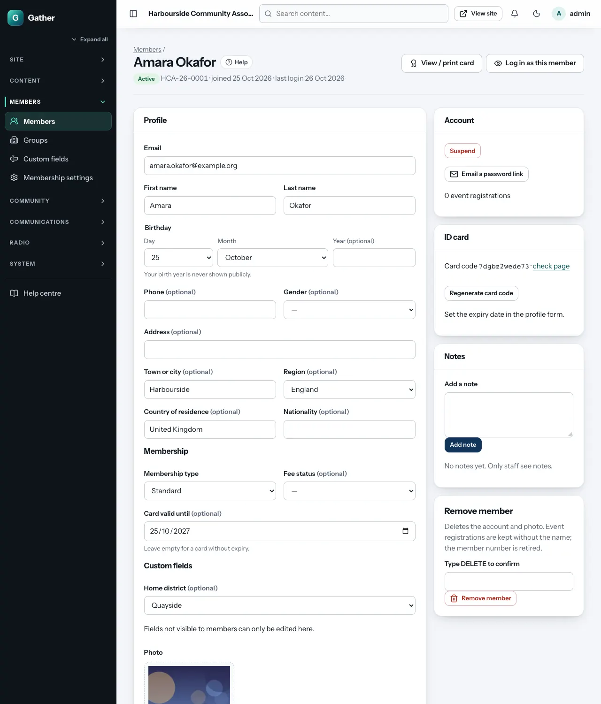

**Profile**: email, name, birthday (the year is optional and never shown
publicly), phone, gender, address, the **location fields** (country of
residence → region/state → town or city, nationality, and origin when it is
switched on, see [Location fields](#location-fields)), and the **Custom
fields** (including ones only admins can see). For members who joined
before the location lists existed, a line under the location fields shows
anything they had typed that did not match the lists, so you can pick the
right entry.

**Membership**:

- **Membership type**: from your list in Membership settings.
- **Fee status**: **free**, **due**, **paid** or **waived**, for your own
  records. Gather takes no payments.
- **Card valid until**: the expiry date printed on the card. Leave it empty
  for a card that never expires. To renew someone, set a new date.

**Photo**: replace the member's photo (cropped to a square).

Click **Save member** after changes.

**Account** (right-hand side):

- **Mark email as verified**: for someone who cannot receive the email (they
  then get their number straight away).
- **Suspend** / **Reactivate**: a suspended member cannot log in.
- **Email a password link**: sends a link to set a new password.

**Log in as this member** (top right, only with the *Log in as a member*
permission): see the site as this member sees it, to help with a question.
See [Log in as a member](#log-in-as-a-member).

**ID card**: **View / print card** (top right), the **card code** and its
**check page**, and **Regenerate card code**. Do that if a card was lost:
the old card's QR code stops working.

**Notes**: private notes about the member, only visible to staff (for
example "Paid in cash at the AGM").

**Remove member**: type `DELETE` and click **Remove member**. This deletes the
account and photo. Event registrations are kept without the name, comments
show as "former member", and the member number is retired (never given to
anyone else).

### Deletion requests

Members can ask for their account to be deleted (My account → Your data).
Super admins get an email. The member's page shows a notice with the date,
and the list's status filter **Deletion requested** finds them. Check
there is no reason to keep the data, then use **Remove member**. UK GDPR
expects you to act within one month.

## Log in as a member

When a member says "I can't find my card" or "the page looks wrong", you can
look at the site through their eyes instead of guessing. You need the
**Log in as a member** permission (super admins always have it; see
[Users and roles](users-roles.md#roles-and-permissions)).

**Admin → Members** → the member → **Log in as this member** (or **Log in
as** in the member's row of the list). For a group account: **Admin →
Groups** → the group → **Log in as this group**.

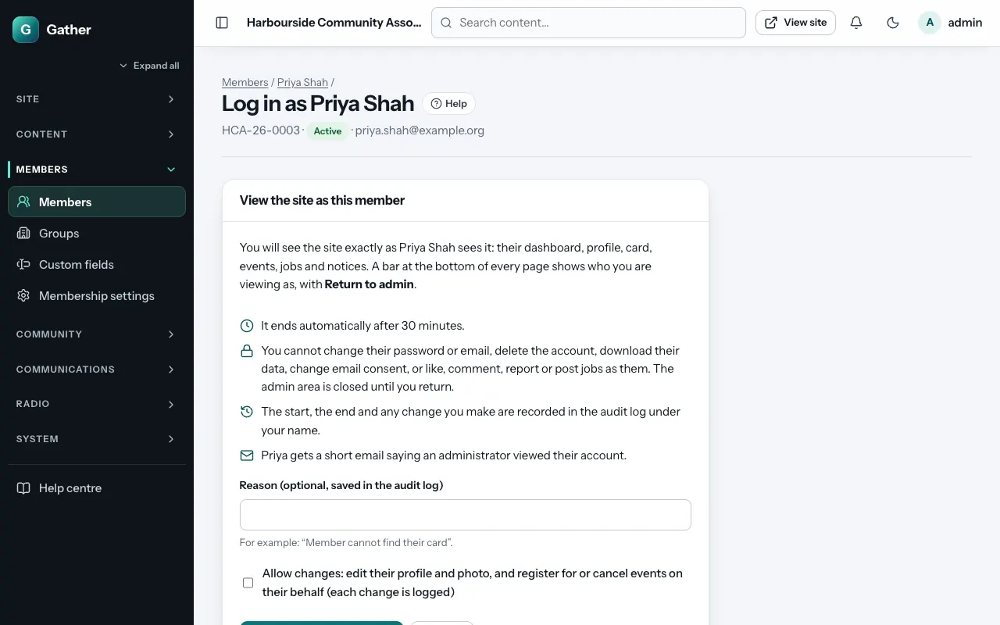

1. Read the summary of what you can and cannot do.
2. Optionally type a **Reason** (for example "Cannot find her card"). It is
   saved in the audit log.
3. Tick **Allow changes** only if you need to edit the member's profile or
   photo, or register them for (or cancel) an event on their behalf. Leave
   it unticked to look without touching anything.
4. For a **suspended** account, or one that has **not verified its email
   yet**, Gather shows a warning; tick **I understand, view this account
   anyway** to continue.
5. Click **Log in as this member**. You land on the member's dashboard.

While you view the site as the member, a black and yellow bar at the bottom
of every page says **You are viewing as** *name (member number)*, whether
changes are allowed, and when it ends. Click **Return to admin** in that bar
when you are done: you go back to the member's page in the admin area.

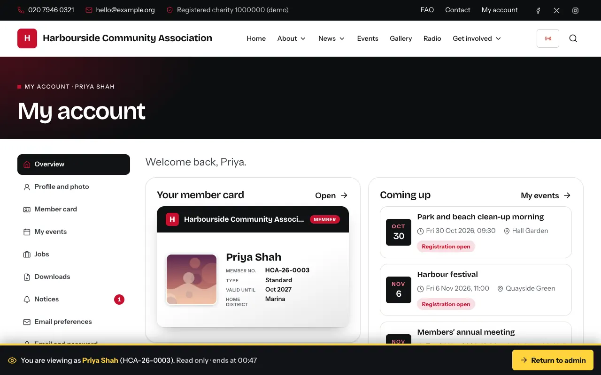

**What you can do**: everything a member can see, such as the dashboard,
profile, member card, events, the job board, notices and downloads.

**What is blocked** (you get a message explaining why):

- changing the member's password or email address, deleting the account or
  asking for it to be deleted, downloading their data;
- email preferences, the news opt-in and unsubscribing;
- liking, commenting, reporting and posting or editing jobs as the member;
- the whole admin area, until you click **Return to admin**;
- profile and photo changes and event registrations, unless you ticked
  **Allow changes**.

**Safety rules**:

- It **ends automatically after 30 minutes**. Start again if you need more
  time.
- Only member and group accounts can be viewed. Admin accounts never can
  (the screen then only says the account cannot be viewed). The member's
  email address is shown on the confirmation screen only to admins who
  also have the *Members and groups* permission.
- You cannot view a second member at the same time: return to admin first.
- **Log out** while viewing as a member logs you out completely.
- If your own admin session ends in the meantime (your password was changed
  elsewhere, you were suspended, or a super admin removed your access), the
  member view ends too and you are logged out. If only the permission was
  removed, you go back to the admin area (to the member's page if you can
  still open it, otherwise to the overview).
- The **start**, the **end** (with how many minutes it lasted) and **every
  change** you make are in the [audit log](audit-log.md) under your name,
  marked *as* the member.
- The member gets a short email saying an administrator viewed their
  account. A super admin can switch this off under **Site settings → Help
  and member support**; the wording is the email template **An administrator
  viewed your account** (see [Email templates](email-templates.md)). It is
  sent even to an address that bounced before, and the audit log records
  whether it was sent (*sent*, *off*, or *failed*, in which case Gather
  retries it like other emails).

## ID cards

Every active member has a digital card with their photo, name, number,
membership type, valid-until date, two extra lines (location lines chosen
in Membership settings, then custom fields marked "show on the card"), your
logo, your contact details, a signature, and a **QR code**.

Scanning the QR code opens a check page on your site showing **Valid**,
**Expired** or **Not valid**, with the member's name and photo only. Show
door volunteers how it works.

Members download or print their own card from their account. See the
[member guide](../member-guide.md#your-member-card).

### Printing cards

**Print selected cards** (or **Print all filtered cards**) opens a print
page with A4 sheets of eight cards: first a sheet of **fronts**, then a sheet
of **backs** with the columns swapped, so double-sided printing lines up.
Use your browser's **Print** (or **Save as PDF**), at 100 % size, on card
stock. Each card is the size of a standard ID card (85.6 × 54 mm).

## Birthdays

**Admin → Members → Birthdays** (members permission) lists every active
member's birthday for one month: the day, name and member number, with a
**Send a message** button and a link to the member's page. Pick another
month with the **Month** list. **Export CSV** downloads the same list (name,
member number, day, month). The birth year and age are never shown or
exported.

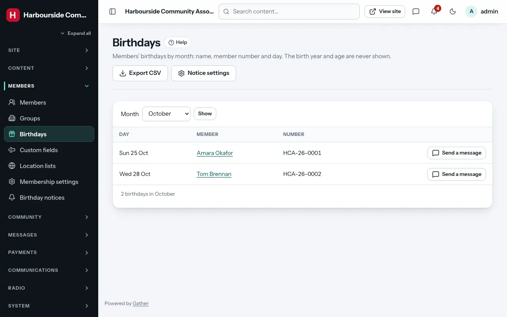 Members born on 29 February appear on 28 February in years that
are not leap years.

The **Birthdays** card on the admin overview has three tabs, **Today**,
**This week** (Monday to Sunday) and **This month**, with the number of
birthdays in each tab's label. People who receive the birthday notices also
see "N birthdays today" in the bell at the top of every admin page.

## Birthday notices

**Admin → Members → Birthday notices** (*super admin*) chooses the emails
that remind admins about birthdays. They are sent at the birthday hour
(**Email settings → Birthday emails at**, 07:00 by default, site time):

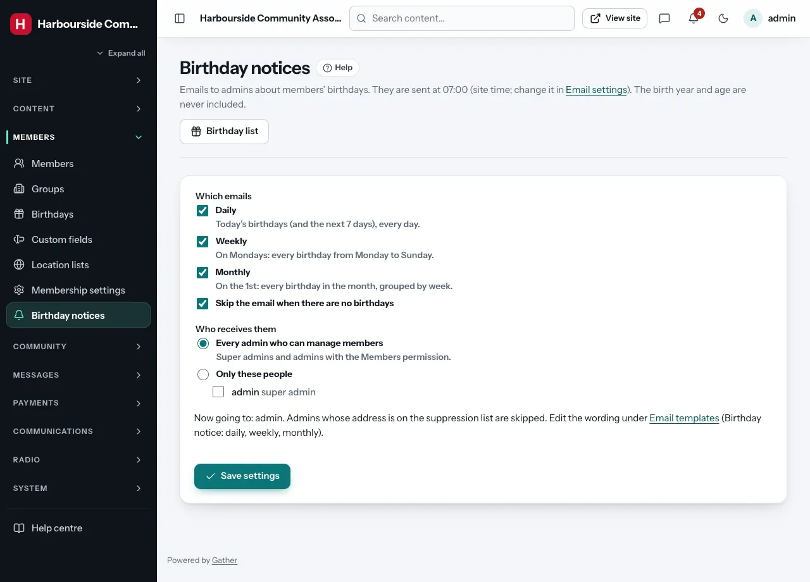

| Email | When | What it lists |
|---|---|---|
| **Daily** | every day | today's birthdays, then the next 7 days |
| **Weekly** | on Mondays | every birthday from Monday to Sunday |
| **Monthly** | on the 1st | every birthday in the month, grouped by week |

All three are on by default. **Skip the email when there are no birthdays**
(on by default) avoids empty emails. Each line shows the name, member
number and day (with a note for 29 February) plus links to the member's
admin page and to **Send a message**. The birth year and age are never
included.

**Who receives them**: **Every admin who can manage members** (super admins
and admins with the members permission; the default) or **Only these
people** (tick some of them). Only people who can see members' details
are offered, and someone who loses the members permission stops getting
the emails. Admins whose address is on
the suppression list (bounced, complained or unsubscribed) are skipped.

Each person gets at most one daily email per day, one weekly email per week
and one monthly email per month, even if cron runs twice. The emails go
through the email queue like other notices. Change the wording under
**Email templates** (**Birthday notice: daily / weekly / monthly**).
Members' own birthday greetings are separate: each member switches them on
or off in their email preferences.

## Membership settings

*Super admins only.*

**Admin → Membership settings**:

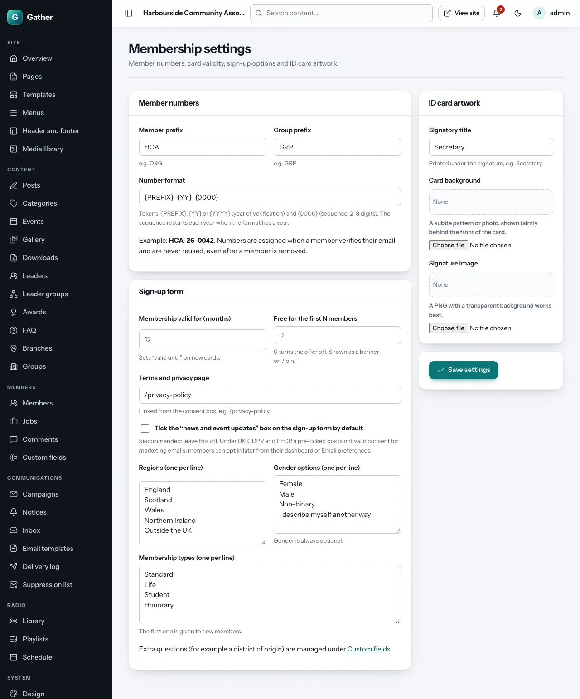

**Member numbers**

- **Member prefix** (for example `HCA`) and **Group prefix** (for example
  `GRP`).
- **Number format**: built from **{PREFIX}**, **{YY}** or **{YYYY}** (the year
  of verification) and **{0000}** (the running number, 2–8 digits). The
  example underneath updates as you type. With a year in the format, the
  count restarts each year (`HCA-26-0001`, then `HCA-27-0001`).
- Numbers are given out when a member verifies their email and are
  **never reused**, even after a member is removed.

**Sign-up form**

- **Membership valid for (months)**: sets "valid until" on new cards.
- **Free for the first N members**: shows a "free membership for the first N
  members" banner on the joining form and marks those members' fee status
  as free. 0 switches it off.
- **Terms and privacy page**: the link in the consent box (for example
  `/privacy-policy`).
- **Tick the "news and event updates" box by default**: leave this **off**.
  Under UK GDPR and PECR a pre-ticked box is not valid consent for marketing
  emails. Members can opt in later from their dashboard or email
  preferences.
- **Gender options** (gender is always optional) and **Membership types**,
  one per line. The first membership type is given to new members.
  (Regions are no longer a list you type: they come from the
  [location lists](#location-fields).)

**Origin on the sign-up form**

- **Ask where members are from**: adds a section with **Country → State →
  Local area**, for example "State of origin" and "LGA" for a Nigerian
  community. Off by default.
- **Heading of the section**, **Levels to ask** (country only; country and
  state; or all three), **Required** (optional, country, country and state,
  or every level).
- **Country**: *Any country* lets members choose; fixing one country (for
  example Nigeria) starts the section at its states.
- **Country label**, **State label** and **Local area label**: leave the
  state and local area labels empty to use the country's own words
  ("State of origin", "Local Government Area"), or type short forms such
  as "LGA".

**ID card artwork**

- **Signatory title**: printed under the signature (for example
  "Secretary").
- **Card background**: a faint pattern or photo behind the front of the card.
- **Signature image**: a PNG with a transparent background works best.
- **Location on the card (line 1 / line 2)**: any level of a member's
  location, for example *State of origin* or *Country of residence*. Two
  extra lines fit on the card: these come first, then custom fields marked
  "show on the card".

Click **Save settings**.

## Location fields

Countries, states/regions and local areas are chosen from lists instead of
typed, so they are spelled the same for everyone and you can filter and
email by them.

- **Where you live**: **Country of residence → Region/State → Town or
  city** (the town is typed).
- **Nationality**: a country.
- **Origin** (when switched on in Membership settings): **Country → State
  → Local area**.
- **Location custom fields**: the same lists for your own questions.

Choosing a country loads its states at once; choosing a state loads its
local areas. Long lists have a **Type to filter** box. When a country has no
list of states (or a state has no list of local areas), the field becomes a
box to type in. Without JavaScript the form still works: members press
**Update the lists** after choosing a country and the page comes back with
the next list.

The names of the levels follow the country: **State / Local Government
Area** for Nigeria, **Nation / County** for the United Kingdom, **State /
County** for the United States, and **Region / Area** where no local term
is set. You can rename them under [Location lists](#location-lists).

**Suggested country**: the joining form puts a likely country at the top
of the list under **Suggested**, guessed only from the visitor's own device
(its time zone and language settings) or a country header added by your
hosting's CDN (for example Cloudflare). Gather never looks up IP addresses.
When two of these hints agree and the form is still empty, the country of
residence is filled in with a note "We guessed … from your device
settings. Change it if that is wrong."

The lists come from [GeoNames](https://www.geonames.org/) (CC BY 4.0). Nigeria
has all 36 states plus the Federal Capital Territory and all 774 Local
Government Areas.

### Members who joined before the location lists

When the site was updated, what members had typed for nationality, country,
region and city was matched against the lists ("UK" and "Great Britain"
became United Kingdom, "Nigerian" became Nigeria, "Lagos State" became
Lagos). Anything that did not match was kept exactly as typed, and the
member's page shows the original values, so nothing was lost. Those members
pick the right entry the next time they edit their profile (or you can do
it for them).

## Location lists

*Super admins only.* **Admin → Location lists**.

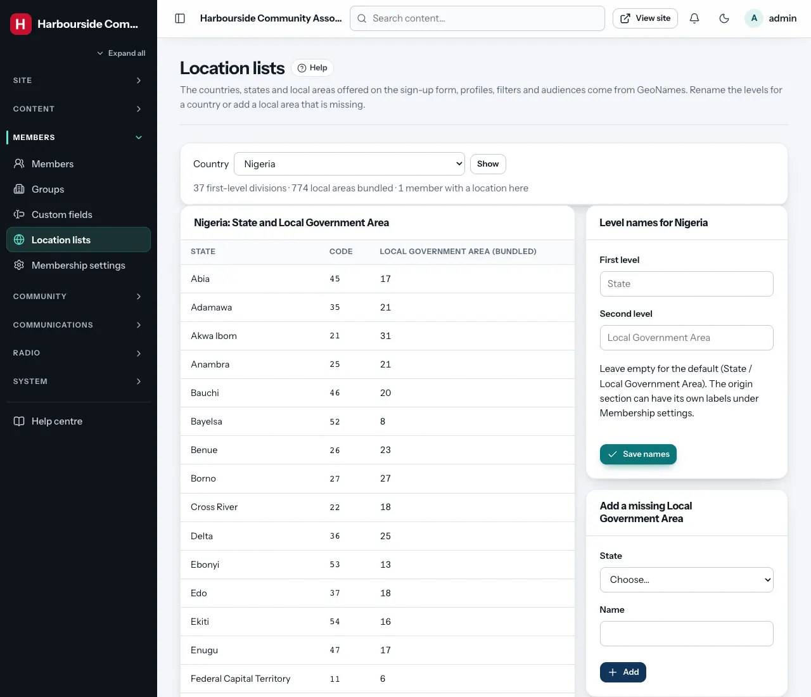

- Choose a **country** and **Show** to see its first-level divisions and
  how many local areas each has.
- **Level names**: rename the two levels for that country (for example
  "LGA" instead of "Local Government Area"). Leave them empty for the
  defaults.
- **Add a missing local area**: choose the state and type the name. It is
  offered on every form straight away. Added areas can be removed while no
  member has chosen them.

## Custom fields

*Super admins only.*

Extra questions on the joining form and member profiles, for example
"District of origin", "Year of graduation" or "Volunteer skills".

**Admin → Custom fields → New field**:

- **Label**: the question.
- **Type**: **Text**, **Choice from a list** (type the **Choices**, one per
  line), **Date**, **Tick box** or **Location** (country → state → local
  area from the [location lists](#location-fields)).
- **Location settings** (for the Location type): **Levels** (country only;
  country and state; or all three), **Country** (*Any country*, or fix one
  so the field starts at its states), the labels, and what the **member
  card** shows (everything, or just the country, state or local area).
  Location fields are for members, not group accounts.
- **Changing an existing field to Location** converts the answers already
  given: an answer that matches a name in the list (for example "Ekiti" in
  a "State of origin" choice field with Nigeria fixed) gets its code; any
  other answer is kept as typed. The confirmation tells you how many
  matched.
- **Asked of**: **Members** or **Group accounts**.
- **Required**.
- **Visible to members**: asked at sign-up and editable on their profile.
  Untick for admin-only fields (for example "Committee notes" or
  "Gift Aid declared").
- **Show on the member card**: up to two fields fit.
- **Order**.

**Delete field** removes the field *and every answer* members gave.

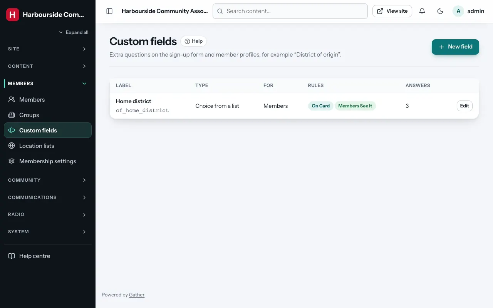

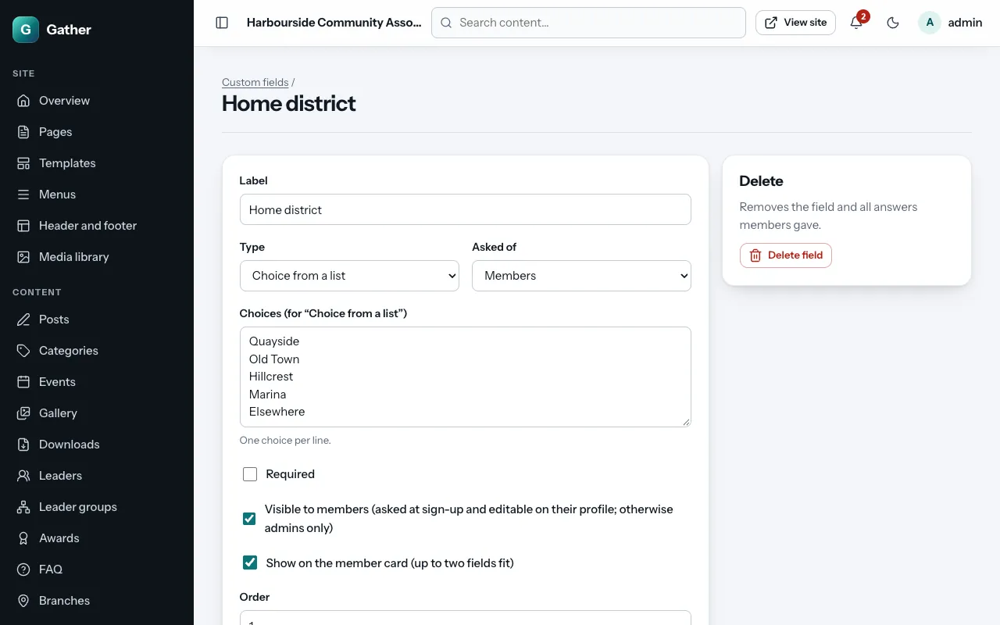

Custom fields can be used to filter the members list and to choose a
campaign audience ("Members with a custom field value"; Location fields
use **Filter by location** and the "Members by location" audience).

## Exporting members

**Members → Export CSV** downloads the list (following the current
filters) as a spreadsheet: member number, email, names, phone, birthday,
gender, address, the location columns (`nationality_code`, `nationality`,
`country_code`, `country`, `region_code`, `region`, `city`, and
`origin_country_code`, `origin_country`, `origin_state_code`,
`origin_state`, `origin_area_code`, `origin_area`), membership type,
status, card valid until, joined date, and one column per custom field
(`cf_…`; Location fields add `cf_…_code`, for example `NG.54.2595346`).

The file contains personal data: store it safely and delete it when you
no longer need it. (Values that could be read as spreadsheet formulas are
made safe.)

## Importing members from a spreadsheet

**Members → Import CSV**:

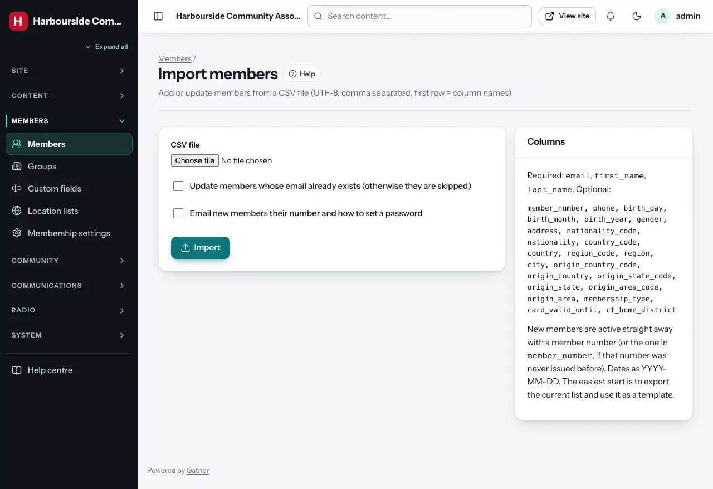

1. Prepare a CSV file (UTF-8, comma separated, first row = column names).
   The easiest start is to **export** the current list and use it as a
   template.
   - Required columns: `email`, `first_name`, `last_name`.
   - Optional: `member_number`, `phone`, `birth_day`, `birth_month`,
     `birth_year`, `gender`, `address`, the location columns listed under
     [Exporting members](#exporting-members), `membership_type`,
     `card_valid_until`, and `cf_…` for custom fields. Dates as
     `YYYY-MM-DD`.
   - Locations: a code column (`country_code`, `region_code`…) wins;
     otherwise names are matched like the update did ("UK", "Lagos State",
     "Nigerian"). A name that is not in the list for that country is
     reported and the row skipped. In update mode, only the levels the file
     has are changed: a file with just a `city` column keeps each member's
     country and region.
2. Choose the file. Options:
   - **Update members whose email already exists** (otherwise those rows are
     skipped).
   - **Email new members their number and how to set a password**.
3. **Import**.

Imported members are **active** straight away with a member number (the one
in `member_number` if that number was never issued before, otherwise a new
one). Up to 5,000 rows at a time. Afterwards you see how many were created,
updated and skipped, with the reason for each skipped row (for example an
email domain that cannot receive mail).

Imported members have no password yet. They set one with the welcome email's
link, or with **Forgotten your password?** on the login page.
