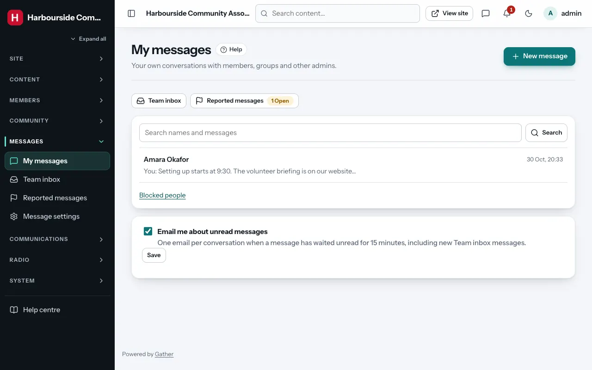
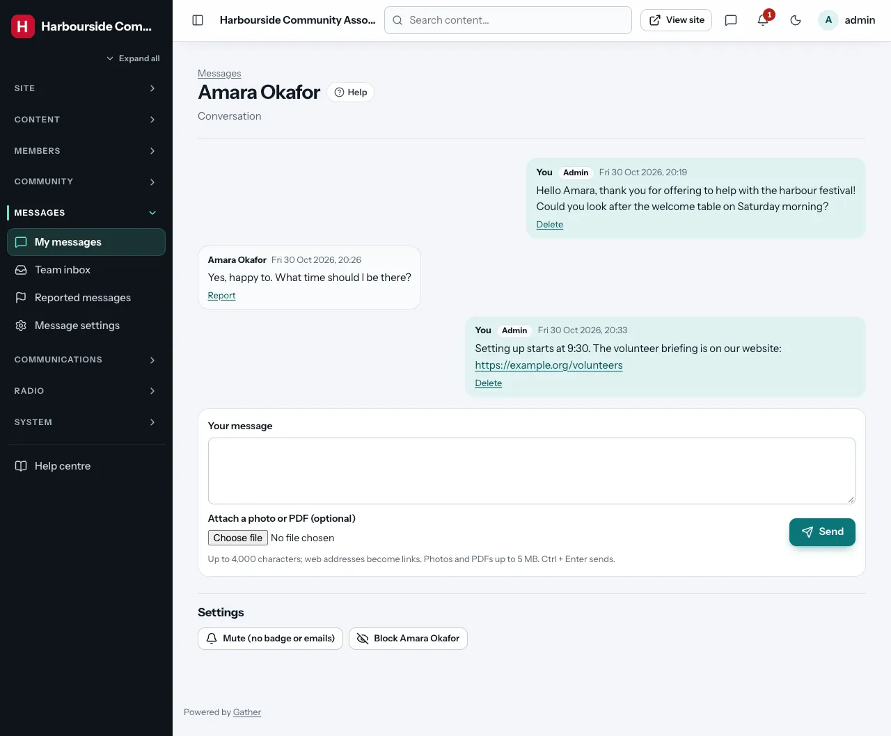
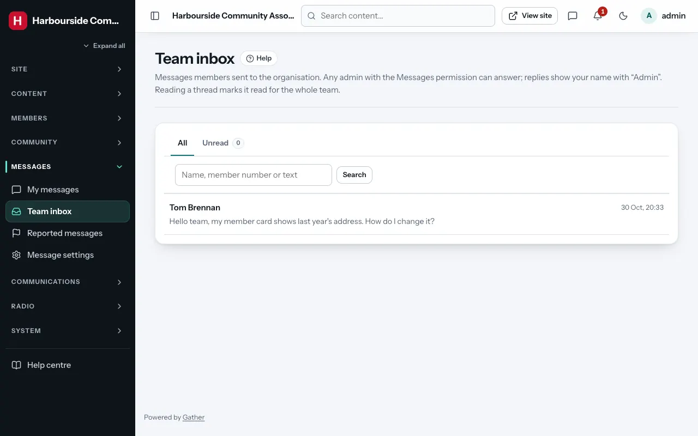
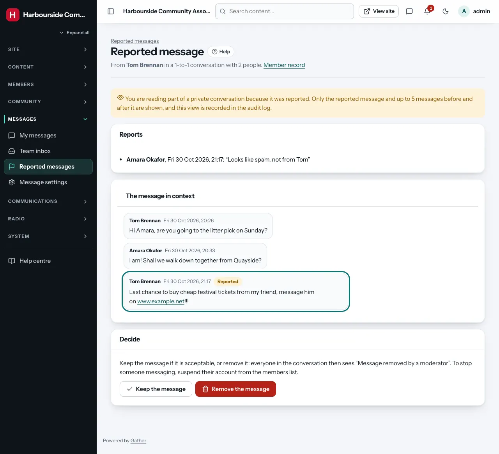

# Messages, Team inbox and reported messages

Members and admins can send each other private messages on the website:
one-to-one, in small groups, or in announcement groups where only admins
post. Members can also write to **the team**, a shared inbox any admin with
the **Messages** permission can answer.

Messages are not chat in the strict sense: the open conversation checks for
new messages about every ten seconds, so it works on any shared hosting
(nothing extra to install). Everything also works without JavaScript; the
page then reloads after each action.

## Your own messages

**Admin → Messages → My messages** lists your conversations, newest first,
with unread counts and the start of the last message. The speech-bubble
icon in the top bar shows how many messages are waiting for you (plus
unread Team inbox threads if you answer the Team inbox); it refreshes every
minute.

- **New message**: search for people by name or member number and tick
  them. Admins can message any member, group or other admin.
- One person = a one-to-one conversation (writing to the same person later
  continues it). Several people = a **group** (up to 20 people including
  you), which needs a name.
- **Announcement group**: tick **Only admins can post** for a larger group
  (up to 5,000 people) where members can read and leave but not reply. Tick
  **Add every active member and group** to include everyone.
- Messages are plain text (up to 4,000 characters, web addresses become
  links). You can attach one photo (JPG, PNG, WebP, GIF) or PDF up to 5 MB.
  Attachments are private: only the people in the conversation can open
  them. They never appear in the media library.
- **Edit** your message within 15 minutes; **Delete** it at any time (the
  others then see "Message deleted").
- In groups you created (and in any group you are in as an admin) you can
  **Add people** and **Remove** them. **Leave conversation** takes you out;
  if the group's creator leaves, the longest-standing member takes over.
- **Mute** stops the badge count and emails for one conversation.

**Email me about unread messages** (under the list) sends you an email when
a message has waited unread for 15 minutes: one email per conversation, not
one per message. Untick it to stop these emails.

Every message you send or change as an admin is recorded in the
[audit log](audit-log.md) (without the text).

## Team inbox

Permission: **messages**.

When a member chooses **Message the team**, the conversation appears in
**Messages → Team inbox**. Each member has one ongoing team thread. Any
admin with the Messages permission can open it and **Reply as the team**:
the member sees your name with an "Admin" label.

- Opening a thread marks it read **for the whole team**, so two people do
  not answer the same question; **Unread** shows threads nobody has read.
- New team messages are counted in the top-bar badge and on the dashboard
  under **Needs attention**.
- Admins who answer the Team inbox get an email about new team messages
  after 15 minutes (unless they switched **Email me about unread messages**
  off).
- **Member record** next to the title opens the member's page (with the
  Members permission).

## Reported messages

Permission: **messages**.

Members can **Report** a message they received. Reports go to **Messages →
Reported messages** (reported comments stay under [Comments and
reports](comments.md)).

Admins cannot read other people's private conversations. The only
exception is a reported message: **Review** shows the report reasons, the
reported message and up to five messages before and after it, nothing more.
Every time an admin opens a report, the [audit log](audit-log.md) records
who read it and when.

Then decide:

- **Keep the message**: the reports are closed and nothing changes.
- **Remove the message**: everyone in the conversation sees "Message removed
  by a moderator", and any attachment is deleted.

To stop someone messaging altogether, suspend their account from
[Members](members.md).

## Message settings

*(super admin)* **Messages → Message settings**:

| Setting | What it does |
|---|---|
| **Members can message each other** | On by default. When off, members can still message the team and the listed admins. |
| **Team inbox** | On by default. Members can write to "the team". When off, members cannot start new team threads (existing ones can still be answered). |
| **Admins members can message by name** | Tick admins who should appear when members search (for example the membership secretary). Unticked admins are not listed for members, but can still message members and members can reply. |
| **Delete messages older than** | Empty (default) keeps messages forever. A number of months deletes older messages and their attachments every night. |

## Rules that always apply

- Only verified (active) members and groups can send messages.
- During their **first 24 hours** after verifying, new members can only
  message the team and the listed admins.
- Members can send at most **30 messages in 10 minutes** and start at most
  **10 new conversations a day**; admins have no limit.
- A member can **block** another member or group: the blocked person cannot
  message them or add them to a group, and their one-to-one conversation is
  hidden. Admins cannot be blocked.
- When an admin uses [Log in as a member](members.md#log-in-as-a-member),
  the member's messages are **read-only**: the admin can read them (each
  view is in the audit log) but cannot send, edit, delete, report, block or
  leave anything, even with "allow changes".
- A member's [data export](members.md) includes the messages they sent.
  When an account is deleted, its messages lose their content and show as
  "Former member · Message deleted".
