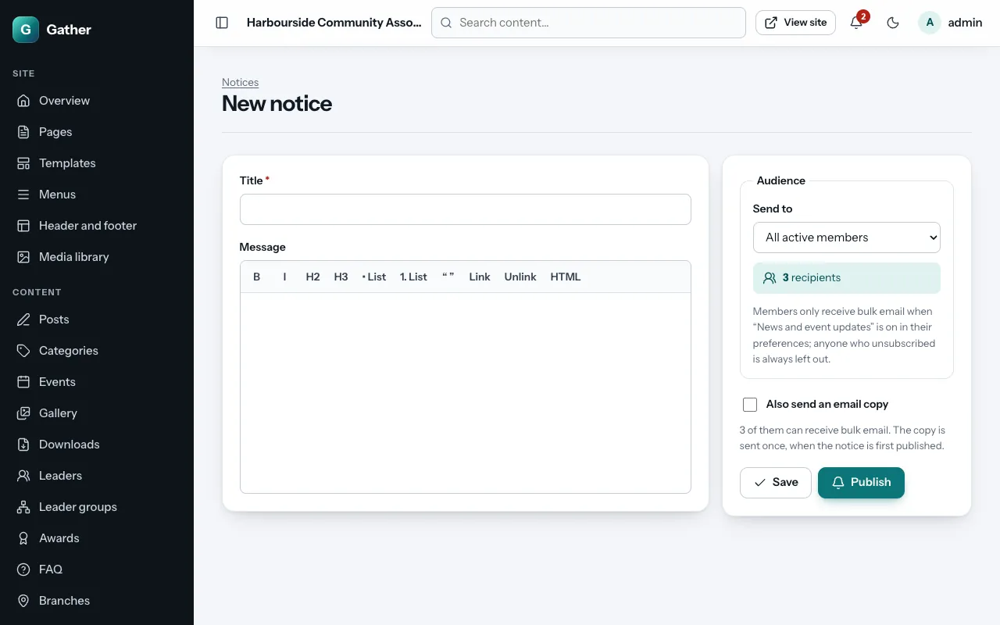
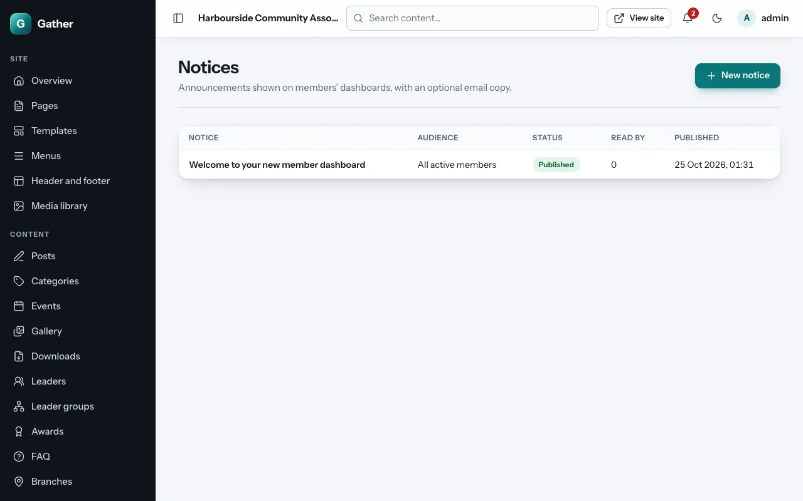

# Notices

Permission: **communications**.

A **notice** is an announcement shown on members' dashboards, for example
"The hall is closed on Monday" or "Nominations for the committee are open".
You can also send it as an email.

Notices vs campaigns: a notice lives on the site and members see it when
they log in (with an unread badge); a [campaign](campaigns.md) is a designed
email newsletter. For important news, use both.

## Writing a notice

**Admin → Notices → New notice**:

- **Title**.
- **Message**: formatted text with links.
- **Audience**: who sees it (all active members, one membership type,
  members by location (for example everyone whose state of origin is
  Ekiti), members with a custom field value, people registered for an event,
  group accounts, admins…). The number of recipients is shown.
- **Also send an email copy**: emails the notice to the audience once, when
  you first publish it. It respects people's email preferences and the
  suppression list.
- **Save** keeps it as a draft; **Publish** shows it to members (and sends
  the email copy if ticked). **Take down** removes it from dashboards again.

## Seeing who read it

**Admin → Notices** shows each notice's audience, status, publication date
and **Read by** (how many members have read it). A notice counts as read
when it has been on a member's screen for a moment, or when they click
**Mark as read**.

## What members see

The **Notices** card on their dashboard shows unread notices, and the
**Notices** page in their account lists them all with **Mark as read** and
**Mark all as read**. See the [member guide](../member-guide.md#notices).
