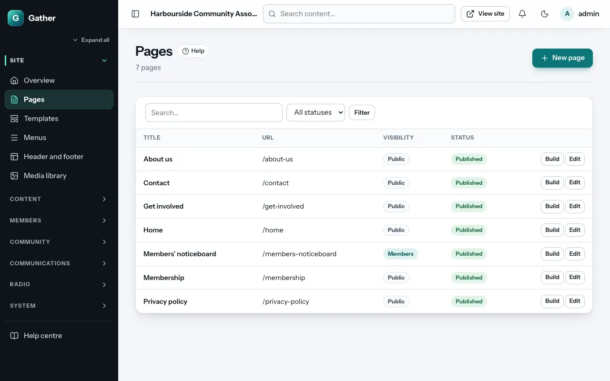
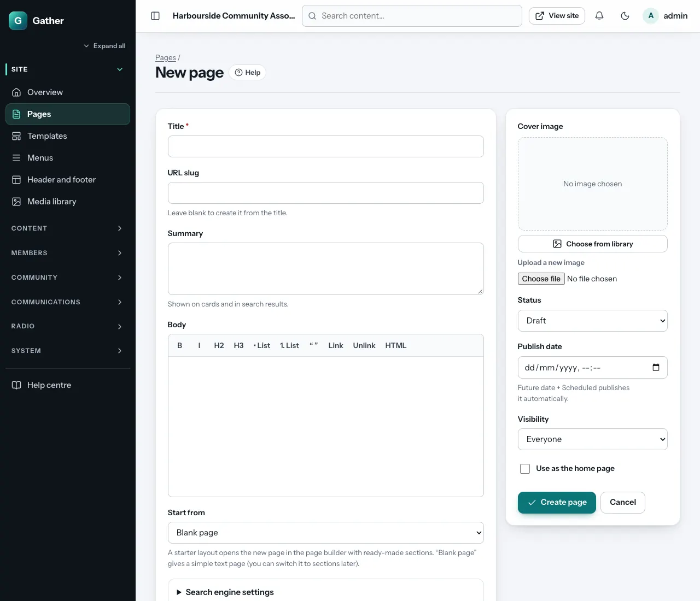
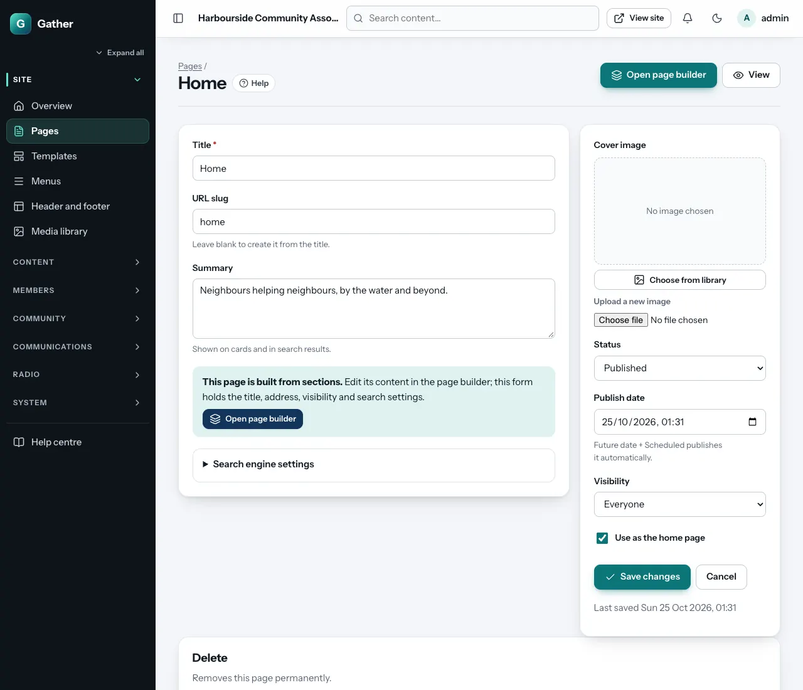
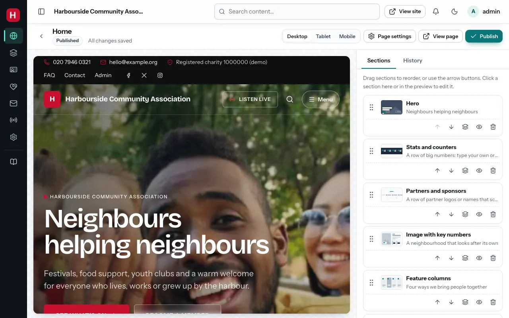
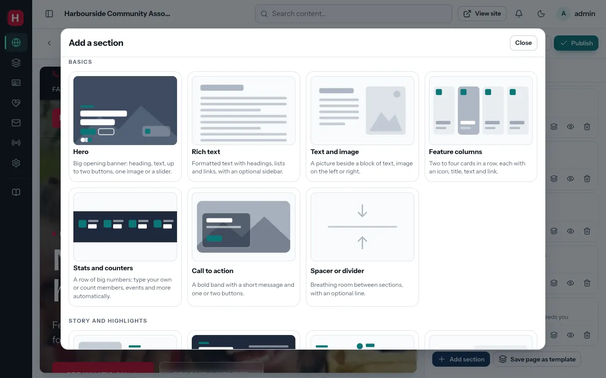
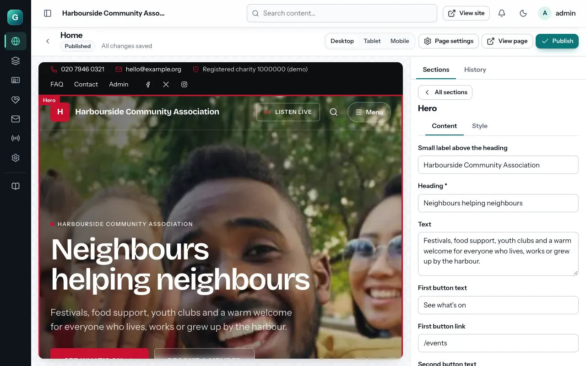
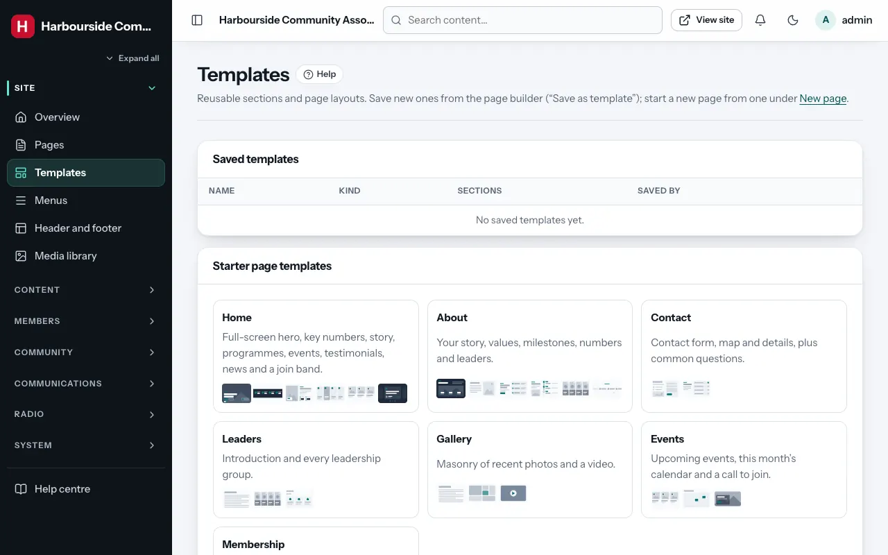

# Pages and the page builder

Permission: **pages and menus**.

Pages are the fixed parts of your site: Home, About, Contact, Membership and
so on. (News, events and the gallery have their own screens.) Most pages are
built from **sections**, ready-made blocks such as a photo banner, a row of
numbers or a list of upcoming events, which you stack in any order in the
**page builder**.

## The pages list

**Admin → Pages** lists every page with its status. Each row has two
buttons:

- **Build**: open the page builder to edit the page's content.
- **Edit**: the page's settings (title, web address, visibility, search engine
  text).

## Creating a page

**Admin → Pages → New page**:

1. **Title**: for example "Volunteer with us".
2. **URL slug**: the last part of the web address (`/volunteer-with-us`).
   Leave it empty to make it from the title.
3. **Start from**:
   - a **Starter** layout, a page of ready-made sections you then adjust:
     **Home**, **About**, **Contact**, **Leaders**, **Gallery**, **Events**
     or **Membership**;
   - one of your own **saved templates**;
   - **Blank page**: a simple text page with a text editor (you can switch to
     sections later with **Build with sections**; the text you wrote becomes
     the first section).
4. **Status**: **Draft** (only admins see it), **Published**, or
   **Scheduled** with a future **Publish date**.
5. **Visibility**: **Everyone**, **Members only** (others are asked to log in)
   or **Hidden (staff only)**.
6. **Create page**. A starter layout opens straight in the page builder.

### Page settings

Open a page's **Edit** screen for:

- **Title**, **URL slug**, **Summary** (shown in search results),
  **Cover image**.
- **Status**, **Publish date**, **Visibility**.
- **Use as the home page**: makes this page the front page of the site.
  Only one page can be the home page.
- **Search engine settings**: an **SEO title** and **SEO description** for
  Google and social sharing (optional; otherwise the title and summary are
  used).
- **Delete page**, at the bottom.

## The page builder

Click **Build** on a page. On the left is a live preview of the real page;
on the right, the list of its sections.

**Top bar**:

- **Desktop / Tablet / Mobile**: preview the page at that width.
- **Page settings**: the page's Edit screen.
- **View page**: the live page in a new tab.
- **Publish**: makes your changes live for visitors.

### Saving and publishing

- Every change is **saved automatically** as a draft. The top bar says
  "All changes saved".
- Visitors keep seeing the last **published** version until you click
  **Publish**. A yellow **Changes not published** label reminds you.
- If someone else edits the same page at the same time, Gather stops and
  tells you who changed it and when. Click **Reload** to see their version
  before carrying on, so nobody's work is overwritten.

### Working with sections

- **Add a section**: **Add section** at the bottom of the list opens the
  picker (below). The new section goes under the section you last selected
  (or at the end), and its settings open straight away.
- **Edit a section**: click it in the list, or click it in the preview. Its
  settings open on the right, in two tabs:
  - **Content**: the words, pictures, buttons and choices for that section.
  - **Style**: see [Section style](#section-style).
  Click **All sections** to go back to the list.
- **Reorder**: drag a section by its handle (the dotted grip), or use the
  **up/down arrows**. On a touch screen, drag the handle with your finger.
  With a keyboard, focus the handle and use the arrow keys.
- **Duplicate** (the stacked-squares icon), **Hide** (the eye: the section
  stays in the builder but visitors do not see it) and **Delete** (the bin).
- **Save as template**: inside a section's settings, saves that section for
  reuse. **Save page as template** (under the list) saves the whole page. Use
  them via **New page → Start from**, or manage them under
  **Admin → Templates**.

### Pictures in sections

Fields for pictures have a **Choose image** button (**Choose video** for
videos) that opens the
[media library](media-library.md) so you can pick an image. Upload new
images under **Admin → Media library** first. Always fill in the image's alt text in the media library. Screen
readers read it aloud to blind visitors.

### History

The **History** tab lists the last 20 saved versions. **Preview** one to look
at it and **Restore** to bring it back. Restoring creates a new draft, so
nothing is lost, and you still need to **Publish**.

### Section style

Every section has the same **Style** tab:

| Setting | Choices |
|---|---|
| **Background** | **None**, **Soft tint**, **Brand colour**, **Dark** or **Image** (then choose a **Background image**) |
| **Spacing above and below** | **Compact**, **Normal**, **Roomy** |
| **Width** | **Contained** (a comfortable reading width) or **Full width** |
| **Anchor name** | Optional, for links that jump to this section: an anchor `volunteer` on the page `/about` can be linked as `/about#volunteer`. Lowercase letters, numbers and dashes |

Alternating **None** and **Soft tint** backgrounds is an easy way to make a
long page readable.

## Every section type

Many sections share the same fields:

- **Small label above the heading**: a short word or two in small capitals
  (for example "Get involved").
- **Heading** and **Intro text**.
- **Heading layout**: **Heading above the intro**, **Heading left, intro
  right**, or **Centred**.
- **Button text** and **Button link** (leave the text empty to hide the
  button); **Link text** and **Link address** for a "see all" link.
- **How many to show**.

Links can be a page on your site (`/events`, `/join`) or a full address
(`https://…`).

Under the reduced-motion setting on visitors' devices, sliders stop moving
by themselves and animations are switched off. Everything is still readable
without JavaScript.

### Basics

**Hero**: the big opening banner at the top of a page.
- Heading, text and up to two buttons.
- **Layout**: **Full-width photo behind the text**, **Text beside the image**,
  or **Centred text over the image**.
- **Height** (full-width layout): **Full screen**, **Tall** or **Fit the
  text**. **Darken the photo**: **Light**, **Medium** or **Strong** (for busy
  photos) keeps white text readable.
- **Images**: one image on its own, or two to six images that become a
  **slider** (with arrows, dots and swiping). **Move the slider on
  automatically** (pauses on hover). **Slow zoom on the photos**.
- **Background video (optional)**: a short, silent MP4 or WebM from the media
  library that loops behind the text.
- **Social proof line** with up to four small **faces** (for example "Join
  1,200 neighbours who already take part") and a number in the last circle
  ("+1k").
- **Floating card**: a small frosted card in the corner, with a title, text,
  link and icon, for example "Next up: Harbour festival".

**Rich text**: formatted text with headings, lists and links.
**Sidebar**: none, right or left, with its own heading and text.

**Text and image**: a picture beside a block of text. **Image position** left
or right, plus an optional button.

**Feature columns**: two to four cards in a row, each with an icon, title,
text and link. **Cards per row** 2, 3 or 4. **Card style**: **Cards with icon
tiles**, **Tall cards, photo appears on hover** (each card has a photo; on
phones it always shows), or **Minimal (no card)**.

**Stats and counters**: a row of big numbers. Type your own ("48 volunteers")
or let Gather count members, events and more automatically. **Layout**:
**Cards**, **Band with icon tiles**, or **Big numbers with accent rules**.
**Count up when scrolled into view** animates them.

**Call to action**: a bold band with a short message and one or two buttons.
**Style**: **Brand colour**, **Accent colour**, **Dark**, **Soft** or **Photo
with a glass panel** (then choose a photo).

**Spacer or divider**: space between sections (**Small**, **Medium**,
**Large**), optionally with a **Line** or **Three dots**.

### Story and highlights

**Image with key numbers**: a large photo beside a heading, text and a button,
with two to four key numbers. **Image position** left or right, and an optional
**floating number** on the photo ("48+ volunteers every week").

**Story with counters**: a dark band. Heading and story side by side, then
a wide rounded photo with counters over it.

**Process and timeline**: numbered steps ("1. Sign up, 2. Confirm your email,
3. Get your card"). **Layout**: **Vertical timeline** (fills in as visitors
scroll, with an optional photo beside it) or **Cards in a row**.

**Highlights list**: heading and text on one side, a list of short points in
soft rows on the other. **Markers**: **Dots**, **Ticks** or **Numbers**.

**Numbered showcase**: a heading that stays in place with an index beside
large numbered photo cards that stack as you scroll. Good for projects or
programmes.

**Testimonials**: quotes with name, role, photo and a star rating. **Layout**:
**Slider** or **Grid**.

**Membership or donation tiers**: two to four price cards, each with a list of
benefits (one per line) and a button. One can be **featured** as a dark card
with a badge (for example "Most popular").

**Partners and sponsors**: partner logos (or names with an icon when there is
no logo). **Display**: **Scrolling row** (loops slowly and pauses on hover;
**Scrolling speed** slow, normal or fast) or **Still grid**.

### Content

These sections fill themselves with your latest content, so you never have
to update them by hand.

**Latest posts**: the newest posts. **Posts from**: news, blog, projects or all.
**Layout**: **Grid of cards**, **Magazine (first post large)**, **Compact
list** or **Carousel (swipe sideways)**.

**Upcoming events**: the next events. **Layout**: **Photo cards with date
badges**, **List with date tiles** or **Two columns**. **Text when there are no
events** is shown when the calendar is empty.

**Event calendar**: this month's events as a calendar grid, linking to the
full calendar.

**Gallery**: photos from **One album** (choose the **Album**) or the **Latest
photos from all albums**. **Layout**: **Square grid**, **Mosaic (mixed
sizes)**, **Masonry (natural shapes)** or **Strip (swipe sideways)**.

**FAQ accordion**: questions that open to show the answer, from one
**Category** or all. **Layout**: heading beside or above the questions.

**Downloads list**: documents to download, from one **Category** or all.
Members-only files show a lock.

### Community

**Leaders**: the people in one leadership **Group** (for example the
executive committee), as **Photo cards** or a **Compact list**.

**Awards**: award winners by year: the latest year, all years, or one
**Year**.

**Branches or groups**: a directory of your **Branches** or **Affiliated
groups**, as **Cards with details** or **Names only**.

**Birthday celebrants**: members celebrating **Today** or **This week** (only
those who chose to appear; first name and last initial, never their age).
**Hide the section when nobody is celebrating**, or show a text instead.

**Radio player**: the live radio player, as a **Compact bar** or **Full
player**. See [Radio](radio.md).

### Contact & embeds

**Donate**: how to give. **Use the bank details and links from Site
settings**, or type different **Bank details** and **Donation buttons** for
this section.

**Contact**: the contact form, a map, and your address, phone and email (from
Site settings). Each part can be switched off. **Map location**: an address
or place name (empty = the address from Site settings). Messages go to the
[Inbox](inbox.md).

**Embed**: a **YouTube** or **Vimeo** video, a **Google Maps** map, a
**Facebook** page timeline, or a link card for an **X** profile. Paste the
link; other websites are not allowed, for safety. Fill in **Description for
screen readers**. **Shape**: **Widescreen 16:9**, **Standard 4:3**,
**Square** or **Tall (timelines)**.

## Templates

**Admin → Templates** lists your saved section and page templates (with
**Delete**) and the starter page templates that come with Gather. New
templates are made from the page builder with **Save as template** or
**Save page as template**.

## Tips

- Start new pages from a starter layout and delete what you do not need.
  That is quicker than building from nothing.
- Check every page with **Mobile** before publishing. Most visitors use
  phones.
- Use **Hide** instead of **Delete** for seasonal sections (for example the
  festival banner).
- Big photos: upload them once in the media library and set the
  [focal point](media-library.md#focal-points), so the important part stays
  visible on every screen.
