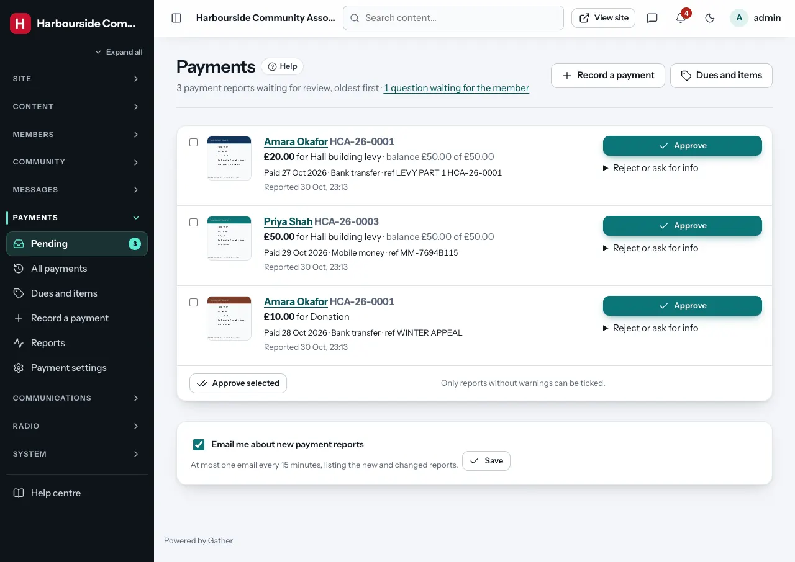
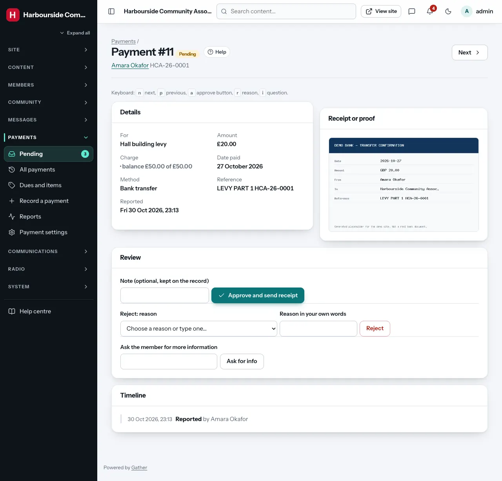
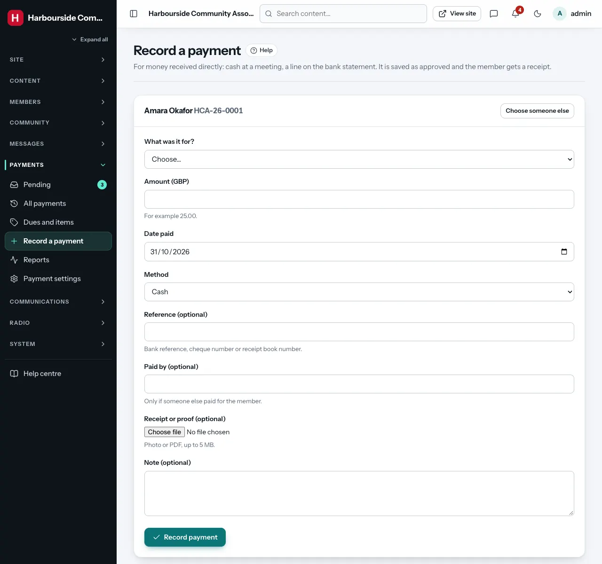
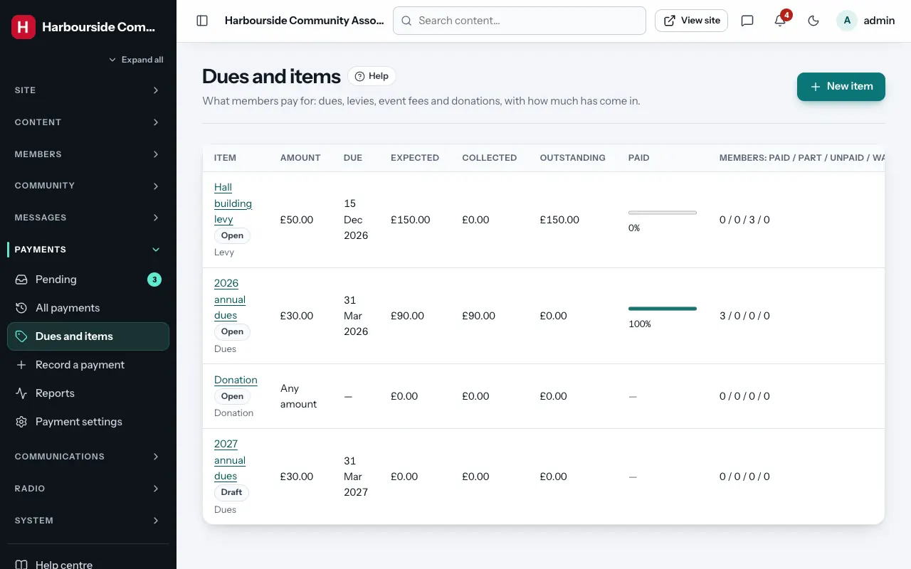
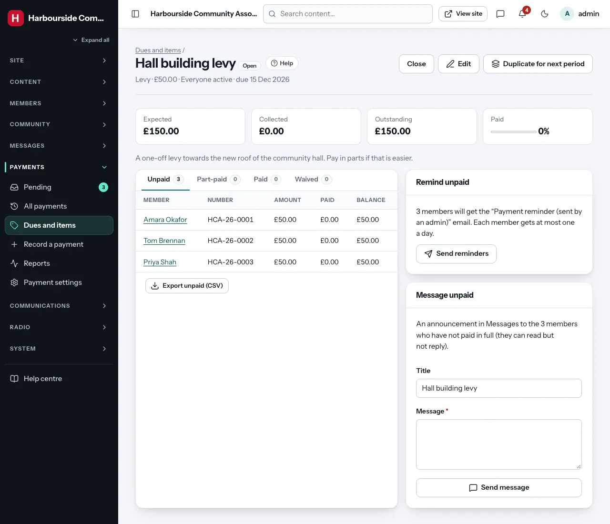
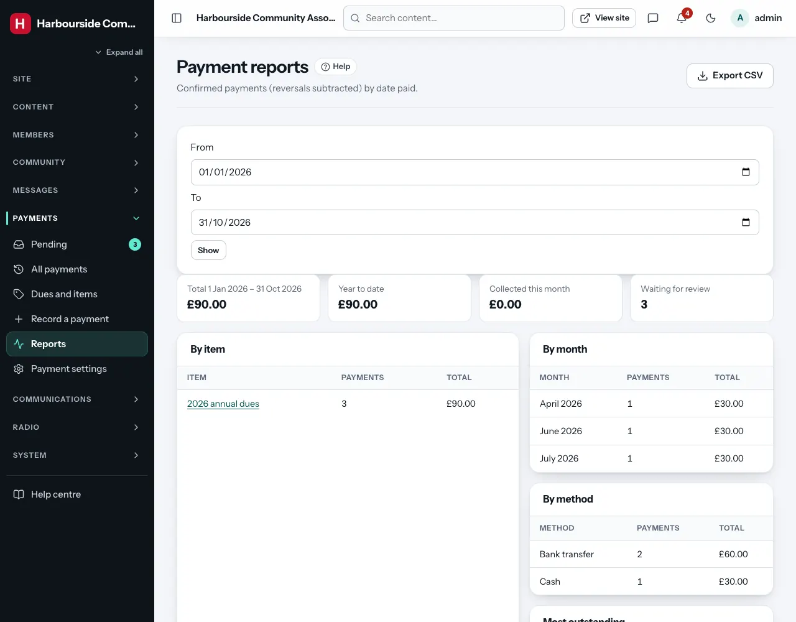
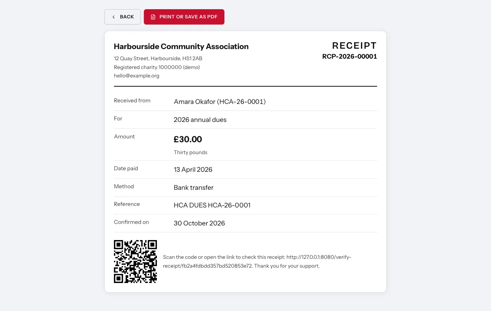
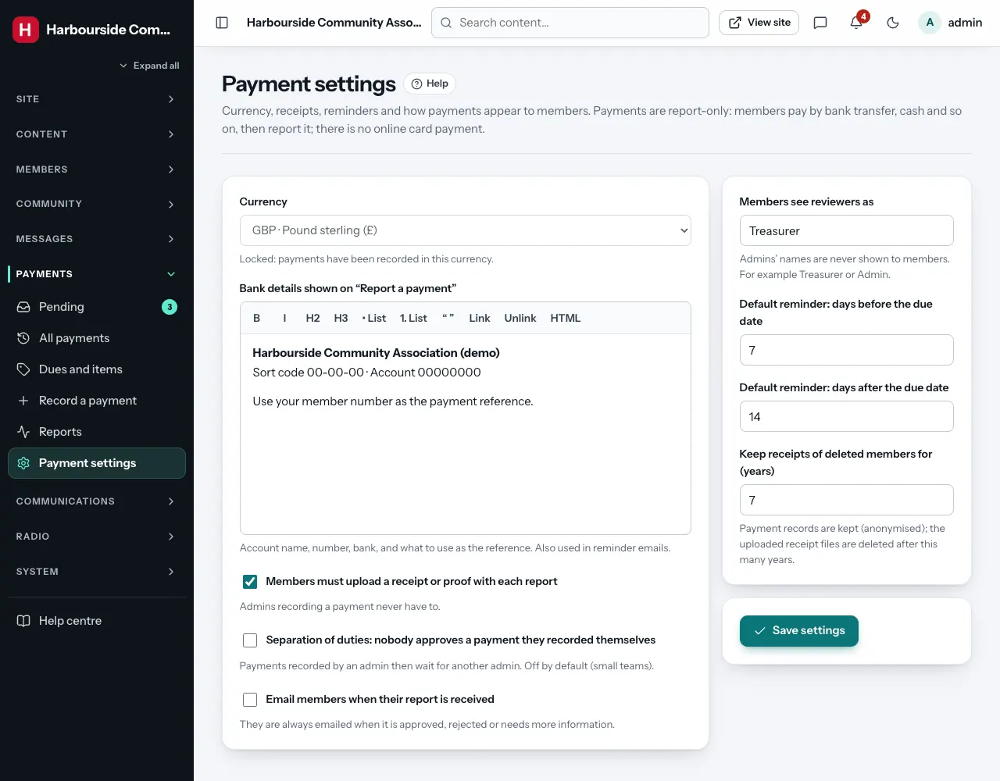

# Payments: dues, payment reports and receipts

Permission: **payments** (payment settings: *super admin*).

Gather keeps track of what members owe and what they have paid. It does
**not** take card payments online. Members pay the way they always have
(bank transfer, cash at a meeting, mobile money, a cheque...) and then
**report the payment** on the website with a photo or PDF of the receipt.
An admin checks it against the bank statement and **approves** it. The
member then gets a numbered receipt they can print.

In short:

1. Set the currency and your bank details once (**Payment settings**).
2. Create an item, for example "2027 annual dues", and **open** it. Every
   member it applies to now owes it.
3. Members report payments. You get a bell notification at once and an
   email (at most one every 15 minutes).
4. You approve, reject or ask a question. The member is emailed each time.
5. Watch the totals on the item's page and in **Reports**, and send
   reminders to people who have not paid.

## Pending payments

**Admin → Payments → Pending** lists reports waiting for review, oldest
first. The number also shows next to **Pending** in the menu and in the
bell. Each row shows the member, what the payment is for, the amount
against the balance still owed, the date, method and reference, a preview
of the receipt (a thumbnail, or a PDF icon that opens in a new tab), and
warnings:

- **Possible duplicate**: the member already has a pending or approved
  payment with the same reference, or the same amount on the same date
  for the same item.
- **More than the balance**: the amount is more than they still owe.

Actions on each row:

- **Approve**: the payment is confirmed, the balance goes down, a receipt
  number (`RCP-2026-00042`) is given and the member is emailed a link to
  the receipt.
- **Reject**: choose a reason from the list (for example "We could not find
  this payment in our bank account") or type one. The member is emailed the
  reason.
- **Ask for info**: type a question. The member is emailed. They answer by
  editing the payment (for example adding the reference or a clearer
  receipt), and it comes back to the pending list.

**Approve selected**: tick several reports and approve them in one go. Only
reports without warnings can be ticked. Look at the others one by one.

Click a member's name to open the **review screen**: the full details, a
large view of the receipt, the record's timeline and the actions. **Next**
and **Previous** move through the pending reports. Keyboard: `n` next,
`p` previous, `a` jumps to Approve, `r` to the reason, `i` to the question.

**Your emails**: untick **Email me about new payment reports** to stop the
emails for yourself. The bell still counts the reports.

### Separation of duties

Off by default, which suits small teams. When a super admin switches it on
(**Payment settings**), nobody can approve a payment they recorded
themselves. Payments an admin records then wait in the pending list for a
second admin.

## Recording a payment

**Admin → Payments → Record a payment** is for money that reached you
directly: cash collected at a meeting, or a line on the bank statement from
someone who did not report it.

1. Search for the member by name, member number or email and choose them.
2. Choose what it was for: one of their charges, another open item, or
   **Other** with a short description.
3. Enter the amount, date, method and (optional) reference, payer and
   receipt.

It is saved as approved with your name as **Recorded by**, and the member
is emailed their receipt. (With separation of duties on, it waits for
another admin.)

## Reversals: correcting a mistake

Approved payments are never edited or deleted, so the records always add
up. To correct one, open it and use **Reverse this payment** with a reason
(bounced transfer, entered twice, refunded...). Gather adds a linked
**reversal**: a negative entry for the same amount. The member's balance
goes back up, the item's totals go down, and the receipt shows "This
receipt is no longer valid" (the verification page says so too). If the
money did arrive in another way, record a new payment.

## All payments

**Admin → Payments → All payments** shows every record, newest first:
filter by status (including **Reversed** and **Reversal entries**), item,
method, dates paid, and **Reported by members** or **Recorded by admins**,
or search by reference, receipt number, member name or member number.
**Older** and **Newest** page through long lists.

**Export CSV** downloads the filtered list with the receipt number, member
number, name, item, amount, currency, date paid, method, reference,
status, reviewer and review time.

## Dues and items

**Admin → Payments → Dues and items** lists what members pay for, with
**expected**, **collected** and **outstanding** amounts, a bar with the
percentage collected, and how many members have paid, part-paid, not paid
or were let off (waived).

**New item**:

- **Name** and **Description** (members see both).
- **Kind**: dues, levy, event fee, donation or other.
- **Amount**: a fixed amount, or **Any amount** for optional items such as
  donations.
- **Applies to**:
  - **Everyone active**: every active member gets a charge.
  - **A membership type** (for example Student).
  - **Members in a location** (country, state, area of residence or
    origin).
  - **Chosen members**: add them one by one on the item's page.
  - **Nobody**: optional. Members choose it themselves when they report a
    payment (donations, a party ticket).
- **Due date** (optional), **Allow part payments** (on by default).
- **Also apply to people who join later**: new members get a charge when
  they verify their email (or are imported).
- **Counts as membership dues**: once a member has paid it in full, their
  **fee status** becomes Paid, and with **Covers until** their card's
  "valid until" date moves to that date.
- **Reminders**: see below.

New items are **drafts**. Check them, then **Open for payments**. Opening
creates the members' charges: the first 500 at once, the rest in batches of
500 every minute (the page shows the progress). Once opened, the amount
and "applies to" are fixed. To change what one person owes, use their
payments page. **Close** an item when you no longer take payments for it.

**Duplicate for next period** copies an item as a draft with the year in the
name and the dates moved on a year: the quickest way to set up next
year's dues.

### An item's page

Tabs **Unpaid**, **Part-paid**, **Paid** and **Waived** list the members,
with an export of each tab as a spreadsheet (CSV).

- **Remind unpaid** emails everyone who has not paid in full (the "Payment
  reminder (sent by an admin)" email template). The box says how many
  people will receive it. People whose address is on the suppression list
  are left out, and nobody gets more than one a day.
- **Message unpaid** sends an announcement in Messages to the same people
  (they can read it but not reply).
- **Add members** (items for chosen members only): search and tick.

### Reminders

Every item with a due date can remind members automatically: by default
**7 days before** and **14 days after** the due date. Only members who
still owe something get them, and each member gets at most one reminder
before and one after. Change the number of days per item, or the defaults
in **Payment settings**. Untick **Email reminders** on an item to stop them.
Reminders are sent at 09:00 (site time).

## A member's payments

On a member's page, **Payments** (shown to admins with the payments
permission) opens their payments page: the charges, what they have paid,
their records and a **Record a payment** button.

- **Change**, then **Change amount**: give one member a different amount
  (a concession, say). A reason is required and kept.
- **Waive**: let the member off what is left. A reason is required. Waived
  charges no longer count as outstanding. **Stop waiving** undoes it.
- **Add a charge**: add an open item the member does not have yet.

Every change is in the audit log and in the charge's history on this page.

## Reports

**Admin → Payments → Reports** shows the confirmed totals (reversals
subtracted) for a date range: **by item**, **by month** and **by method**,
plus the year to date, this month's total, what is waiting for review, and
the items with the most outstanding. **Export CSV** downloads the
figures. The admin overview has a **Payments** card with the same key
numbers.

## Receipts

Members open **View and print receipt** on an approved payment. The receipt
shows your organisation's name, logo and address, the receipt number, the
member's name and number, what it was for, the amount in figures and in
words, the date paid, method, reference, the date it was confirmed and a
**QR code**. Printing it, or saving it as a PDF from the print window, gives
a one-page document.

The QR code opens `/verify-receipt/<code>` on your site. That page only says
whether the receipt is valid, your organisation's name, the amount, the
date and the member's initials. It shows nothing else about the member.

## Payment settings

**Admin → Payments → Payment settings** *(super admin)*:

- **Currency**: one currency for the whole site, chosen when installing
  (Gather guesses it from your location, otherwise Nigerian naira). It can
  only change until the first payment is recorded.
- **Bank details** shown at the top of "Report a payment" and in reminder
  emails: account name, number, bank and the reference to use.
- **Members must upload a receipt** (on by default; admins recording a
  payment never have to).
- **Separation of duties** (off by default).
- **Email members when their report is received** (off by default).
- **Members see reviewers as**: admins' names are never shown to members.
  The timeline says "Treasurer" (or what you type here).
- **Default reminder days** before and after the due date.
- **Keep receipts of deleted members for (years)**: default 7.

## Privacy and deleted members

Members only ever see their own payments and receipts. Uploaded receipts
are private files: only the member and admins with the payments
permission can open them, and they never appear in the media library.
Members' data downloads include their charges and payment records.

When a member's account is deleted, their payment records **stay** for the
organisation's accounts, but their name is replaced with "Former member
#<number>" and any "paid by" name is removed. Reports still waiting for
review are withdrawn. Charges with nothing paid are removed, and other
balances are waived. The uploaded receipt files are deleted once the
retention period has passed.

## Checking the totals

Each item's expected, collected and outstanding amounts are kept up to date
whenever a payment is approved or reversed. **System health** checks them
against the payment records under **Payments → Payment counters**. If it
ever reports a difference, a technical person runs `php bin/payments-reconcile`
to see it and `php bin/payments-reconcile --fix` to correct it.
