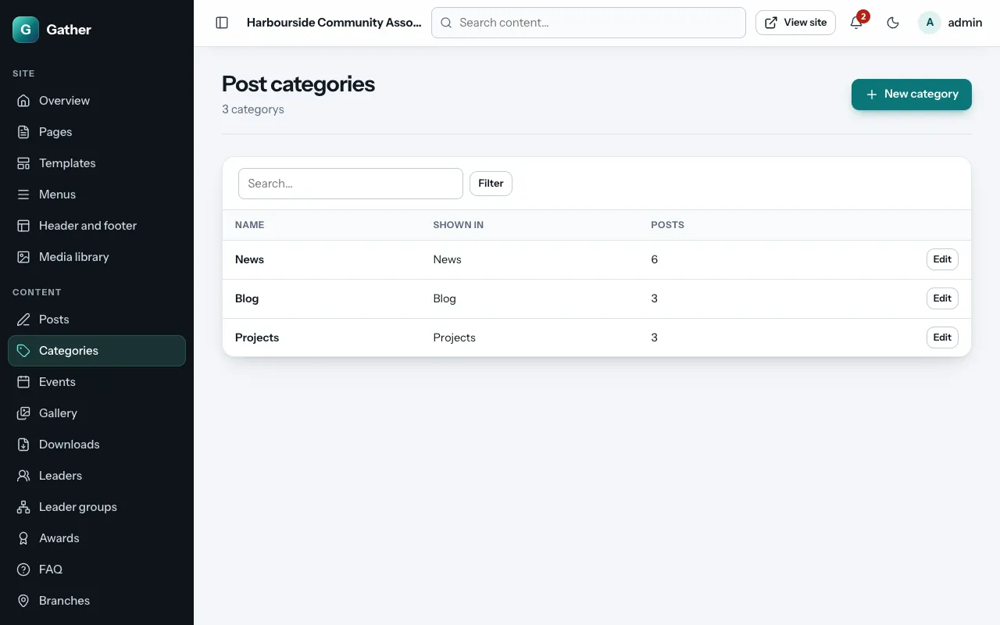
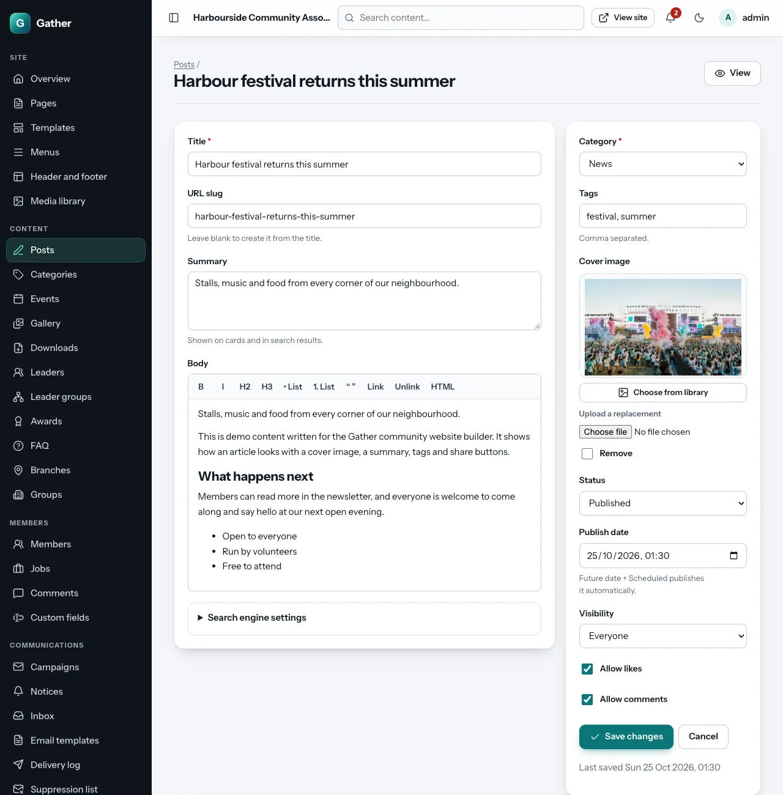
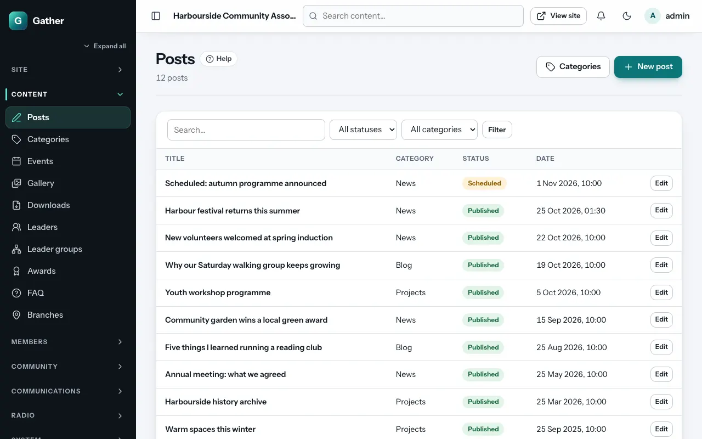
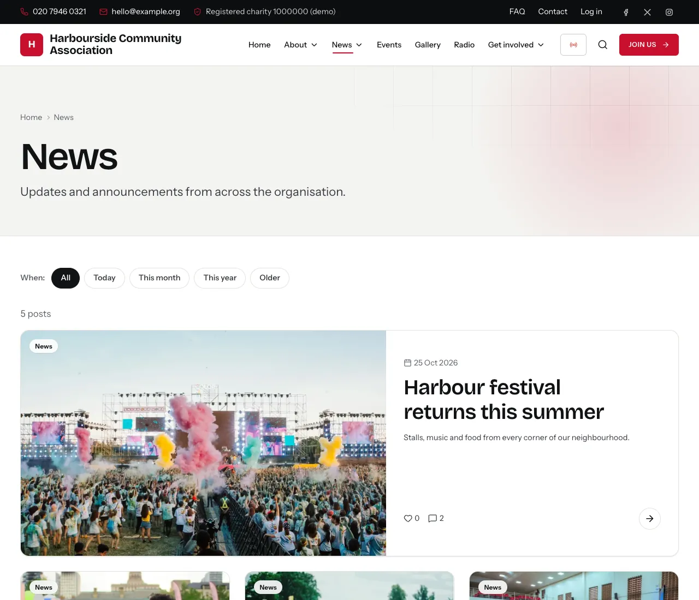

# Posts: news, blog and projects

Permission: **content**.

Posts are dated articles: news, blog entries and project updates. Each post
belongs to a **category**, and each category appears in one of three lists
on the site:

| List | Web address |
|---|---|
| News | `/news` |
| Blog | `/blog` |
| Projects | `/projects` |

## Categories

**Admin → Categories** → **New category**:

- **Name**, for example "Community news" or "Youth club".
- **Shown in**: **News**, **Blog** or **Projects**. Posts in this category
  appear in that list and use its web address.
- **Order**: lower numbers come first.

The demo comes with a category for each list. You need at least one
category before you can write a post.

## Writing a post

**Admin → Posts → New post**:

**Main column**

- **Title**.
- **URL slug**: the end of the web address; leave it empty to make it from
  the title.
- **Summary**: one or two sentences, shown on cards and in search results.
- **Body**: the article. The toolbar has **B** (bold), **I** (italic),
  **H2** / **H3** (headings), **• List** and **1. List**, **“ ”** (quote),
  **Link** / **Unlink**, and **HTML** to see the underlying code. Pasted text
  is cleaned up automatically. Scripts and odd formatting are removed.
- **Search engine settings** (optional): **SEO title** and **SEO
  description**.

**Right-hand column**

- **Category** (required) and **Tags** (comma separated, for example
  `festival, volunteers`).
- **Cover image**: **Choose from library**, or **Upload a replacement**
  straight from your computer. **Remove** takes it off.
- **Status**: **Draft**, **Published** or **Scheduled**.
- **Publish date**: the date shown on the post. For a **Scheduled** post, the
  moment it goes live.
- **Visibility**: **Everyone** or **Members only** (others see a "log in to
  read" message).
- **Allow likes** and **Allow comments** (members only; see
  [Comments and reports](comments.md)).
- **Create post** / **Save changes**. **View** (top right) opens the post on the
  site. Drafts can be previewed this way too.

## Scheduling

Set **Status** to **Scheduled** and the **Publish date** to the future. The
post goes live automatically at that time (the cron job does it). Even if
cron stops, scheduled posts go live on the first visit to the site after
their time.

## The posts list

**Admin → Posts** lists all posts with filters (status and category) and a
search box. Click **Edit** on a row to open a post.

## On the site

Posts appear in their list (`/news` etc., newest first; the first one is
shown large), on the home page through the **Latest posts** section, in the
RSS feed (`/feed.xml`) and in site search. Each post page shows the reading
time, share buttons, likes and comments, and related posts.

## Deleting

Open the post and use **Delete post** at the bottom. That cannot be undone;
to take a post off the site temporarily, set it back to **Draft**.
