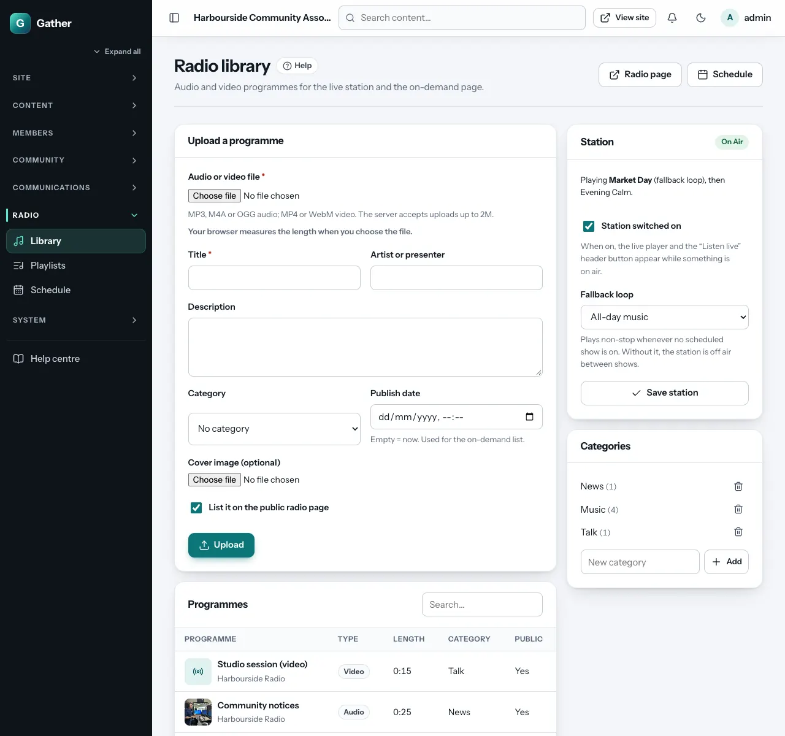
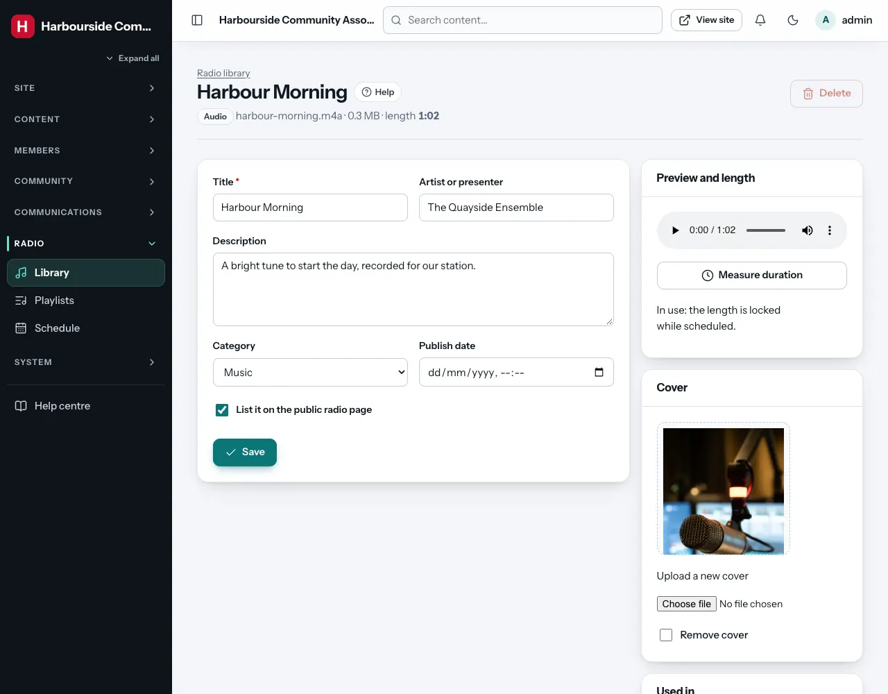
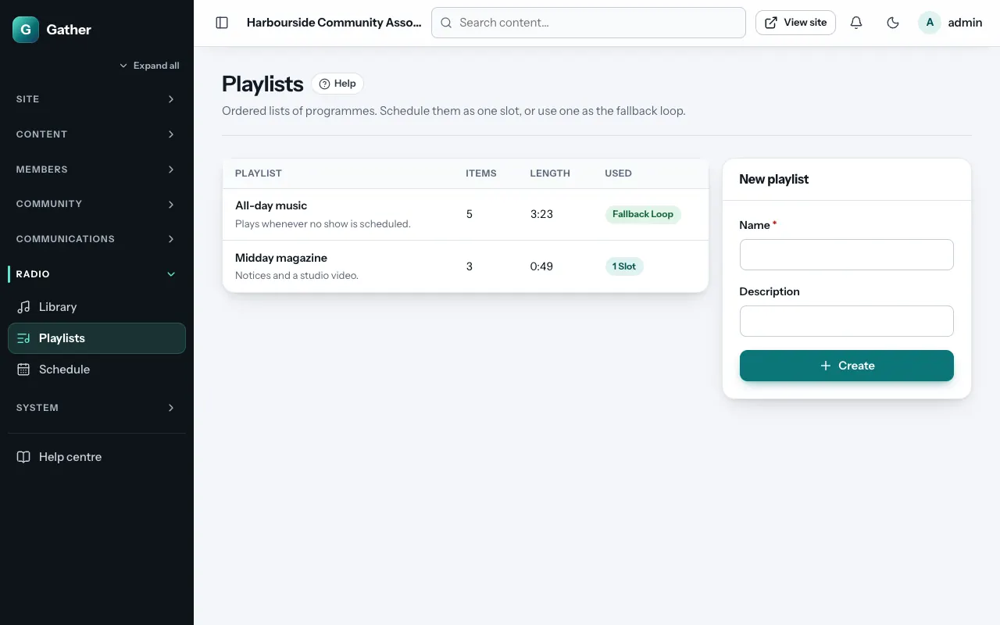
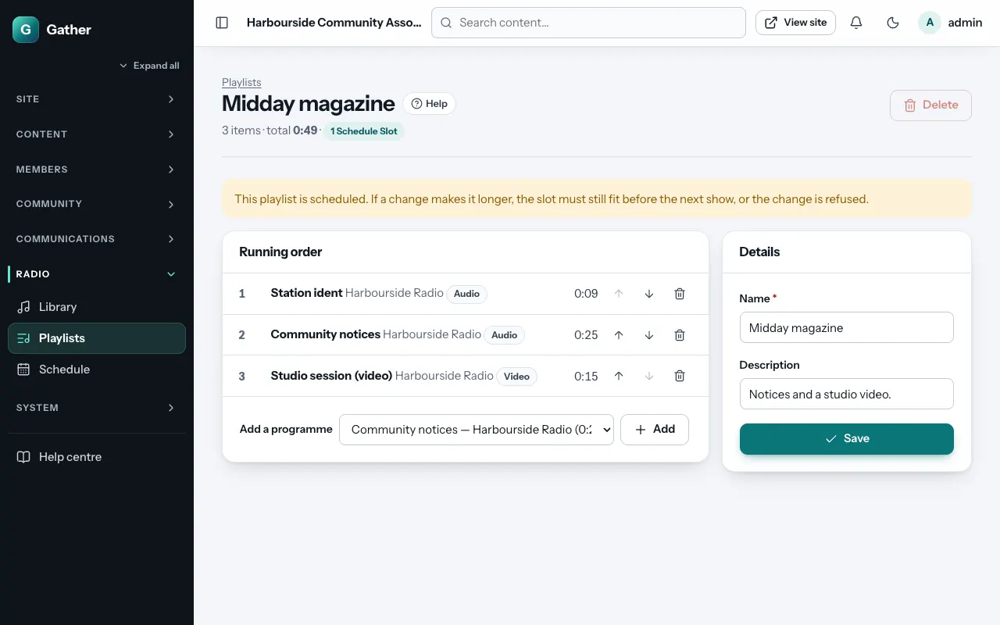
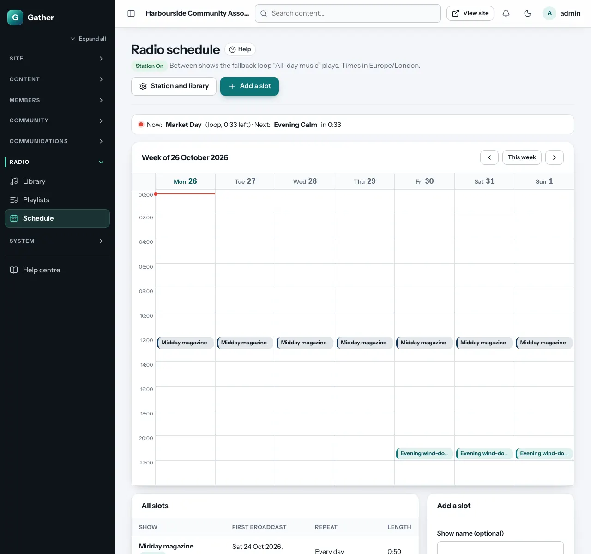
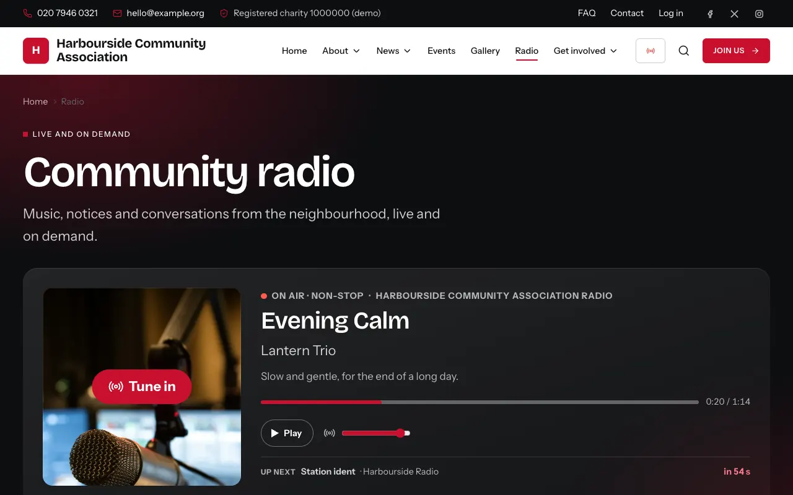

# Radio: library, playlists and schedule

Permission: **radio**.

Gather includes a simple community radio station. It plays audio (and video)
programmes you upload, following a schedule, and everyone who tunes in hears
the same thing at the same moment, like real radio. Programmes can also be
listened to on demand. Visitors find it at `/radio`, and a **Listen live**
button appears in the header while something is on air.

No streaming server is needed: your normal hosting serves the files.

## 1. The library: uploading programmes

**Admin → Library** (under *Radio*):

Under **Upload a programme**:

- **Audio or video file**: MP3, M4A or OGG audio (up to 100 MB), or MP4 or
  WebM video (up to 300 MB). Your hosting may allow less; the hint shows the
  real limit. Your browser **measures the length** when you choose the
  file. The schedule needs it.
- **Title** and **Artist or presenter**.
- **Description**.
- **Category**: for example News, Music or Talk (manage categories in the
  **Categories** box on the right).
- **Publish date**: for the on-demand list (empty = now).
- **Cover image** (optional).
- **List it on the public radio page**: untick for items that should only
  play live (jingles, station idents).
- **Upload**.

**Programmes** lists everything with its type, length, category and whether
it is public. Click one to edit it:

- If the length is **unknown** (for example if JavaScript was off during the
  upload), click **Measure duration**: your browser reads it from the file.
  Programmes with an unknown length cannot be scheduled.
- Change the details or the cover, and click **Save**.
- **Used in** shows the playlists and schedule slots that use it. A
  programme cannot be deleted while it is used.

## 2. The station

The **Station** box on the library screen:

- **Station switched on**: when on, the live player and the **Listen live**
  button appear while something is on air. Switch it off to take the station
  off air entirely.
- **Fallback loop**: a playlist that plays non-stop whenever no scheduled
  show is on. Without one, the station is off air between shows.
- **Save station**. The box shows what is playing now.

## 3. Playlists

**Admin → Playlists**: ordered lists of programmes. Use one as a schedule
slot (for example "Saturday morning music") or as the fallback loop.

1. Under **New playlist**, type a **Name** (and an optional **Description**),
   then click **Create**.
2. Open it. Under **Add a programme**, choose a programme and click **Add**.
   Repeat.
3. In the **Running order**, use **Move up**, **Move down** and **Remove**. The
   total length is shown at the top.

If the playlist is already scheduled, a change that would make it run into
the next show is refused, so the schedule always fits.

## 4. The schedule

**Admin → Schedule** shows the week as a calendar (or a list per day), with
**Now** and **Next** at the top. Use **Previous week**, **This week** and
**Next week** to move around.

Under **Add a slot**:

- **Plays**: a programme or a playlist.
- **Show name (optional)**: shown in "up next" (otherwise the programme or
  playlist name).
- **Starts**: date and time, in the site's time zone.
- **Repeat**: none, **every day**, or **weekly** on the days you tick.
- **Repeat until (optional)**.
- **Add to schedule**.

Slots cannot overlap, including with their own repeats. Gather tells you if
one would. **All slots** lists every slot; click one to change or **Remove**
it.

## What listeners get

On `/radio` (and in the **Radio player** page section):

- A big **Tune in** button (browsers only start sound after a click). The
  player joins the programme at the right point, keeps in step with the
  station, and moves on to the next item by itself.
- The current programme with its cover, progress, and **up next** with a
  countdown. Volume is remembered.
- **Off air** with the next show's time when nothing is playing.
- Below the player, **On demand**: the public programmes, newest first,
  with category filters and search.

## Tips

- Make a long fallback playlist of music, so the station never sounds dead.
- Keep files reasonably small: 128 kbit/s MP3 is plenty for speech and
  music on the web.
- Only broadcast music you have the rights to. A licence may be needed for
  commercial recordings.
