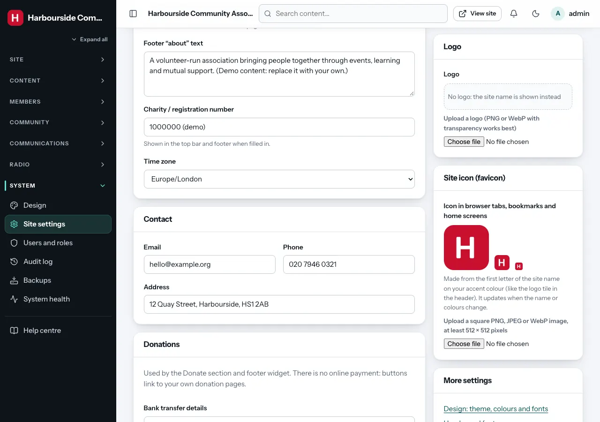

# Site settings *(super admin)*

**Admin → Site settings** holds your organisation's identity: the details
that appear in the header, the footer, emails and search results. Change
anything, then click **Save settings** (bottom right).

## Identity

| Field | Where it shows |
|---|---|
| **Organisation name** | The header (when there is no logo), page titles, emails (also as the sender name unless Email settings has one), the member card, the admin menu and admin page titles, and the generated site icon |
| **Tagline** | Under the name on the home page and in search results |
| **Footer "about" text** | The "About" widget in the footer |
| **Charity / registration number** | The top bar and footer, when filled in |
| **Time zone** | All dates and times on the site, scheduled publishing, birthday emails and backups use it. Set it once, correctly |

## Contact

**Email**, **Phone** and **Address** appear in the top bar, the footer's
contact widget, the Contact section of pages, and on the member card's back.
Contact-form messages are emailed to this email address (and kept in the
[Inbox](inbox.md)).

## Donations

Gather does not take payments itself. Instead:

- **Bank transfer details**: free text, for example account name, sort code
  and account number.
- **Button 1–3 text** and **link**: buttons that open your own donation pages
  (for example a JustGiving, PayPal or bank page).

These are shown by the **Donate** page section (see
[Page builder](page-builder.md#contact--embeds)) and the **Donate** footer
widget. The footer's call-to-action strip also links to the first donation
link.

## Analytics and cookies

Off by default. To count visitors:

1. **Provider**: choose **Plausible**, **Fathom** or **Google Analytics 4**.
   You cannot paste other scripts; that is deliberate, for privacy and
   security.
2. **Site ID**: Plausible wants your domain (`example.org`), Fathom its site ID
   (`ABCDEFGH`), Google Analytics the measurement ID (`G-…`).
3. **Cookie banner text** (optional): the wording of the consent banner.

Plausible and Fathom do not set cookies, so no banner appears. Google
Analytics sets cookies, so visitors see a banner with **Accept analytics**
and **No thanks**, and nothing is tracked until they accept. A **Cookie
settings** link in the footer lets them change their mind. The admin area is
never tracked.

## Social links

Web addresses of your Facebook, X, Instagram, YouTube and LinkedIn pages.
Filled-in ones appear as icons in the top bar and footer.

## Help and member support

- **Member guide at /help**: who can read the [member guide](../member-guide.md)
  on your website. **Everyone (public)** (the default) or **Logged-in
  members only**. See [The help centre](help-centre.md#the-member-guide-on-your-website).
- **Email the member when an admin views their account**: when an admin
  uses [Log in as this member](members.md#log-in-as-a-member), the member
  gets a short notice by email. On by default, and recommended: it keeps
  members informed and discourages misuse. Change the wording under
  **Email templates → An administrator viewed your account**.

## Logo

Upload a logo (PNG or WebP with a transparent background works best). Tick
**Remove logo** to go back to showing the organisation name.

## Site icon (favicon)

The small icon in browser tabs, bookmarks and on phone home screens. It is
used on every page: the public site, members' pages, the admin area, the
help centre, error pages and the printable member card.

- **Without an upload**, Gather draws it for you: the first letter of the
  organisation name on your accent colour, like the square next to the name
  in the header. It is redrawn automatically when you change the name or the
  colours (under [Design](design.md)).
- **Upload** a square PNG, JPEG or WebP image of at least **512 × 512
  pixels** (a simple, bold mark works best at tiny sizes). Gather makes every
  size browsers and phones ask for (`favicon.ico` with 16, 32 and 48 pixels,
  a 32 pixel PNG, the 180 pixel Apple touch icon, 192 and 512 pixel app
  icons) and a `site.webmanifest` with your organisation name and brand
  colour.
- Tick **Use the letter tile instead** to go back to the drawn icon.

Browsers keep icons for a long time; each new icon gets a new address, so
visitors see it on their next visit (a few browsers need a refresh of the
tab first).

## More settings

The **More settings** box links to related screens:
[Design](design.md), [Header and footer](header-footer-menus.md),
[Membership and ID cards](members.md#membership-settings) and
[Custom profile fields](members.md#custom-fields).
