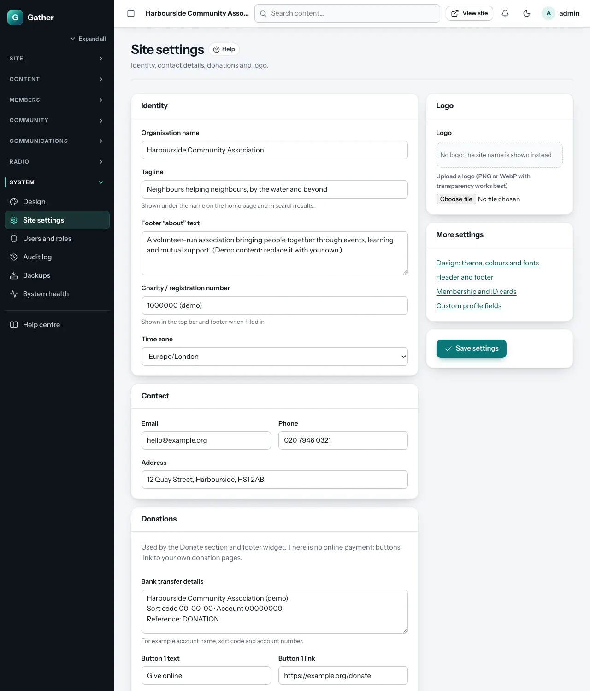

# Site settings *(super admin)*

**Admin → Site settings** holds your organisation's identity: the details
that appear in the header, the footer, emails and search results. Change
anything, then click **Save settings** (bottom right).

## Identity

| Field | Where it shows |
|---|---|
| **Organisation name** | The header (when there is no logo), page titles, emails, the member card |
| **Tagline** | Under the name on the home page and in search results |
| **Footer "about" text** | The "About" widget in the footer |
| **Charity / registration number** | The top bar and footer, when filled in |
| **Time zone** | All dates and times on the site, scheduled publishing, birthday emails and backups use it. Set it once, correctly |

## Contact

**Email**, **Phone** and **Address** appear in the top bar, the footer's
contact widget, the Contact section of pages, and on the member card's back.
Contact-form messages are emailed to this email address (and kept in the
[Inbox](inbox.md)).

## Donations

Gather does not take payments itself. Instead:

- **Bank transfer details**: free text, for example account name, sort code
  and account number.
- **Button 1–3 text** and **link**: buttons that open your own donation pages
  (for example a JustGiving, PayPal or bank page).

These are shown by the **Donate** page section (see
[Page builder](page-builder.md#contact--embeds)) and the **Donate** footer
widget. The footer's call-to-action strip also links to the first donation
link.

## Analytics and cookies

Off by default. To count visitors:

1. **Provider**: choose **Plausible**, **Fathom** or **Google Analytics 4**.
   You cannot paste other scripts; that is deliberate, for privacy and
   security.
2. **Site ID**: Plausible wants your domain (`example.org`), Fathom its site ID
   (`ABCDEFGH`), Google Analytics the measurement ID (`G-…`).
3. **Cookie banner text** (optional): the wording of the consent banner.

Plausible and Fathom do not set cookies, so no banner appears. Google
Analytics sets cookies, so visitors see a banner with **Accept analytics**
and **No thanks**, and nothing is tracked until they accept. A **Cookie
settings** link in the footer lets them change their mind. The admin area is
never tracked.

## Social links

Web addresses of your Facebook, X, Instagram, YouTube and LinkedIn pages.
Filled-in ones appear as icons in the top bar and footer.

## Logo

Upload a logo (PNG or WebP with a transparent background works best). Tick
**Remove logo** to go back to showing the organisation name.

## More settings

The **More settings** box links to related screens:
[Design](design.md), [Header and footer](header-footer-menus.md),
[Membership and ID cards](members.md#membership-settings) and
[Custom profile fields](members.md#custom-fields).
