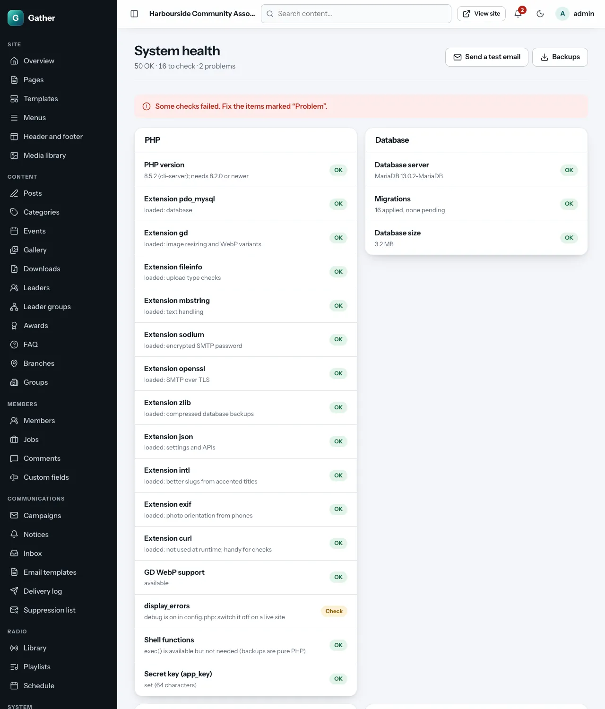

# System health *(super admin)*

**Admin → System health** checks the server and the site's settings and
marks each item:

- **OK**: fine.
- **Check**: advice; worth a look but not urgent.
- **Problem**: something does not work, or is unsafe. Fix it, or ask your
  technical person.

The page only reads; you can reload it any time. Buttons at the top lead to
**Send a test email** and **Backups**.

## The groups

| Group | What it checks | Typical fixes |
|---|---|---|
| **PHP** | PHP version (8.2+), required and optional extensions, WebP support for images, that errors are not shown to visitors, the secret key (`app_key`) | Ask the host to enable a missing extension; choose a newer PHP version in the control panel |
| **Database** | The database server and version, **Migrations** (must say *none pending*), size | After an update, run `php bin/migrate` |
| **Cron** | When the scheduled jobs last ran, each job's last run, overdue scheduled items, emails stuck in the queue | Add or fix the cron job (see below) |
| **Storage** | Free disk space, that the folders Gather writes to are writable, that `config.php` is not readable by everyone, total size of uploads | Ask the host for more space; fix folder permissions |
| **Uploads** | `upload_max_filesize`, `post_max_size`, the largest possible upload compared with the radio's limits, memory and time limits | Raise the PHP limits (see your install guide) |
| **Mail and site** | Mail transport (SMTP or "file"), whether the mail server answered, failed emails in the last 7 days, that the site address uses `https://`, scheduled backups | Set up SMTP; switch on daily backups |
| **Bounces and complaints** | Bounce and complaint rates over 7 and 30 days, spam blocks and paused campaigns, the bounce mailbox, unprocessed bounce messages, the bounce address | See [Email deliverability](../email-deliverability.md#6-reading-system-health) |
| **Server and paths** | The web server, the install folder, where the document root points, the configuration file, `php.ini`, `open_basedir`, the user PHP runs as, the PHP command for cron, and the exact **cron line** | Copy the cron line into your hosting's cron settings |

## Server and paths

This group shows what Gather detected on *your* server, so your technical
person does not have to guess:

- **Install folder**: where Gather lives.
- **Document root**: whether the web server points at the `public/` folder
  (recommended) or at the install folder (the `.htaccess` fallback, which
  also works on Apache and LiteSpeed).
- **PHP runs as**: the system user that must be able to write `storage/` and
  `public/uploads/`. Cron should run as the same user.
- **PHP for cron** and **Cron line**: the exact line to add to the server's
  crontab (or the command part, after the five stars, for a control panel's
  cron screen). If the PHP path could not be confirmed, ask your host for
  the path of the PHP command-line program.

## "Cron is not running"

Cron is the server's timer that runs Gather's background jobs every minute.
Without it:

- campaigns, notice emails and birthday greetings are **not sent**;
- daily backups do not happen;
- bounces are not processed;
- scheduled posts and events still go live, but only when someone visits
  the site.

Fix: add the **Cron line** from this page to the hosting's cron settings
(see the install guide for [cPanel](../install-cpanel.md#10-add-the-cron-job),
a [VPS](../install-vps.md#11-cron), [aaPanel](../install-aaPanel.md#6-cron)
or [Plesk](../install-plesk.md)). Within two minutes the **Cron** item turns
green.
