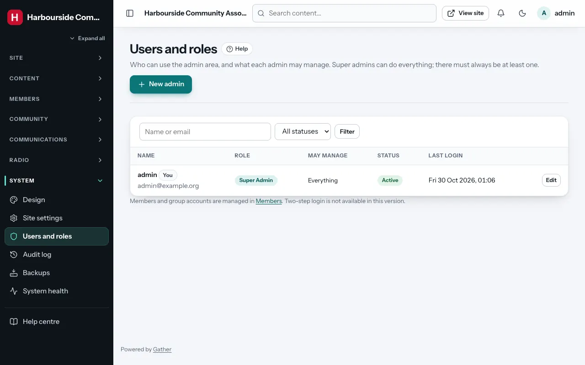
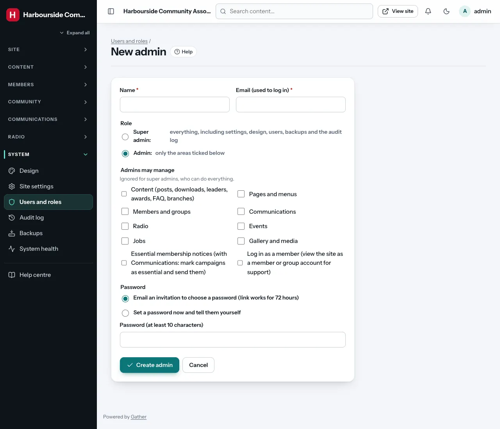

# Users and roles *(super admin)*

**Admin → Users and roles** manages the people who can use the admin area.
Members and group accounts are managed under [Members](members.md) and
[Groups](branches-groups.md).

The list shows each admin's role, the areas they may manage, their status
and last login. Search and filter by status (**Active** / **Suspended**).

## Roles and permissions

- **Super admin**: can do everything. There must always be at least one
  active super admin. Gather refuses any change that would leave none.
- **Admin**: sees only the areas ticked under **Admins may manage**:

| Permission | Lets them manage |
|---|---|
| **Content (posts, downloads, leaders, awards, FAQ, branches)** | Posts, categories, downloads, leaders, leader groups, awards, FAQs, branches, comments |
| **Pages and menus** | Pages, the page builder, templates, menus, header and footer |
| **Members and groups** | Members, groups, member card printing, import/export |
| **Communications** | Campaigns, notices, inbox, email templates, delivery log, suppression list |
| **Radio** | The radio library, playlists and schedule |
| **Events** | Events and registrations |
| **Jobs** | The job board queue and settings |
| **Gallery and media** | Albums and the media library |
| **Essential membership notices** | Nothing on its own. Together with Communications: mark a campaign as an essential notice (sent even to members who switched news emails off) and send or schedule it |

Only super admins can reach Design, Site settings, Membership settings,
Custom fields, Email settings, Users and roles, the Audit log, Backups and
System health.

## Adding an admin

**New admin**:

1. **Name** and **Email (used to log in)**.
2. **Role**: **Admin** or **Super admin**.
3. **Admins may manage**: tick the areas (ignored for super admins).
4. **Password**:
   - **Email an invitation to choose a password**: they get a link that
     works for 72 hours (recommended), or
   - **Set a password now and tell them yourself** (at least 10
     characters).
5. **Create admin**.

## Changing or removing an admin

Click **Edit** next to an admin:

- Change their name, email, role, status and permissions.
- **Status: Suspended**: they cannot log in, and are logged out straight away.
  Use this when someone leaves. Their name stays in the audit log.
- **Send password link**: emails them a link (valid for one hour) to choose a
  new password.
- **Recent actions** shows their latest changes (**Full history** opens the
  audit log filtered to them).

You cannot change your own role or status: ask another super admin. That is
why it is wise to have **at least two super admins**.

Two-step login (2FA) is not available in this version. Make sure every admin
uses a strong, unique password.
