# Member guide

This guide is for members of an organisation whose website runs on Gather.
The pictures show a demo site; your organisation's site has its own name,
colours and menus, but the buttons and pages are the same.

## Joining

1. Click **Join us** (top right of the site), or go to `/join`.
2. Fill in the form:
   - **About you**: your name, and the other details your organisation asks
     for (some are optional).
   - **Where you live**: choose your **country**, then your **region or
     state** from the list that appears, and type your town or city. The
     country you are most likely in is shown at the top of the list under
     **Suggested** (a guess from your device's time zone and language; if
     the form fills it in for you, a note says so; change it if it is
     wrong). Long lists have a **Type to filter** box: type a few letters
     to find your entry. If your browser does not run JavaScript, press
     **Update the lists** after choosing a country to see the next list.
   - **Nationality**, and, if your organisation asks, **where you are
     from** (country, state and local area, for example State of origin and
     LGA).
   - **Photo for your member card**: a clear, recent photo of your face. You
     can drag and zoom to choose the square that appears on your card. Only
     you and the site's administrators can see it.
   - **Your account**: your email address and a password of **at least 10
     characters**.
   - **Send me news and event updates by email**: tick it if you want
     newsletters. You can change your mind any time.
   - Agree to the terms and privacy policy.
3. Click **Create my account**.

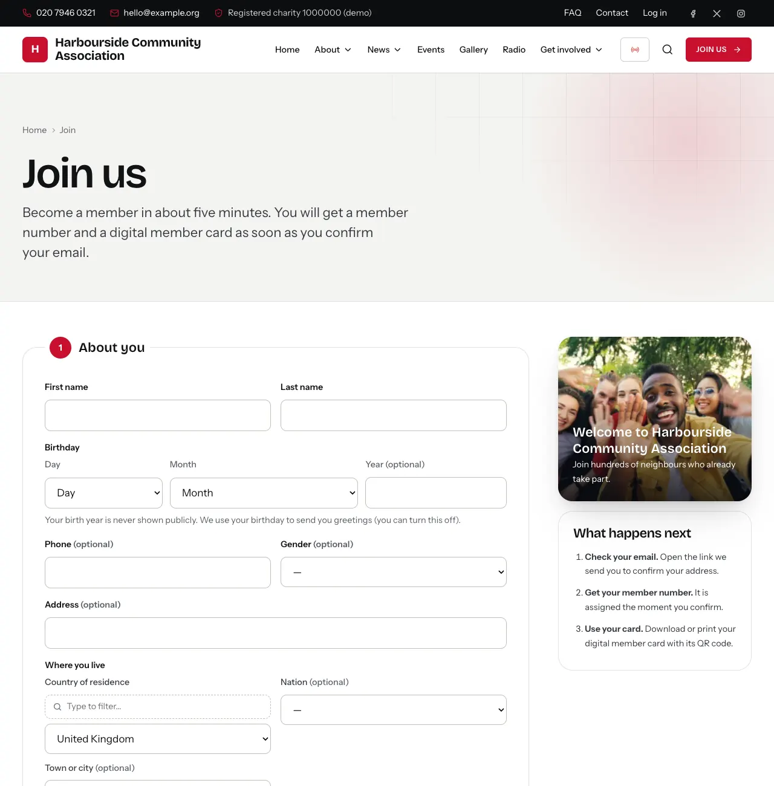

The location questions: choose a country first, then the region or state
list appears (here with the country guessed from the device and a filter
box above the long list):

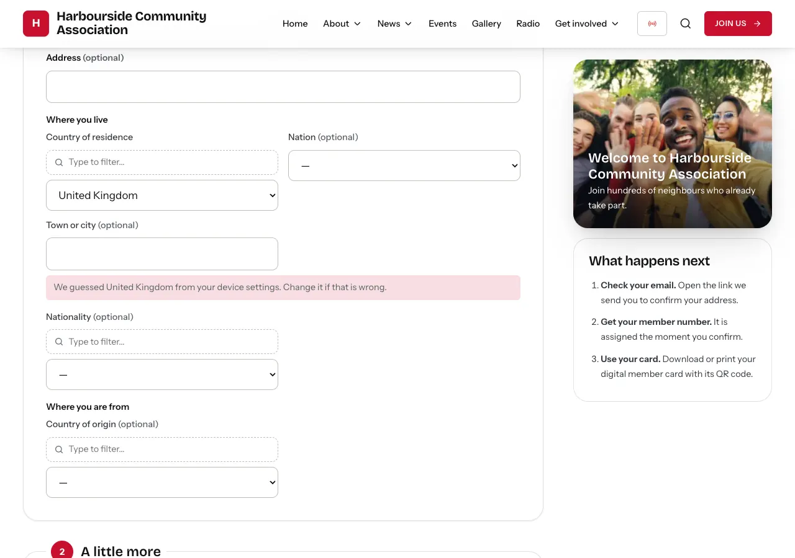

On a phone, the same form fits the screen:

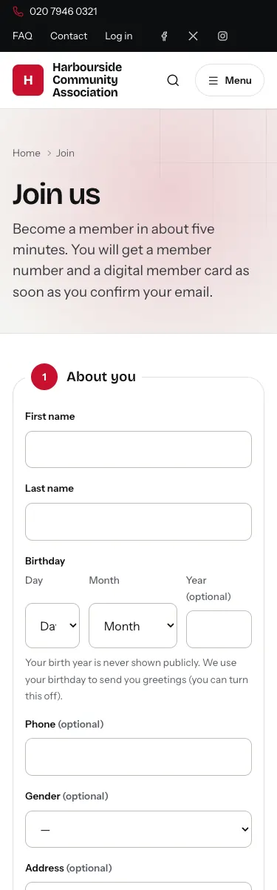

If your sign-up is for a whole organisation (for example an affiliated
association), use **Register a group** under the form instead.

## Verifying your email

Gather sends an email to the address you gave. Open it and click the
button, then **Verify my email** on the page that opens. That:

- activates your account and logs you in;
- gives you your **member number** (for example `HCA-26-0042`);
- sends you a welcome email with your number.

Nothing arrived? Check your spam folder. On your account page you can also
**Send a new link**. Accounts that are not verified within **14 days** are
removed automatically, so you would need to join again.

## Logging in

Click **Log in** at the top of the site (or go to `/login`), enter your email
and password, and you arrive at **My account**. Forgotten your password?
Click **Forgotten your password?** on the login page. You get an email with
a link that works for one hour.

## Your dashboard (My account)

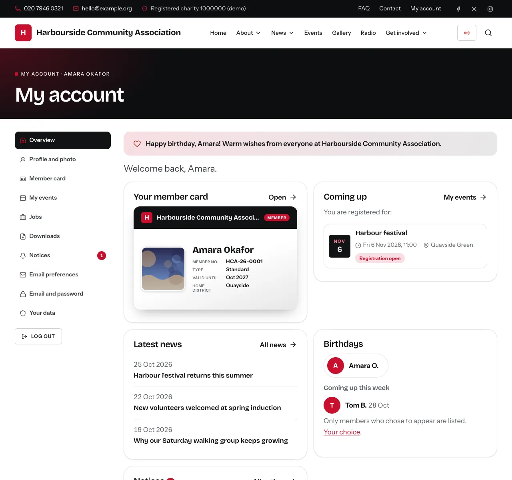

The dashboard shows:

- **Your member card**: a preview; click **Open** for the full card.
- **Coming up**: the events you registered for.
- **Latest news** from the organisation.
- **Birthdays**: members celebrating today and this week (only those who
  chose to be listed).
- **Notices**: announcements from the organisation. A red number shows how
  many you have not read yet.
- If you said no to newsletters, a card asks whether you would like them.
  **Yes, send me updates** switches them on; **No thanks** hides the card
  (it may ask again after 90 days).

The menu on the left (on a phone, at the top) leads to every part of your
account.

On a phone, the dashboard looks like this:

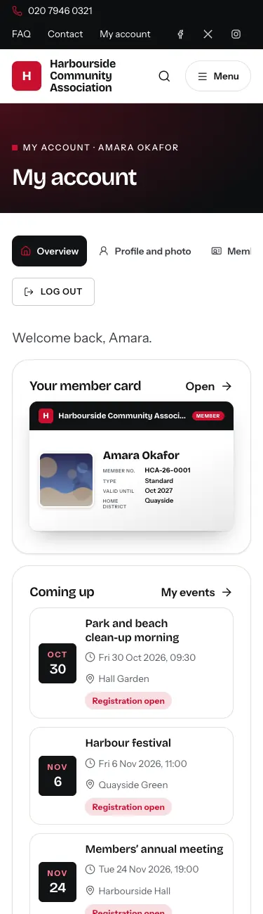

## Your member card

**Member card** shows the front and back of your digital card: the
organisation's logo, your photo, name, member number, membership type and
"valid until" date. The back has a **QR code**: anyone who scans it sees a
page confirming that your card is valid, with your name and photo only.

- **Download as image (PNG)**: save it to your phone's photos.
- **Print or save as PDF**: prints at the size of a standard ID card.
- **See what the QR code shows**: the check page that others see.

If your card has expired, the page says so. Contact the organisation to
renew.

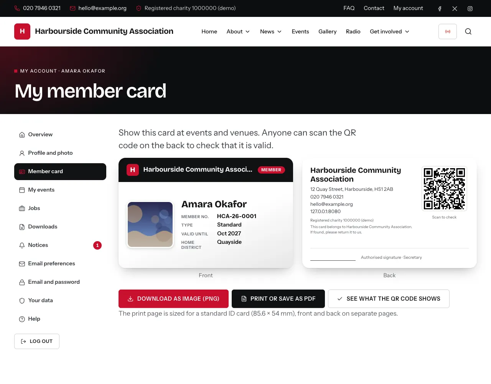

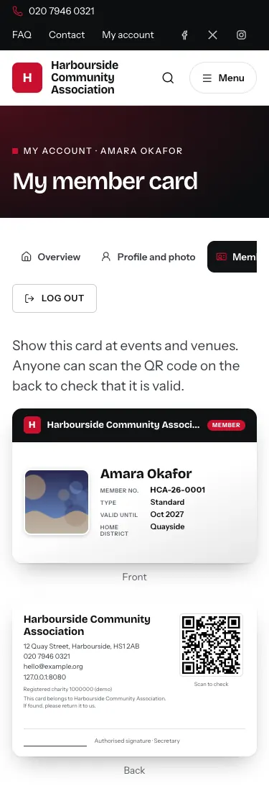

## Profile and photo

**Profile and photo** lets you correct your details and upload a new photo
(cropped to a square). Some fields may be managed only by the organisation.

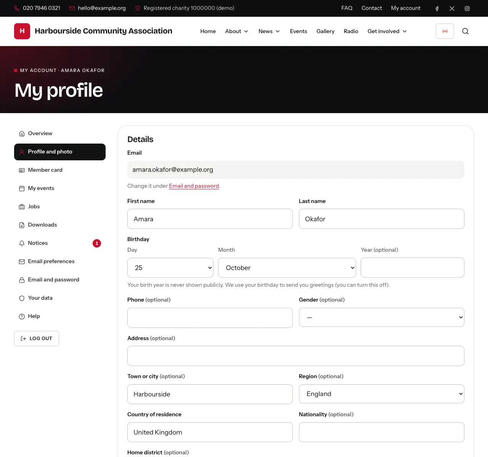

## Email and password

**Email and password**:

- **Change email**: type the new address and your current password. We send
  a link to the new address; your login stays the same until you open it.
  The old address gets a notice too, in case it was not you.
- **Change password**: your current password, then the new one twice.

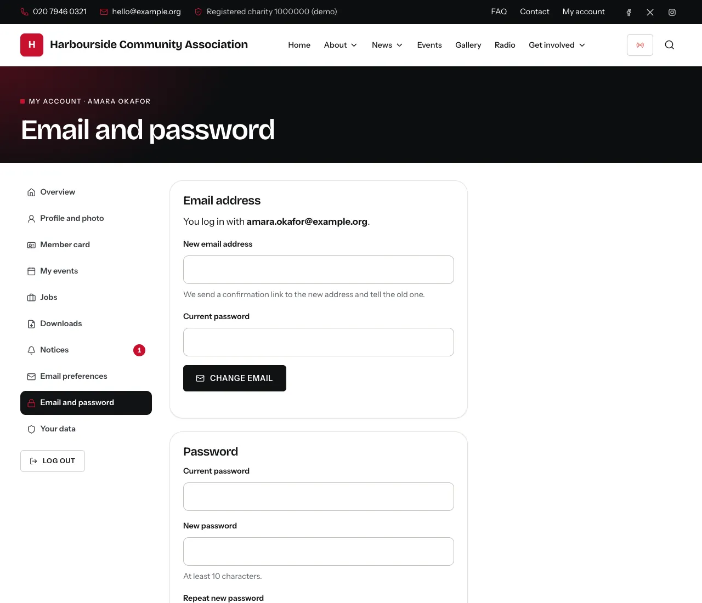

## Email preferences

**Email preferences** controls what you receive:

| Setting | What it means |
|---|---|
| **News and event updates** | Newsletters and invitations |
| **Birthday greeting** | A short email on your birthday |
| **Message notifications** | An email when a message has waited unread for 15 minutes (one per conversation) |
| **Others can find me in messages** | Members can find you by name or member number when they start a new message (on by default). Switch it off and only people you already have a conversation with, and the organisation's admins, can message you |
| **Show me in the birthday celebrants list** | Your first name and last initial appear on your birthday (your age is never shown) |

Important account emails (password resets, email verification, event
confirmations) always arrive, whatever you choose here. Every email also has
a **Manage email preferences** link at the bottom, and newsletters have an
**unsubscribe** link.

Your organisation may occasionally send an **essential membership notice**
(for example the notice of the annual general meeting) even if you switched
newsletters off. Such an email says why you received it.

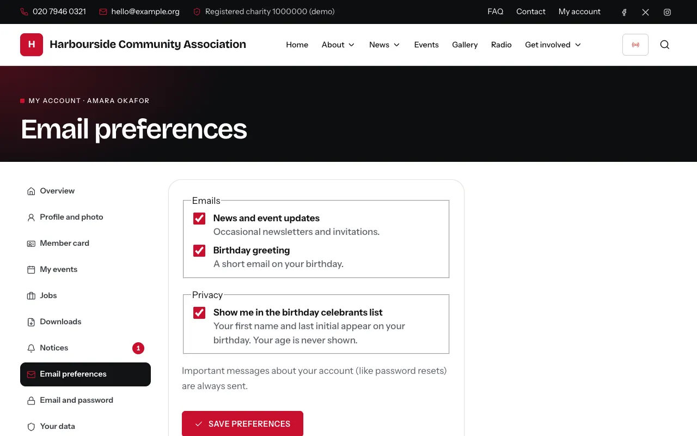

## Events

On the **Events** page, open an event and click **Register now**. Choose the
ticket and number of places if the event has them, and confirm. You get a
confirmation email. **My events** lists your registrations, and **Cancel**
gives your place back. No payment is taken on the website.

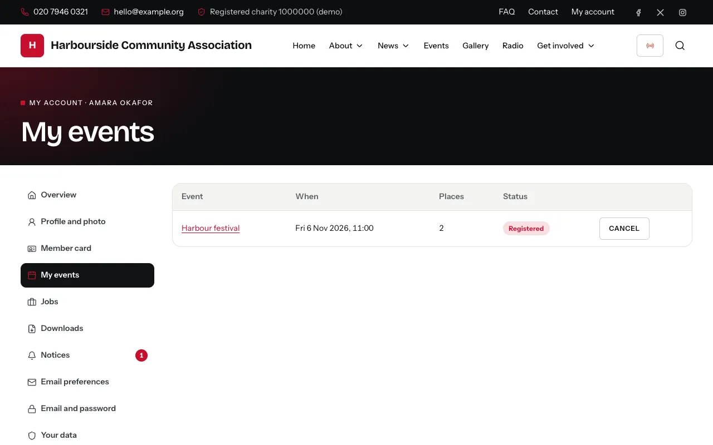

**Add to calendar** on an event page puts it in your phone or computer
calendar.

## Messages

**Messages** in My account is where you send and receive private messages.
The number next to it shows how many messages you have not read yet.

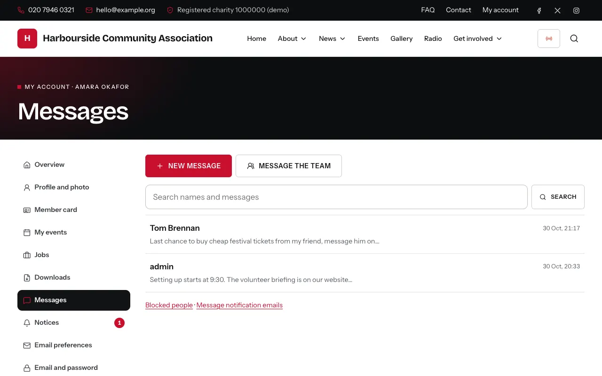

- **New message**: search for a member by name (at least 3 letters) or by
  their full member number, tick them and write your message. Tick several
  people to start a group (up to 20 people, give it a name). Members who
  switched off **Others can find me in messages** do not appear.
- **Message the team**: questions for the organisation. Any of the admins
  who look after messages can answer, and you see their name.
- Messages are plain text (web addresses become links). You can attach a
  photo or a PDF (up to 5 MB); only the people in the conversation can open
  it.
- An open conversation shows new messages by itself after a few seconds.
- **Edit** your message within 15 minutes of sending it, or **Delete** it
  (the others then see "Message deleted").
- **Mute** a conversation to stop its count and emails; **Leave
  conversation** takes you out of a group.

Some limits keep messages friendly: during your first day as a member you
can only message the team and reply to messages sent to you (not post in
members' groups you were added to), you can send 30 messages in 10 minutes,
start 10 new conversations a day, contact 40 new people a day and add people
to groups 20 times a day. If someone adds you to a group, you see the
messages written from then on. Your organisation may also have switched off
messages between members.

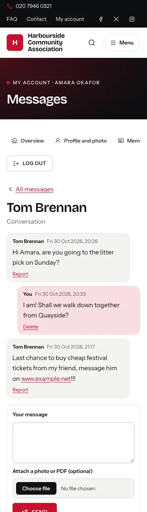

### Blocking and reporting

- **Block** (in a one-to-one conversation, under Settings): that person can
  no longer message you or add you to a group, and the conversation is
  hidden from you. They are not told. **Blocked people** (at the bottom of
  your messages) lets you unblock them. Admins cannot be blocked.
- **Report** (under a message): tell the organisation about a message that
  breaks the rules. The admins who handle reports see that message and the
  few messages around it, nothing else of your conversations. Admins cannot
  read your private messages otherwise.

### Email notifications

If a message waits unread for 15 minutes, you get one email for that
conversation (not one per message). When a member you have not written to
yet starts a conversation with you, the email only says you have a new
message on the website (no name, no text) until you reply. Switch **Message notifications** off in
**Email preferences** to stop these emails.

## Notices

**Notices** lists announcements from the organisation. They are marked as
read when you have seen them, or click **Mark as read** / **Mark all as
read**.

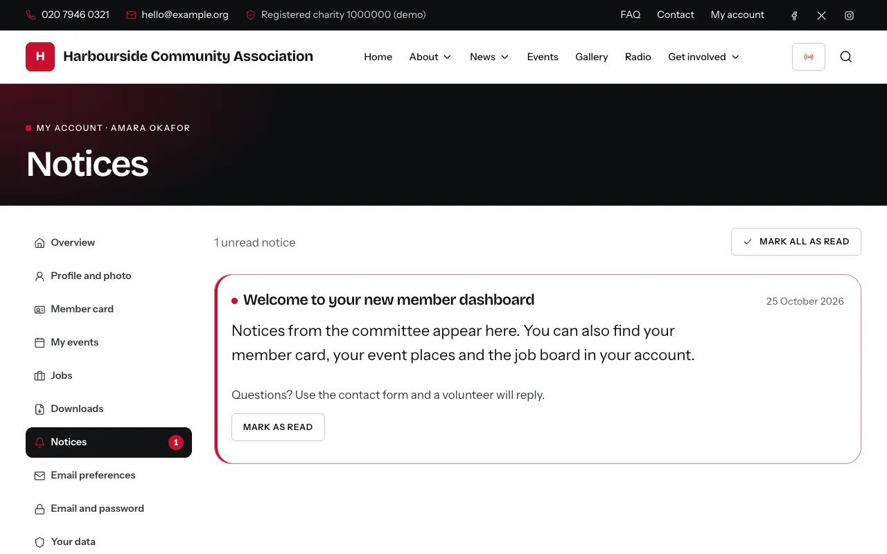

## Downloads

**Downloads** holds documents shared with members only (for example minutes
or the constitution).

## Jobs

The **job board** (`/jobs`) lists jobs, volunteering roles and internships
shared by members. Open one to see how to apply.

To share one yourself: **Jobs** in your account → **Post a job**. Fill in the
details and how to apply. An administrator checks posts before they appear
(members who have posted good jobs before may be published straight away).
**Your job posts** shows the status of each, and you can edit or remove
them. Jobs disappear after their closing date, or after 60 days.

If a job looks wrong or suspicious, use **Report this job** on its page.

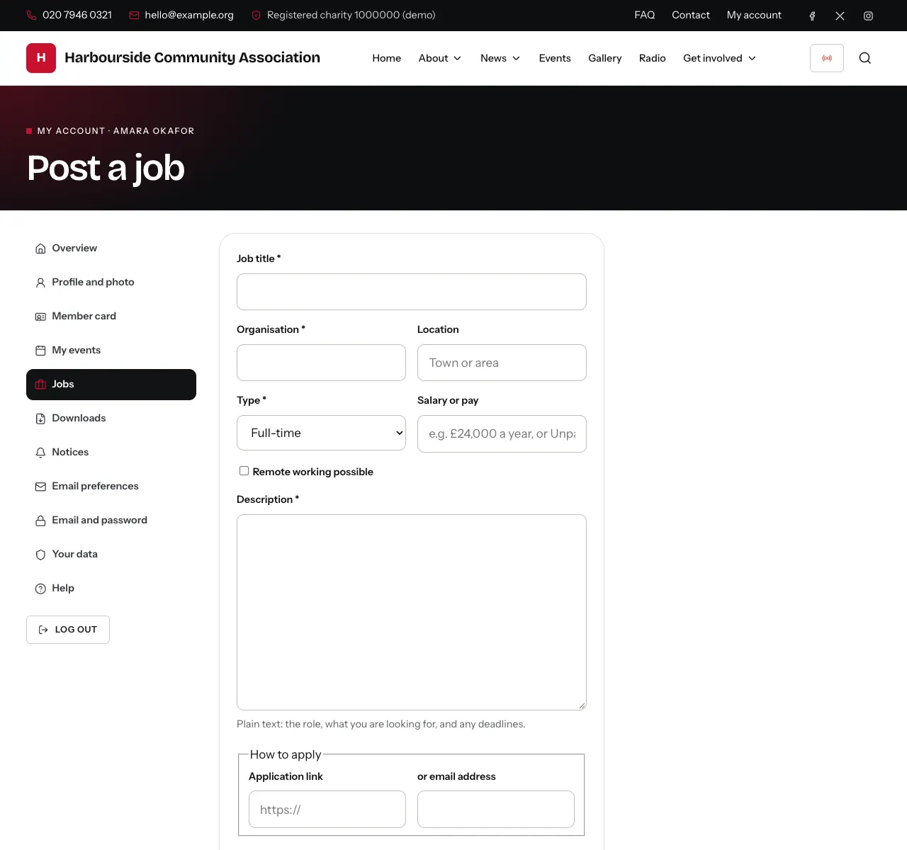

## Comments and likes

On news posts that allow it, members can **like** a post and leave
**comments**. Comments appear straight away. You can edit your own comment
for 15 minutes after posting, and delete it at any time. (A comment others
replied to shows as "[deleted]", so their replies still make sense.) If you see something inappropriate,
click **Report**: comments reported by several members are hidden until an
administrator looks at them.

## Your data and deleting your account

**Your data**:

- **Download my data**: a file with everything the organisation holds about
  you (profile, preferences, event registrations, comments, the messages
  you sent).
- **Delete my account**: enter your password and click **Request deletion**.
  An administrator confirms it. Your profile and photo are removed, your
  member number is retired, event registrations are kept without your name,
  your comments show as "former member", and the messages you sent are
  emptied (others see "Former member · Message deleted").

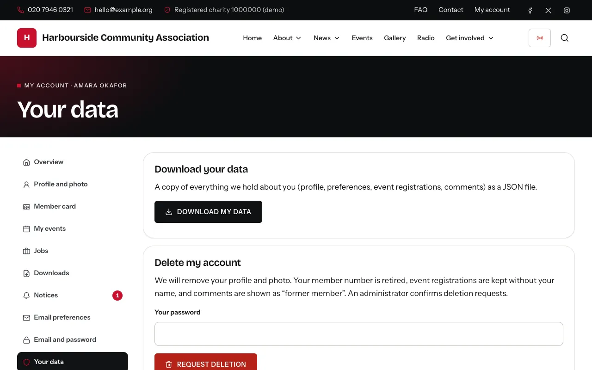

## When an administrator looks at your account

To help with a question ("I can't find my card"), an administrator can view
the site as you see it, for up to 30 minutes. They cannot see or change your
password or email address, delete your account, download your data or
change your email choices, and they cannot like, comment, post or send
messages as you. They can read your messages while viewing as you; each
time is recorded.
Everything they do is recorded. You normally get an email saying an
administrator viewed your account; if you did not expect it, contact the
organisation.

## Help

This guide is on your organisation's website at `/help` (the **Help** link
in the footer and in **My account**). For anything else, use the
**Contact** page of your organisation's site, or reply to any email you
received from it.
